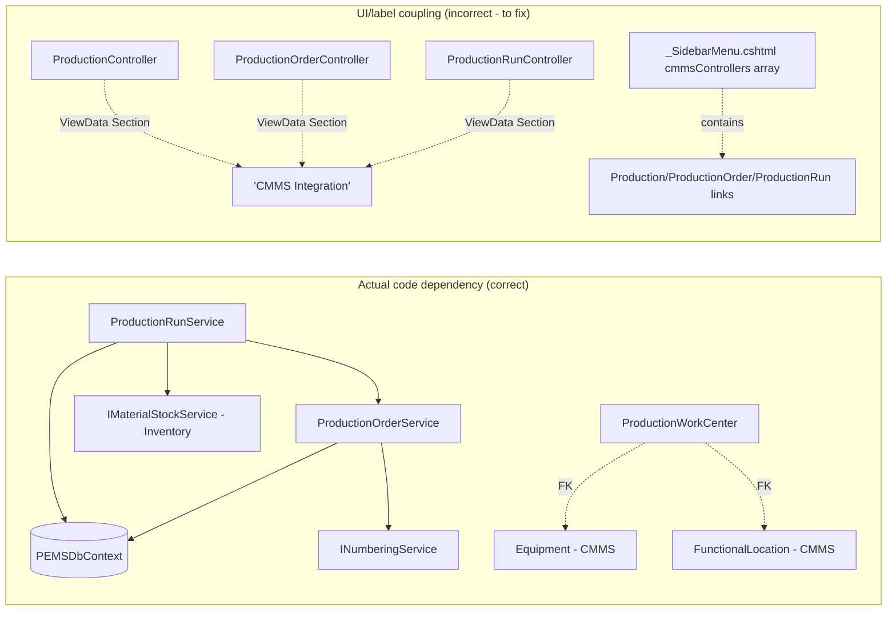

# PEMS Operations Architecture & Period-Based Reporting — Audit

**Status: AUDIT ONLY. No application code, entity, controller, view, migration, database
schema, permission, or test was modified to produce this document.**

All file/line references are exact, taken from the current working tree, including the
Production Core (Phase 1) implementation from the immediately preceding task. This audit does
**not** assume that implementation was architecturally correct — Section 1 states plainly
where it was wrong.

---

## 1. Executive Summary

The Phase 1 Production Core implementation is **domain-layer correct but UI/navigation-layer
wrong**. Concretely:

- Every domain entity, EF configuration, application service, and permission module built in
  Phase 1 is already independent of CMMS at the code level — `ProductionOrderService`/
  `ProductionRunService` depend only on `PEMSDbContext`, `INumberingService`, and
  `IMaterialStockService` (Inventory, not CMMS); the `"Production"` permission module is a
  flat, standalone entry in `PermissionService.Modules`, not nested under any CMMS grouping;
  the two new SoD policies are named `Production.*`, not `CMMS.Production.*`.
- However, **all three new controllers literally set `ViewData["Section"] = "CMMS
  Integration"`** (`ProductionController.cs:31`, `ProductionOrderController.cs:41,60,72`,
  `ProductionRunController.cs:45,70,244`), and the two Production sidebar links were added
  **inside** the existing `CMMS Integration` collapsible `<div>` in `_SidebarMenu.cshtml`,
  sharing its `cmmsControllers` highlighting array. This is a real instance of exactly what
  this task calls "Operations implemented as a child module of CMMS" — but it is confined to
  breadcrumb labels and sidebar placement, not to any deeper coupling.
- This means the fix is **low-risk and precedent-following**, not a rewrite: the codebase
  already has a working example of "give a domain its own top-level sidebar section without a
  full namespace/RBAC redesign" — `Inventory & Materials` (Section 4). The same pattern
  applies directly to Operations.
- **No namespace, folder, or project-reference restructuring is required.** This codebase has
  never used per-module namespaces or folders anywhere (Equipment, MaterialItem,
  EngineeringDocument, WorkOrder, and now the Production entities all sit in the same flat
  `PEMS.Domain/Entities/` directory) — introducing one for Operations alone would be
  inconsistent with the codebase's own established convention, not a correction of it
  (Section 3).
- **Product Master vs. Production Transaction**: `MaterialItem` should continue to be reused
  as the base Product/Material master (it already has `MaterialGrade`, `Description`, `UomId`,
  `MaterialType`), but it structurally lacks Product Family, Packaging Type, Product
  Status/Lifecycle, and Product Version. The correct fix, following an exact precedent already
  in the codebase (`Instrument` as a 1:1 specialization of `Equipment`, not a new identity),
  is a future thin `ProductionProductProfile` extension table keyed on `MaterialItemId` — not
  a parallel `Product` entity (Section 5).
- **Period-based reporting (Day/Week/Month/Custom) does not exist anywhere in PEMS today.**
  The one real reporting pattern that exists, `ReportController` + per-module
  `IXxxReportService`, only accepts raw `fromDate`/`toDate` — there is no `PeriodType` enum,
  no week/month bucketing helper, and no Jalali/Persian-calendar conversion anywhere in actual
  application code. This is a genuine, confirmed gap, not an oversight in this audit
  (Section 9).
- **A real, previously-undocumented data-integrity gap was found**: once a `ProductionOutput`
  is posted to inventory (Phase 1's `PostOutputToInventoryAsync`), the resulting
  `MaterialStock` row carries **no batch reference and no quality status** — `MaterialStock` is
  keyed only by `(MaterialItemId, WarehouseId, StorageLocationId)`. The link back to which
  `ProductionBatch` (and therefore which `QualityStatus`) a given unit of on-hand stock came
  from exists only one hop away, in `InventoryTransaction.ReferenceId → ProductionOutput →
  ProductionBatch`, and is not queryable as "how much of the stock on hand right now is from a
  Released batch vs. a Blocked one." This is flagged as a **data-integrity risk requiring a
  design decision**, not silently glossed over (Section 8, Section 16).

**Final classification (Section 23): ARCHITECTURE ACCEPTABLE WITH REQUIRED REFACTORING.**

---

## 2. Current Architecture Findings

### 2.1 Solution structure (unchanged by Phase 1)

```
PEMS.Domain            — flat PEMS.Domain/Entities/ for every module, no per-module subfolders
PEMS.Application       — flat PEMS.Application/{DTOs,Interfaces}/, same convention
PEMS.Persistence       — flat PEMS.Persistence/{Servises,Configurations,Seed}/ (sic — "Servises")
PEMS.Infrastructure    — file storage, cache
PEMS.AI                — Ollama/OCR/AI extraction
PEMS.WorkflowPlatform  — separate project, generic workflow engine
PEMS.Web               — flat PEMS.Web/Controllers/, flat PEMS.Web/Views/<ControllerName>/
PEMS.Shared, PEMS.Tests
```

**No PEMS project or folder has ever been organized by business module** (Engineering, VDR,
Correspondence, CMMS, Inventory all coexist in the same flat directories). This is the single
most important structural fact for Phase 2 of this audit: PEMS's actual module boundary
mechanism is not namespaces — it is (a) the permission module-name string, (b) the sidebar
section, and (c) the `ViewData["Section"]` breadcrumb label. A "module" in PEMS is a UI/RBAC
concept, not a code-organization concept.

### 2.2 What Phase 1 actually built (re-verified, not re-described from memory)

| Layer | Production Core code | CMMS-specific dependency? |
|---|---|---|
| Domain entities (9) | `PEMS.Domain/Entities/Production*.cs`, `ShiftDefinition.cs` | `ProductionWorkCenter` has FKs to `Equipment`/`FunctionalLocation` (legitimate integration, not ownership — see Section 4) |
| Application interfaces | `IProductionOrderService.cs`, `IProductionRunService.cs` | None |
| Persistence services | `ProductionOrderService.cs`, `ProductionRunService.cs` | Depend on `PEMSDbContext`, `INumberingService`, `IMaterialStockService` (Inventory) — **zero CMMS service dependency** |
| Permission module | `PermissionService.Modules` — `"Production"` string, flat, standalone | None — not nested under `"CMMS"` or any CMMS module string |
| SoD policies | `Production.Create↔Approve`, `Production.Edit↔Approve` | None |
| Controllers (3) | `ProductionController.cs`, `ProductionOrderController.cs`, `ProductionRunController.cs` | **`ViewData["Section"] = "CMMS Integration"` in all three — this is the actual bug** |
| Sidebar | 2 links added inside the existing `CMMS Integration` `<div>` in `_SidebarMenu.cshtml`, `"Production"/"ProductionOrder"/"ProductionRun"` added to `cmmsControllers` array | **This is the actual bug** |

**Conclusion: the coupling is exactly two things — a breadcrumb string and a sidebar
placement. It is not a domain dependency, not a database ownership issue, and not a
permission/RBAC nesting issue.** This materially changes the size of the required fix from
"decouple Operations from CMMS" (implying deep rework) to "give Operations its own
section label and its own sidebar accordion" (a contained, low-risk UI change).

---

## 3. Current Operations-to-CMMS Dependency Map



The only real cross-module dependency (`ProductionWorkCenter → Equipment/FunctionalLocation`)
is a **reference**, not ownership — identical in kind to how `WorkOrder.EquipmentId` already
references `Equipment` without WorkOrder "belonging to" Equipment. Reference ≠ parent.

**Verified absence of deeper coupling**: grepped `ProductionOrderService.cs`/
`ProductionRunService.cs`/the 3 controllers for any `IWorkOrder*`, `IMaintenance*`,
`IEquipmentService`, `IFunctionalLocationService` injection — none found. The only shared
service is `IMaterialStockService`, which belongs to Inventory, not CMMS, and Inventory is
already its own peer section in the sidebar (Section 2.1), not a CMMS child either.

---

## 4. Target Module Boundary

### 4.1 The precedent already in the codebase

`_SidebarMenu.cshtml` already demonstrates the exact fix needed. `Inventory & Materials`
(lines 440-477) is rendered as its **own top-level accordion** — own `nav-section-title`, own
icon (`bi-boxes`), own `#sec-inventory` collapse target, own visual position in the sidebar,
completely separate from the `CMMS Integration` block directly above it (lines 285-437) — even
though, today, both sections happen to share the same coarse permission gate,
`MenuAccess.CmmsIntegration` (`PEMS.Web/Security/MenuAccess.cs:65-71`). Visually and
structurally, Inventory reads as a peer of CMMS, not a child of it, despite sharing one
role-array today. **This is proof PEMS already treats "visually separate top-level section" as
independent from "which exact permission array gates it"** — the two are already decoupled in
this codebase's own design.

`MenuAccess.cs` itself is a simple, additive pattern: 9 `static readonly string[]` role arrays,
one per top-level section, checked by one generic `CanSee(user, array)` helper. Adding a 10th,
`MenuAccess.Operations`, is a trivial, precedent-following, purely-additive change.

### 4.2 Target structure

```
PEMS (sidebar, top-level accordions — UI/permission-layer boundary, matching how every
other "module" already exists in this codebase)
├── Engineering Management        (existing, MenuAccess.EngineeringManagement)
├── AI & Knowledge                (existing, MenuAccess.AIIntelligence)
├── Correspondence                (existing, MenuAccess.CorrespondenceDocControl)
├── Quality Control               (existing, MenuAccess.QualityControl)
├── Contract Management           (existing, MenuAccess.ContractManagement)
├── Project Controls              (existing, MenuAccess.ProjectControls)
├── CMMS Integration              (existing, MenuAccess.CmmsIntegration) — Equipment, WorkOrder, MaintenancePlan, Permit, ...
├── Operations & Production       (NEW — own MenuAccess.Operations array, own accordion, own icon)
│   ├── Dashboard  (ProductionController)
│   ├── Production Orders  (ProductionOrderController)
│   ├── Production Runs  (reached from Order Details, same as today)
│   └── (future: Products, Daily Operations, Packaging, Reports)
├── Inventory & Materials         (existing, currently shares MenuAccess.CmmsIntegration — Section 4.3 open question)
├── Administration                (existing, MenuAccess.Administration)
```

`ViewData["Section"]` in all three Production controllers changes from `"CMMS Integration"` to
`"Operations & Production"` (or a shorter `"Operations"`, to match the breadcrumb style of
other 1-2 word sections like `"Correspondence Management"`).

### 4.3 Open question this audit will not silently resolve

Should `Inventory & Materials` **also** be moved off `MenuAccess.CmmsIntegration` onto its own
`MenuAccess.Inventory` array while this fix is being made? It shares the sidebar's visual
separation already but not the permission gate. This is `OPEN ARCHITECTURAL QUESTION`:
in scope only if the user wants Inventory's long-standing (pre-existing, not
Phase-1-introduced) coupling fixed in the same pass — **not required** to correct Operations,
since Operations gets its own new array regardless of what Inventory does.

### 4.4 What does NOT need to change

- No entity moves namespace or folder.
- No `PEMS.Persistence.Servises` reorganization.
- No new PEMS project (`PEMS.Operations` as a separate assembly) — unjustified; the entire
  codebase is one deployable, and no other module has its own project either.
- No Areas/Operations MVC Area — `PEMS.Web/Areas/` currently holds only `Admin`, for a
  genuinely different reason (separate layout/auth policy for system administration); ordinary
  business modules are not Areas in this codebase (Engineering, CMMS, Inventory are all plain
  `Controllers`/`Views` folders, not Areas) — creating `Areas/Operations` would be the one
  actually-inconsistent choice here.

---

## 5. Product Master vs. Production Transaction Analysis

### 5.1 Current state of `MaterialItem`

Re-read in full (`PEMS.Domain/Entities/MaterialItem.cs`): `MaterialItemId`, `MaterialCode`,
`MaterialType` (free string, e.g. "Bearing"/"Valve"/"Chemical"), `Description`,
`LongDescription`, `CategoryId`/`DisciplineId`/`UomId`/`VendorId` (real FKs),
`Manufacturer`/`ManufacturerPartNumber`, `Specification`, `Model`, `Size`, `MaterialGrade`
(**already exists**), `IsSerialized`/`IsBatchControlled` (unimplemented placeholder flags,
confirmed in the prior architecture spec), `IsStockItem`, `IsCritical`, `IsActive`.

### 5.2 Gap against Operations' Product Master requirements

| Requirement | Present on `MaterialItem`? |
|---|---|
| Product Code | ✅ `MaterialCode` |
| Product Name/Description | ✅ `Description`/`LongDescription` |
| Base UOM | ✅ `UomId` |
| Product Grade | ✅ `MaterialGrade` (already exists — not previously highlighted) |
| Product Family | ⚠️ Partial — `MaterialType` is a broad free-string category ("Chemical"), not a normalized "Family" concept with its own master data |
| Product Type | ⚠️ Partial — same as above |
| Product Specification | ✅ `Specification` |
| Packaging Type | ❌ Missing |
| Product Status/Lifecycle | ❌ Missing — only the generic `IsActive` bool, no Draft/Active/Discontinued states |
| Product Version | ❌ Missing |
| Product Classification | ⚠️ Partial — `CategoryId` (`MaterialCategory`) exists but is a spare-parts/procurement-oriented taxonomy, not necessarily a finished-goods classification |
| Bulk vs. Packaged product distinction | ❌ Missing |
| Product-to-material relationship | N/A — `MaterialItem` **is** the material; if a "packaged product" is conceptually a specific packaging of a bulk `MaterialItem`, that relationship doesn't exist yet |

### 5.3 Recommendation

**Reuse `MaterialItem` as the Product/Material master — do not create a parallel `Product`
entity.** `MaterialItem` is already confirmed (prior audit) as the de facto Product/Material
master with ~50k real catalog rows; creating a second master would immediately violate
"REUSE > EXTEND > CREATE" and recreate the exact `SparePart`-vs-`MaterialItem` duplication
this codebase has already suffered once (documented in `MaintenanceSpareUsage.cs`'s own
comment, "switched from SparePart to MaterialItem so we don't have two parallel systems").

For the missing fields (Family/PackagingType/Status/Version), the codebase already has a
proven pattern for "this entity needs specialization-specific fields without duplicating the
base identity": **`Instrument`**, whose own doc comment states it is "a specialization of the
same Equipment row, not a separate identity" — a 1:1 extension table keyed on
`Instrument.EquipmentId`. The direct analog for Operations is a future, optional
`ProductionProductProfile` entity keyed on `MaterialItemId` (1:1, created only for
`MaterialItem` rows that are actually finished/produced goods, not for every spare part or
consumable in the 50k-row catalog), carrying `ProductFamily`, `PackagingType`,
`ProductStatus`, `ProductVersion`, and any other Operations-only attributes. This keeps the
50k-row spare-parts catalog untouched while giving Operations exactly the fields it needs.

```text
MaterialItem (existing, REUSE)  ←1:1 (optional)→  ProductionProductProfile (future, CREATE)
```

This entity is **not created in this audit pass** — it is a Phase 2+ recommendation, listed in
Section 21.

---

## 6. Existing Entity Reuse/Extend/Create Matrix (Operations, consolidated)

| Concept | Existing | Decision (already applied in Phase 1 / recommended going forward) |
|---|---|---|
| Product/Material | `MaterialItem` | REUSE (Section 5) |
| Product profile (Family/Packaging/Status/Version) | — | CREATE (future, `ProductionProductProfile`, 1:1 extension) |
| Production Order/Run/Batch/Input/Output/Loss/Event | — | CREATE (done, Phase 1) |
| Work Center | `Equipment`/`FunctionalLocation` referenced | CREATE thin `ProductionWorkCenter` (done, Phase 1) |
| Shift | `ShiftHandover` (event only) | CREATE minimal `ShiftDefinition` (done, Phase 1) |
| Warehouse/StorageLocation/InventoryTransaction/MaterialStock | existing | REUSE, unchanged (Phase 1 respected this) |
| Barcode Identity | `BarcodeIdentity` | EXTEND (done, Phase 1 — new `TargetType`) |
| Packaging (Order/Run/Package/HandlingUnit) | — | **NOT YET CREATED** — genuine gap, Section 7 |
| Quality release (batch-level) | — | CREATE (done, Phase 1 — `ProductionBatch.QualityStatus`) |
| Quality/QC as an independent domain entity beyond batch status | — | **NOT YET CREATED** — no `QualityInspection`/`QCRelease` entity exists anywhere in PEMS outside `ProductionBatch.QualityStatus`; `QAManager` is only a role name, not backed by a dedicated Quality module |
| Stock-level batch/quality visibility | `MaterialStock` (no batch/quality field) | **GAP — Section 8, requires a decision, not yet resolved** |
| Period-based reporting | `ReportController` + `IXxxReportService` (raw from/to only) | EXTEND — add a shared period-type helper, Section 9 |
| Sidebar/permission independence | `MenuAccess` role arrays | CREATE `MenuAccess.Operations` (Section 4) |

---

## 7. Production Data Model Gap Analysis

| Requirement | Status | Evidence |
|---|---|---|
| Daily/Weekly/Monthly production quantity | ⚠️ Partial | Raw fact (`ProductionOutput.TransactionDate`) exists; no period-bucketed query/report layer exists (Section 9) |
| Production by product | ✅ | `ProductionOutput.MaterialItemId` |
| Production by grade | ⚠️ Partial | Grade lives on `MaterialItem.MaterialGrade`, not snapshotted on `ProductionOutput` — if a material's grade classification changes later, historical "production by grade" reports would silently reflect the *current* grade, not the grade at production time |
| Production by line/work center | ✅ | `ProductionRun.ProductionWorkCenterId` |
| Production by shift | ⚠️ Partial | `ShiftDefinition` is Run-level (`ProductionRun.ShiftDefinitionId`), not per-output-event — a run spanning a shift change cannot split its output by shift |
| Production by batch | ✅ | `ProductionOutput.ProductionBatchId` |
| Gross vs. Net quantity | ❌ Missing | `ProductionOutput` has one `Quantity` field only |
| Accepted / Rejected quantity | ⚠️ Partial | Derivable by joining `ProductionOutput → ProductionBatch.QualityStatus`, but no dedicated aggregate/report field yet |
| Rework quantity | ⚠️ Partial | `"Rework"` exists as a `ProductionLoss.LossCategory` value, but is treated purely as a loss, not as a recoverable quantity that re-enters production |
| Loss quantity | ✅ | `ProductionLoss` |
| Production target (period-scoped) | ⚠️ Partial | `ProductionOrder.PlannedQuantity` is a single total for the whole order, not a per-day/shift target |
| Actual production | ✅ | `SUM(ProductionOutput.Quantity)` |
| Variance vs. target | ❌ Missing | Not computed anywhere; computable once a period-scoped target exists |

## 8. Packaging Data Model Gap Analysis

**Everything in this section is confirmed missing** — no `Package`, `PackagingOrder`,
`PackagingRun`, `HandlingUnit`, or `Pallet` entity exists anywhere in `PEMS.Domain`. This
matches the architecture spec's original finding and was correctly **not** implemented in
Phase 1 (explicitly out of scope). No gap-closing recommendation is made here beyond
confirming the deferral remains correct — Packaging is Phase 4+ work per the original roadmap.

**Warehouse/Product-flow gap analysis** (the "Warehouse and Product Flow" list from the task):

| Requirement | Status | Evidence |
|---|---|---|
| Quantity transferred/received to warehouse | ✅ | `IMaterialStockService.ReceiveAsync`, reused by `PostOutputToInventoryAsync` (Phase 1) |
| Storage location | ✅ | `StorageLocation` (existing) |
| Reserved quantity | ✅ | `MaterialReservation` (existing) |
| Returned quantity | ✅ | `ReturnAsync`/`TransactionType="Return"` (existing) |
| **QC pending / Released / Hold / Rejected quantity at the stock level** | ❌ **Missing — real gap** | `MaterialStock` has no `QualityStatus` and no `ProductionBatchId`; `ProductionBatch.QualityStatus` exists only "upstream" of the warehouse. See Section 16. |
| Dispatched quantity | ❌ Missing | No `"Issue"`/`"Dispatch"` `TransactionType` exists anywhere in `MaterialStockService` today (confirmed: only `Receipt`/`Adjustment`/`Return`/`TransferOut`/`TransferIn`) — a pre-existing gap, not introduced by Phase 1, but directly relevant to "Dispatched quantity" reporting |

---

## 9. Reporting Architecture Recommendation

### 9.1 What exists today

`PEMS.Web/Controllers/ReportController.cs` + a family of per-module report services
(`ICorrespondenceReportService`, `IEngineeringReportService`, `IVDRReportService`,
`ICmmsReportService`, `IProcurementReportService`), each taking `(int? projectId, int?
disciplineId, DateTime? fromDate, DateTime? toDate)`. This is a real, working, consistent
pattern — **but it has no period-type concept at all**: no Daily/Weekly/Monthly buckets, no
week-start-day handling, no Jalali conversion. Every report is a flat custom-range query.

### 9.2 Recommendation

1. **Add `IOperationsReportService`** to the existing `ReportController` family (same
   constructor-injection pattern, same `ReportController.Xxx(int? projectId, ...)` action
   style) rather than inventing a separate reporting mechanism for Operations.
2. **Introduce one small, shared period-resolution helper** —
   `PEMS.Application/Common/ReportingPeriod.cs` (next to the existing `DataGridPageSize`/
   `PagedResult<T>` in that same `Common` namespace) — with a `PeriodType` enum
   (`Daily`/`Weekly`/`Monthly`/`Custom`) and one `Resolve(DateTime? from, DateTime? to,
   PeriodType type)` method returning a normalized `(DateTime From, DateTime To)` range. This
   is deliberately **not** Operations-specific — every existing report service could adopt it
   later — directly addressing the task's instruction to "avoid inconsistent date logic across
   controllers and reports" by having exactly one place that logic lives, rather than
   Operations reinventing it in isolation.
3. **Query strategy**: direct EF aggregate queries (`GroupBy`/`Sum`) against
   `ProductionOutput`/`ProductionLoss`/`InventoryTransaction`, matching how every existing
   report service in this codebase already works (none of them use materialized views, SQL
   views, or pre-aggregation). At current confirmed scale (~150 daily users, per the original
   architecture spec), this is appropriate; revisit only with real slow-query evidence — no
   premature data warehousing, per the task's explicit instruction.
4. Do **not** build this in the current audit pass — listed as Phase 2+ implementation work in
   Section 21.

---

## 10. Operational Parameter Model Recommendation

Per the task's own guidance and this audit's findings:

- **Critical, well-understood facts stay as dedicated typed entities** — exactly what Phase 1
  already did (`ProductionOutput`, `ProductionLoss`, etc. are typed tables with typed columns
  and DB constraints, not EAV rows). This must **not** be replaced by a generic
  `OperationalMetricEntry` model — doing so would remove the `decimal(18,3)` precision,
  foreign-key integrity, and index support Phase 1 deliberately built in, and would damage
  reporting integrity exactly as the task warns.
- A configurable `OperationalMetricDefinition`/`OperationalMetricEntry` pair is **only**
  justified for genuinely open-ended, plant-specific measurements that do not warrant their
  own schema change — e.g., ambient conditions, ad-hoc utility readings, a plant engineer's
  custom secondary KPI. This is explicitly **not** for Production Quantity, Loss, Batch
  Quality, or any of the core facts audited in Section 7/8 — those must remain dedicated
  entities.
- If built, `OperationalMetricEntry` must enforce, at minimum: a `DataType`-driven single
  value column set (`NumericValue`/`TextValue`/`BooleanValue`, only one populated per
  `DataType`), a UOM FK to the existing `MaterialUOM` table (not a free string, avoiding the
  exact inconsistency `MaterialUOM`'s own doc comment says it was built to prevent — "EA/Each/
  PCS/Piece should not be 4 independent concepts"), and a uniqueness constraint on
  `(MetricDefinitionId, EntryDate, dimension columns)` to prevent duplicate entries — this
  audit does not design the full entity, only the constraints a future design must satisfy.
- KPIs (OEE, Yield, Availability) must remain **calculated** from authoritative source
  transactions (`ProductionOutput`/`ProductionLoss`/a future Downtime entity), never manually
  entered as a value — consistent with the original architecture spec's KPI dictionary
  (Section AG), which already marks Performance/OEE as blocked on a still-missing Recipe/
  theoretical-rate master, not as something to work around via manual entry.

**Not implemented in this pass** — a design recommendation only, per the task's explicit
instruction not to auto-implement this model.

---

## 11. Daily Operations Record Recommendation

**Do not create a `DailyOperationsRecord`/`DailyProductionEntry` as a second source of truth.**
The existing Phase 1 facts (`ProductionOutput`, `ProductionLoss`, and — once posted —
`InventoryTransaction`) are already the authoritative transactions; a "daily total" is a
`GROUP BY CAST(TransactionDate AS DATE)` query over them, not a new table a user re-types
numbers into. Duplicating the same quantity into an independent daily table would create
exactly the double-counting risk the task explicitly warns against.

If a genuine business need exists for **shift-level submission and sign-off** (an operator
formally closing out a shift, a supervisor approving it before the numbers are considered
final for reporting), the correct shape — per the task's own framing — is a **reconciliation/
submission container that references the underlying facts, not a duplicate of them**:

```text
ShiftProductionSubmission
  - ProductionRunId(s) or a date+shift+work-center scope
  - Status: Draft → Submitted → Approved → ReturnedForCorrection
  - SubmittedByEmployeeId / ApprovedByEmployeeId / dates
  - (no Quantity columns of its own — always computed from ProductionOutput/Loss within scope)
```

This is a Phase 2+ design item, not implemented here.

---

## 12. Daily/Weekly/Monthly Period Semantics

Per Section 9's `ReportingPeriod` recommendation, the semantics that must be explicitly decided
(not silently assumed) before implementation:

- **Daily** = calendar day of `TransactionDate` (server-local, naive `DateTime`, matching
  100% of the rest of this codebase's date handling — see Section 13). Simple, already what
  Phase 1's raw data supports.
- **Weekly** = `OPEN ARCHITECTURAL QUESTION` — week-start-day is not configured anywhere in
  PEMS today (no `WeekStartDay` setting found). Recommend defaulting to Saturday (regionally
  correct for Iran) but this must be an explicit constant in the new `ReportingPeriod` helper,
  not left to .NET's culture-default (which would default to Sunday under most cultures and
  silently produce wrong week boundaries for this user base).
- **Monthly** = `OPEN ARCHITECTURAL QUESTION` — Gregorian calendar month (simplest, matches
  100% of existing date storage) vs. Persian/Jalali month (matches the business calendar this
  organization likely actually operates on, per PEMS's bilingual Persian-first convention).
  **No Jalali conversion exists anywhere in current PEMS application code** (confirmed via
  repository-wide search — the only "Jalali" hits are inside design-mockup scaffold files
  under `src/stitch-temp/`, not real app code, and inside this session's own graphify cache
  artifacts, not source). Introducing Jalali month semantics is a real, non-trivial decision
  with UI and query implications and must be made explicitly by the business owner, not
  assumed by either this audit or a future implementation pass.

---

## 13. Calendar and Shift Handling

Confirmed findings (not assumed):

1. **Database storage**: naive server-local `DateTime` (e.g. `ProductionOrder.CreatedDate =
   DateTime.Now`), not UTC — this is the convention across the *entire* codebase (every
   existing entity uses the same `DateTime.Now` pattern), not something Phase 1 introduced or
   should deviate from.
2. **Timezone**: no explicit timezone-conversion layer exists anywhere in PEMS — the implicit
   assumption is "the app server's local time is the operational time," which is a common,
   acceptable simplification for a single-plant/single-timezone deployment, but should be
   confirmed as correct for PEMS's actual deployment topology (`OPEN ARCHITECTURAL QUESTION`
   if PEMS is ever deployed for multiple plants across timezones).
3. **Jalali display**: does not exist anywhere in real application code today (Section 12).
4. **Week start day**: not configured anywhere (Section 12).
5. **Night shift crossing midnight**: `ShiftDefinition.StartTime`/`EndTime` (Phase 1) are
   `TimeSpan` values only — a shift defined as `22:00–06:00` is representable, but nothing in
   `ProductionRun`/`ProductionOutput` currently decides whether that shift's output belongs to
   the calendar date it started or the date it ended; `ProductionOutput.TransactionDate` is
   simply "whenever the entry was made" (`DateTime.Now` at record time), which is reasonable
   for Phase 1's live-entry model but does not yet support a clean "operational day" concept
   for reporting purposes. `OPEN ARCHITECTURAL QUESTION`, flagged, not resolved here.
6. **Operational day start time**: no such concept exists (implicitly midnight, per item 1).

**These six items must be explicitly decided before Daily/Weekly/Monthly reports can be
deterministic and reproducible, per the task's own requirement** — none of them are resolved
by this audit; they are named as required inputs to the Phase 2+ implementation plan
(Section 21).

---

## 14. Approval and Correction Workflow

Phase 1 already provides: SoD-gated Release/Complete/Close on `ProductionOrder`, SoD-gated
Release/Reject on `ProductionBatch`, and append-only (no update/delete path) `ProductionInput`/
`ProductionOutput`/`ProductionLoss`/`ProductionEvent` — this is a real, working, audited
lifecycle already, not a gap.

**What is missing**: a sanctioned **correction path** for a mistaken entry after a Run has
completed. Because the append-only design is deliberate (matching
`InventoryTransaction`/`WorkflowHistory`'s own precedent), the correct fix is **not** to allow
editing historical facts, but to add a future `ProductionAdjustment`-style entity — an
explicit, reason-required, append-only offsetting entry referencing the original row — mirroring
`InventoryTransaction`'s own existing `"Adjustment"` `TransactionType` pattern. Not implemented
here; listed in Section 21.

Operations' permission module (`"Production"`) is already independently defined from CMMS's
modules (Section 2.2) — the task's instruction "must not automatically reuse CMMS approval
semantics" is already satisfied; Operations does not reuse `WorkOrder`'s `RolePermission` row,
it has its own.

---

## 15. RBAC and SoD Recommendations

Already independent (Section 2.2, Section 14). Remaining gap, carried over from the Phase 1
report's own "Known Limitations": no dedicated `Production Operator`/`QC Inspector`/
`Warehouse Operator` roles exist — Phase 1 reused `MaintenanceEngineer`/`QAManager`/
`EngineeringManager`. This remains an open, explicitly-deferred decision (not a defect
introduced by the module-boundary issue this audit addresses) — creating dedicated roles is
independent of, and does not block, fixing the sidebar/breadcrumb coupling in Section 4.

---

## 16. Data Integrity and Double-Counting Risks

1. **Stock-level batch/quality visibility gap** (Section 8): `MaterialStock` cannot answer
   "how much of the on-hand quantity for Material X in Warehouse Y is from a Released batch
   vs. a Blocked/Rejected one" — the only path is a multi-hop join
   (`MaterialStock → InventoryTransaction(ReferenceType="ProductionOutput") →
   ProductionOutput → ProductionBatch.QualityStatus`), and only for stock that actually came
   from Production (stock received via MRS import or manual Receive has no such chain at all).
   This is a real risk if Operations reporting is ever asked "what quality-released inventory
   do we have," and it is **not** solved by anything built in Phase 1. `OPEN ARCHITECTURAL
   QUESTION` — requires a decision on whether `MaterialStock` should be extended with an
   optional `ProductionBatchId`/batch-level stock splitting (a bigger, more invasive change to
   an existing, already-live table) or whether quality-released reporting should instead
   remain a Production-side query (looking only at `ProductionBatch.QualityStatus` counts,
   never claiming to reflect literal warehouse stock).
2. **Double-counting via multiple report paths**: as long as Section 11's recommendation (no
   independent `DailyOperationsRecord`) is followed, and Section 9's `ReportingPeriod` helper
   is the single shared query path, double-counting risk stays low. The risk materializes
   specifically if a future `DailyOperationsRecord` is built as a second manually-entered
   table rather than a computed view — explicitly warned against in Section 11.
3. **Grade-at-production-time not snapshotted** (Section 7): if `MaterialItem.MaterialGrade`
   is ever edited after a batch was produced, "production by grade" historical reports would
   silently reflect today's grade, not the grade at production time. Flagged, not fixed here.

---

## 17. Performance and Query Strategy

No performance evidence exists yet (Phase 1 has not been exercised at real user volume). Per
the task's explicit instruction against premature optimization: use direct EF aggregate
queries (Section 9.2) at Phase 1/2 scale; revisit only with real slow-query evidence. The 39
indexes already added in the `AddProductionCore` migration (FK lookups + the 5 requested
unique constraints) are the only indexing this audit recommends carrying forward — no
additional indexes are proposed without a concrete query pattern driving them.

---

## 18. Migration-Safe Refactoring Plan

All of the following are **additive/renaming-at-the-UI-layer-only** changes — no migration is
required for any of them, since none touch the database:

| # | Change | File(s) | Risk |
|---|---|---|---|
| 1 | Add `MenuAccess.Operations` role array | `PEMS.Web/Security/MenuAccess.cs` | None — purely additive, same pattern as the other 9 arrays |
| 2 | Give Operations its own sidebar accordion (own `nav-section-title`/icon/`#sec-operations` collapse block), remove the 2 Production links from inside the `CMMS Integration` block | `PEMS.Web/Views/Shared/_SidebarMenu.cshtml` | Low — same mechanical edit already done once for Barcode/Production; moving, not adding, so verify no orphaned `cmmsControllers` array entries remain for `"Production"`/`"ProductionOrder"`/`"ProductionRun"` |
| 3 | Change `ViewData["Section"]` from `"CMMS Integration"` to `"Operations & Production"` in all 7 locations across `ProductionController.cs`/`ProductionOrderController.cs`/`ProductionRunController.cs` | same 3 files | None — string literal only |
| 4 | (Future) `ProductionProductProfile` 1:1 extension entity | new file + new migration | Additive migration only, no existing table touched (Section 5.3) |
| 5 | (Future) `ReportingPeriod` helper + `IOperationsReportService` | new files | No migration needed |
| 6 | (Future) `ProductionAdjustment` correction entity | new file + new migration | Additive migration only |
| 7 | (Future) Resolve the `MaterialStock` batch/quality visibility gap | TBD pending the open question in Section 16 | Could range from additive-only (a new optional FK column) to more invasive (batch-split stock rows) — **must not be started until the open question is explicitly answered** |

No existing table, column, controller route, or permission row is deleted or renamed by items
1-3. Items 4-7 are new, additive, future work.

---

## 19. Phased Implementation Roadmap

1. **Phase 2 (immediate, low-risk)**: items 1-3 in Section 18 — decouple Operations'
   sidebar/breadcrumb from CMMS. No database change.
2. **Phase 3**: `ProductionProductProfile` extension (Section 5.3), resolve Section 4.3's
   Inventory question if desired at the same time.
3. **Phase 4**: `ReportingPeriod` helper + `IOperationsReportService`, resolve Section 12/13's
   open calendar/week/shift-boundary questions with the business owner before building period
   reports.
4. **Phase 5**: Resolve Section 16's `MaterialStock` batch/quality visibility question; only
   then build Warehouse/Product-flow reporting (QC pending/Released/Hold quantities).
5. **Phase 6**: `ProductionAdjustment` correction entity (Section 14).
6. **Phase 7+**: Packaging, Traceability, Sales/Dispatch — unchanged from the original
   architecture spec's Phase 4+ plan, not accelerated or altered by this audit.

## 20. Risks and Deferred Scope

- Sales/Dispatch, full ERP, EPCIS, GS1 Digital Link, mobile/offline: unchanged, still
  out of scope, no new evidence in this audit changes that conclusion.
- Building period reporting (Phase 4 above) **before** Section 12/13's calendar questions are
  answered risks shipping Daily/Weekly reports whose boundaries silently disagree with the
  business's actual operational calendar — the single biggest risk this audit identified.
- Building `MaterialStock` batch-splitting (Section 16, item 7) without first confirming it's
  actually needed (vs. Production-side-only quality reporting being sufficient) risks a much
  larger, harder-to-reverse schema change to an already-live, heavily-used table.

## 21. Exact Files and Symbols Requiring Future Changes

```
PEMS.Web/Security/MenuAccess.cs                         — add Operations array
PEMS.Web/Views/Shared/_SidebarMenu.cshtml                — new accordion block, trim cmmsControllers
PEMS.Web/Controllers/ProductionController.cs:31          — ViewData["Section"]
PEMS.Web/Controllers/ProductionOrderController.cs:41,60,72 — ViewData["Section"]
PEMS.Web/Controllers/ProductionRunController.cs:45,70,244  — ViewData["Section"]
PEMS.Domain/Entities/ProductionProductProfile.cs (new)    — future, Section 5.3
PEMS.Application/Common/ReportingPeriod.cs (new)          — future, Section 9.2
PEMS.Application/Interfaces/IOperationsReportService.cs (new) — future, Section 9.2
PEMS.Domain/Entities/ProductionAdjustment.cs (new)        — future, Section 14
PEMS.Domain/Entities/MaterialStock.cs                     — future, pending Section 16 decision
```

## 22. Verification Checklist

- [x] Repository inspected directly (not assumed) — file/line citations throughout.
- [x] Phase 1's own correctness re-questioned, not taken as given (Section 1-2).
- [x] CMMS confirmed not the true parent of Operations at the code/domain level (Section 2-3).
- [x] The one real coupling (breadcrumb + sidebar placement) precisely located, not vaguely described.
- [x] No duplicate Product/Warehouse/Inventory/Equipment/FunctionalLocation/Batch/Barcode/Audit/Workflow/Reporting infrastructure proposed.
- [x] No destructive migration proposed anywhere in this document.
- [x] No browser verification claimed (none was performed in this audit pass — this is a document-only task).
- [x] Existing reporting pattern (`ReportController`) found and built upon, not replaced.
- [x] Jalali/calendar/week-start gaps confirmed via repository-wide search, not assumed.
- [x] Stock-level batch/quality visibility gap identified as new evidence, not carried from the prior spec.

## 23. Final Architectural Decision

# ARCHITECTURE ACCEPTABLE WITH REQUIRED REFACTORING

**Required refactoring** (Section 18, items 1-3 — low-risk, no migration, no data change):
give Operations its own `MenuAccess.Operations` array and its own top-level sidebar accordion
(mirroring the existing `Inventory & Materials` precedent), and change the three controllers'
`ViewData["Section"]` from `"CMMS Integration"` to `"Operations & Production"`.

Everything else audited in this document — the domain entities, application services,
permission module, SoD policies, database schema, and inventory integration built in Phase 1
— is already architecturally independent of CMMS and does **not** require rework. The
Production/Operational-parameter/period-reporting gaps identified in Sections 7-17 are real
and should inform the Phase 3+ roadmap (Section 19), but none of them block or require
undoing Phase 1's work — they are additive next steps, not corrections to what already
exists.

No code was changed in this task. No commit or push was made.
