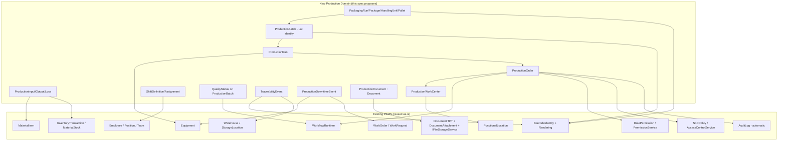
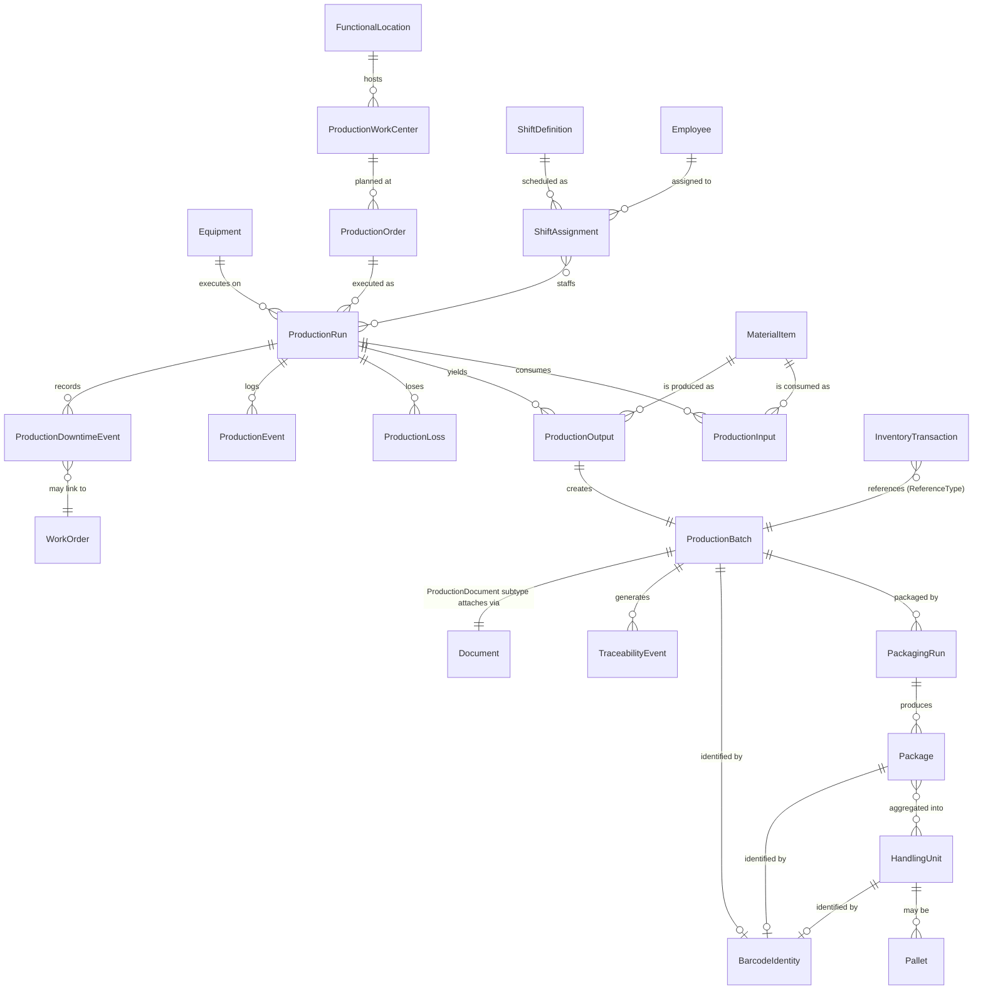
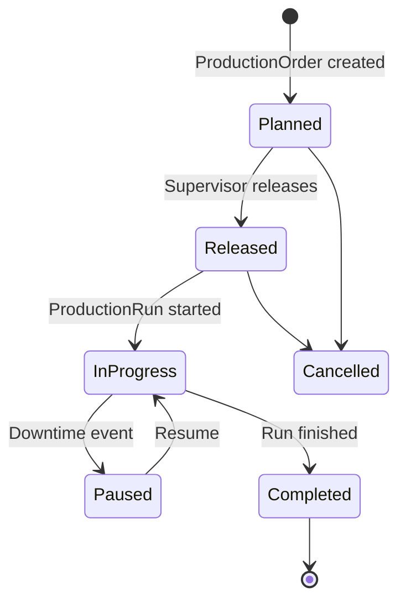
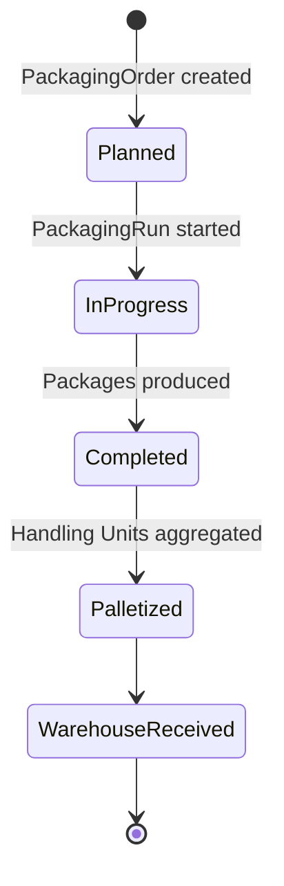
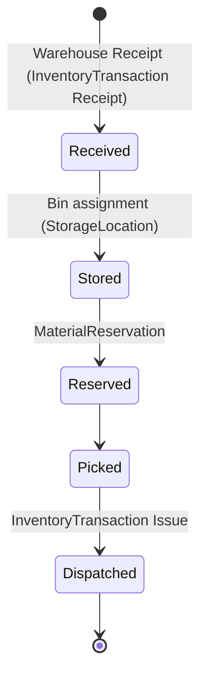
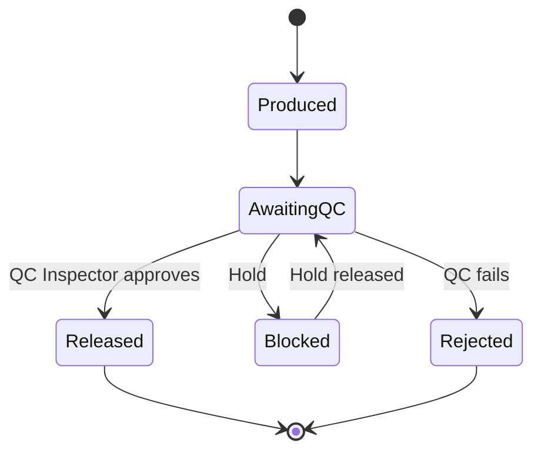
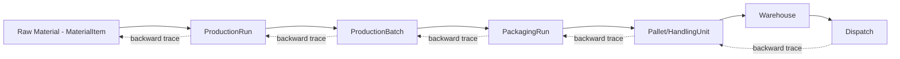
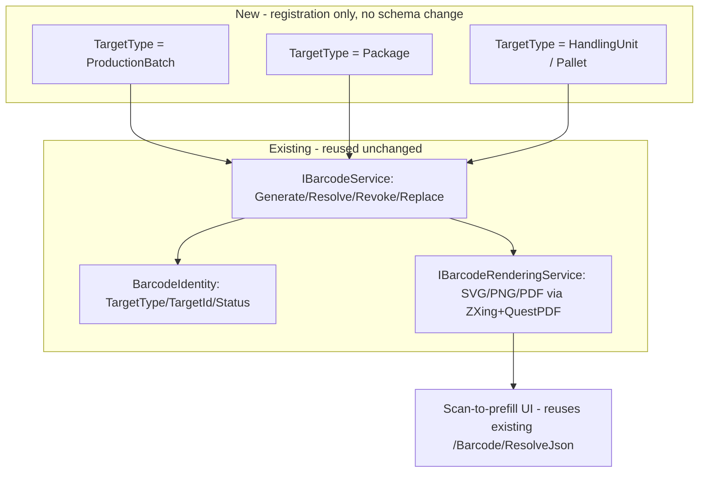
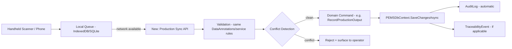
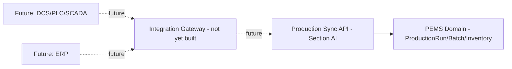

# PEMS Operations & Production Architecture Specification v1.0

**Status: AUDIT + ARCHITECTURE ONLY. No application code, DbContext, migration, controller, view, or configuration was modified to produce this document. No live database data was read, written, or reset.**

All file paths are relative to the repository root
`D:\PEMS\03-SOURCE\PEMS-cmms-edit-empoleeys-master\PEMS-cmms-edit-empoleeys-master`.
Every claim below is backed by evidence actually found in the repository (exact
file/class names cited); anything not confirmed is explicitly marked
`OPEN ARCHITECTURAL QUESTION` rather than assumed.

---

## A. Executive Summary

PEMS already contains **far more of the Operations & Production foundation than
a from-scratch read of the CLAUDE.md roadmap would suggest**. In particular, a
very recent commit (`866c56a`, "Enterprise Barcode/QR Core and
Warehouse/Inventory integration", landed the same day as this audit) has
already built:

- A real `Warehouse` → `StorageLocation` (self-referencing Zone/Rack/Bin)
  hierarchy.
- A proper **append-only** `InventoryTransaction` ledger with derived
  `MaterialStock` balances (not a mutable `CurrentQuantity` field) — this is
  exactly the "transaction-oriented, always auditable" requirement Section 20
  of the brief asks for, and it already exists.
- A generic, polymorphic `BarcodeIdentity` model (`TargetType`/`TargetId`,
  lifecycle status, filtered unique index, replace-chain) cleanly separated
  from a stateless `IBarcodeRenderingService` — architecturally exactly the
  "Identity vs. Carrier" split GS1/Section 22 asks for, extensible to new
  target types (`Batch`, `Pallet`, `HandlingUnit`, ...) **with zero schema
  change**.
- A `MaterialItem` catalog (~50k rows sourced from real MRS data) that is the
  de facto Material/Product master, with `IsSerialized`/`IsBatchControlled`
  flags already reserved (but explicitly documented as **not yet
  implemented** — no Batch/Lot/Serial instance entities exist anywhere).

What is genuinely **missing** is the Production/Manufacturing domain itself:
there is no `ProductionOrder`, `ProductionRun`, `Batch`/`Lot` instance,
`WorkCenter`, `Recipe`, `Shift` schedule, `Customer`, or `Dispatch`/`Shipment`
concept anywhere in the codebase. There is also no first-class `Downtime`
event entity (only a single `decimal? DowntimeHours` snapshot field on
`WorkOrder`/`FailureRecord`).

Critically, the platforms a Production module would need to **plug into**
are all real, generic, and already proven by multiple existing consumers:

| Cross-cutting platform | Generic? | Existing consumers | Verdict for Production |
|---|---|---|---|
| Workflow engine (`PEMS.WorkflowPlatform`) | Yes — `BusinessObjectId` is a bare `int`, `Module`/`BusinessObjectType` are free strings, zero entity-specific code in the engine | EngineeringDocument, VDR, **WorkOrder**, Permit, TechnicalQuery, MOC | Plug in with a new seeder + thin adapter service, **zero engine changes** |
| Audit trail (`AuditLog`) | Yes — automatic EF `SaveChangesAsync` interceptor on `PEMSDbContext`, any `BaseEntity`-derived `DbSet` gets audited for free | Every entity in the DbContext | Zero extra code needed |
| SoD framework (`SoDPolicy` + `AccessControlService`) | Yes — data-driven policy rows, generic `AuthorizeAsync` call | EngineeringDocuments, WorkOrder, Permit | Add policy rows only |
| Permission model (`RolePermission` + `PermissionService`) | Yes — fixed 5-action vocabulary (View/Create/Edit/Delete/Approve), module = string | ~36 modules including the brand-new `Barcode` module | Add module string + seeder block |
| Identity/carrier (`BarcodeIdentity`) | Yes — generic `TargetType`/`TargetId` | Equipment, MaterialItem, Warehouse, StorageLocation | Add `"Batch"`/`"Pallet"`/`"HandlingUnit"` to the supported-type set |
| Document/file storage (`Document` TPT + `DocumentAttachment` + `IFileStorageService`) | Partially — `Document` base is generic (TPT), but `DocumentAttachment`'s parent link is a set of nullable per-type FKs, not a single polymorphic pointer | EngineeringDocument, VDRItem, MaintenanceDocument | New `Document` subtype + one new nullable FK, reusing the same attachment/storage/download pipeline |
| Functional Location hierarchy | Yes — self-referencing, real import pipeline | Equipment, Asset, WorkRequest | Reuse directly, no changes needed |

**Bottom line**: this is not a "build Operations from nothing" project. It is
"add the Production/Batch/Shift/Dispatch domain layer on top of an
unusually complete Warehouse/Inventory/Identity/Workflow/Audit/SoD
foundation that was, in large part, already built for a different original
purpose (CMMS spare-parts and barcode scanning) but generalizes cleanly."

---

## B. Existing Repository Architecture

Solution: `PEMS.slnx`. Projects (all `.csproj` found under repo root, excluding
`bin`/`obj`):

```
PEMS.Domain            — entities, enums, BaseEntity (no project references)
PEMS.Application       — DTOs, interfaces, (thin) application services
PEMS.Persistence       — EF Core DbContext, Configurations, "Servises" (sic), Migrations, Seed
PEMS.Infrastructure    — file storage providers, cache
PEMS.AI                — Ollama/OCR/AI extraction
PEMS.WorkflowPlatform  — generic workflow/state-machine engine (separate project, own Entities/Interfaces/Services)
PEMS.Web               — ASP.NET Core MVC, Controllers, Views, Areas/Admin
PEMS.Shared            — shared helpers
PEMS.Tests             — unit/integration tests
tools/LoadTestSeed      — load-test data seeding utility
WebApplication1         — appears to be a stray/unrelated scaffold project, not part of the CMMS solution proper
```

`PEMS.WorkflowPlatform` is architecturally significant and was **not**
prominent in the CLAUDE.md summary: it is a standalone, dependency-inverted
state-machine engine referenced only through `IWorkflowRuntime`, consumed by
six different business modules already (Section H).

---

## C. Existing Operations-Related Capabilities

Confirmed to already exist (with evidence, detailed in Section E–J):

- Material/Product catalog (`MaterialItem`)
- Warehouse + hierarchical storage locations (`Warehouse`, `StorageLocation`)
- Append-only inventory ledger (`InventoryTransaction`, `MaterialStock`)
- Material reservations (`MaterialReservation`)
- Unit of Measure master (`MaterialUOM`) — no conversion logic implemented
- Generic barcode/QR identity + rendering + scan-resolve (`BarcodeIdentity`,
  `IBarcodeService`, `IBarcodeRenderingService`, `BarcodeController`)
- Scan-to-prefill JSON pattern already wired into Receive Stock / Add Spare
  Usage / Add Required Material forms
- Internal material requisition/issue workflows (`MaterialRequisition`,
  `StoreRequisition`) — procurement/internal-issue oriented, not a
  sales/dispatch model

Confirmed **not** to exist anywhere in `PEMS.Domain`/`PEMS.Application`:

- Production/Manufacturing: `ProductionOrder`, `ProductionRun`, `WorkCenter`,
  `ProductionLine`, `Recipe`, `Yield`, `Scrap`, `ProductionLoss`
- Batch/Lot/Serial as real entities (only unimplemented boolean flags on
  `MaterialItem`)
- Packaging: `PackagingOrder`, `Package`, `HandlingUnit`, `Pallet`
- Sales/Dispatch: `Customer`, `SalesOrder`, `Shipment`, `Delivery`, `Picking`,
  `Allocation`
- Quality release gate as a distinct entity (`AwaitingQC`/`Released`/`Blocked`
  state machine) — no `QualityStatus` concept found on any entity
- Shift scheduling (`Shift`, `ShiftDefinition`, `ShiftAssignment`) — only a
  shift-**handover** event workflow exists (`ShiftHandover`), explicitly
  documented in its own code comment as deliberately not a schedule entity
- GS1 concepts: `GTIN`, `GLN`, `SSCC` — none found
- EPCIS / traceability-event / genealogy concepts — none found
- First-class `Downtime` entity — only a `decimal?` snapshot field

---

## D. Reuse / Extend / Create Matrix

| Required Concept | Existing PEMS Concept | Location | Status | Action |
|---|---|---|---|---|
| Product / Material master | `MaterialItem` | `PEMS.Domain/Entities/MaterialItem.cs` | Existing | **Reuse** |
| Material catalog attributes (UOM, category, discipline, vendor) | `MaterialUOM`, `MaterialCategory`, `Discipline`, `Vendor` | `PEMS.Domain/Entities/*.cs` | Existing | **Reuse** |
| Warehouse | `Warehouse` | `PEMS.Domain/Entities/Warehouse.cs` | Existing | **Reuse** |
| Storage Location (Zone/Rack/Bin) | `StorageLocation` (self-referencing) | `PEMS.Domain/Entities/StorageLocation.cs` | Existing | **Reuse** |
| Equipment | `Equipment` | `PEMS.Domain/Entities/Equipment.cs` | Existing | **MUST REUSE** |
| Functional Location | `FunctionalLocation` (self-referencing, real import pipeline) | `PEMS.Domain/Entities/FunctionalLocation.cs` | Existing | **MUST REUSE** |
| Employee / Personnel | `Employee`, `Position`, `Department` | `PEMS.Domain/Entities/Employee.cs`, `Position.cs` | Existing | **MUST REUSE** |
| Workflow / approvals | `IWorkflowRuntime` (`PEMS.WorkflowPlatform`) | `PEMS.WorkflowPlatform/Interfaces/IWorkflowRuntime.cs` | Existing, generic | **MUST REUSE** |
| Audit trail | `AuditLog` + `SaveChangesAsync` interceptor | `PEMS.Domain/Entities/AuditLog.cs`, `PEMS.Persistence/Context/PEMSDbContext.cs` | Existing, automatic | **MUST REUSE** |
| SoD / authorization decision audit | `SoDPolicy`, `AuthorizationAuditLog`, `AccessControlService` | `PEMS.Domain/Entities/SoDPolicy.cs`, `PEMS.Persistence/Servises/AccessControlService.cs` | Existing, generic, data-driven | **MUST REUSE** |
| Permission module wiring | `RolePermission` + `PermissionService.SeedMissingRolesAsync` | `PEMS.Persistence/Servises/PermissionService.cs` | Existing, fixed 5-action vocabulary | **MUST REUSE** |
| Document/file storage | `Document` (TPT base), `DocumentAttachment`, `IFileStorageService` | `PEMS.Domain/Entities/Document.cs`, `PEMS.Application/Interfaces/IFileStorageService.cs` | Existing, one new nullable FK needed per new document type | **Extend** |
| Unit of Measure | `MaterialUOM` | `PEMS.Domain/Entities/MaterialUOM.cs` | Partial (no conversion logic) | **Extend** (implement conversion) |
| Inventory / Stock | `MaterialStock` + `InventoryTransaction` | `PEMS.Domain/Entities/*.cs` | Existing, transaction-oriented | **Reuse / Extend** (add production-specific `TransactionType`/`ReferenceType` values) |
| Barcode/QR identity | `BarcodeIdentity` + `IBarcodeService` | `PEMS.Domain/Entities/BarcodeIdentity.cs` | Existing, generic, extensible | **Extend** (register new `TargetType`s) |
| Barcode rendering | `IBarcodeRenderingService` (ZXing.Net + QuestPDF) | `PEMS.Persistence/Servises/BarcodeRenderingService.cs` | Existing, stateless | **Reuse** |
| Downtime tracking | `WorkOrder.DowntimeHours` / `FailureRecord.DowntimeHours` | `PEMS.Domain/Entities/WorkOrder.cs` | Partial (snapshot field only, no event log) | **Extend** (new `ProductionDowntimeEvent` entity linking Production Run ↔ Equipment ↔ WorkOrder) |
| Shift | `ShiftHandover` (event only) | `PEMS.Domain/Entities/ShiftHandover.cs` | Partial | **Create** `ShiftDefinition`/`ShiftAssignment` (deliberately excluded from `ShiftHandover`'s own scope per its doc comment) |
| Production Order / Run / Batch | — | — | Missing | **Create** |
| Work Center / Production Line | — | — | Missing | **Create** (or: reuse `Equipment`/`FunctionalLocation` as the Work Center concept — see Section T) |
| Recipe / BOM | — | — | Missing | **Create** |
| Packaging Order / Package / Handling Unit / Pallet | — | — | Missing | **Create** |
| Quality release gate | — (no `QualityStatus` on any entity) | — | Missing | **Create** (`ProductionBatch.QualityStatus` + workflow, reusing `IWorkflowRuntime`) |
| Traceability event / genealogy | — | — | Missing | **Create** (`TraceabilityEvent`, EPCIS-shaped but not a full EPCIS server) |
| Customer / Sales Order / Dispatch / Shipment | — | — | Missing | **Create** — `OPEN ARCHITECTURAL QUESTION`: is external sales in scope for PEMS, or does "dispatch" mean internal warehouse-to-site issue only? (Section AQ) |
| SparePart (legacy) vs. MaterialItem | Two parallel, unlinked entities | `PEMS.Domain/Entities/SparePart.cs` vs `MaterialItem.cs` | Existing conflict | **Do not create a third** — Production must consume `MaterialItem`/`MaterialStock`, never `SparePart` (see Section AO risk) |

**Rule enforced throughout this document: REUSE > EXTEND > CREATE.**

---

## E. Existing Master Data Map

| Master data | Entity | Key fields |
|---|---|---|
| Material/Product | `MaterialItem` | `MaterialCode`, `MaterialType`, `Description`, `CategoryId`, `DisciplineId`, `UomId`, `Manufacturer`, `IsSerialized`, `IsBatchControlled`, `IsStockItem`, `IsCritical`, `IsActive` |
| UOM | `MaterialUOM` | `Code`, `Name`, `ConversionFactor` (unused) |
| Vendor | `Vendor` | referenced by `MaterialItem.VendorId` |
| Warehouse | `Warehouse` | `Code`, `Name`, `Locations` |
| Storage Location | `StorageLocation` | self-referencing `ParentLocationId`/`Children` |
| Equipment | `Equipment` | `TagNumber`, `EquipmentType`, `FunctionalLocationId`, `ParentEquipmentId` |
| Functional Location | `FunctionalLocation` | self-referencing `ParentId`, `Plant`/`Area`/`Unit` string attributes |
| Employee | `Employee` | `PersonnelCode`, `PositionId`, `DepartmentId`, `PersonnelType` (Internal/Contractor/External/Temporary) |
| Position | `Position` | distinct from Identity role, per explicit "Position ≠ Role ≠ Permission" design doc-comment |
| Team | `Team` | `MaintenanceGroupId`, `SupervisorEmployeeId`, free-text `Shift` |
| Project / Discipline | `Project`, `Discipline` | referenced across almost every entity |

No Plant/Site master distinct from `FunctionalLocation.Plant` (a string
attribute, not a normalized entity) was found — `OPEN ARCHITECTURAL QUESTION`
if a real `Plant` master entity is needed for multi-plant Production
reporting, or the string attribute is sufficient.

---

## F. Existing CMMS Integration Map

```
Equipment (TagNumber, EquipmentType, FunctionalLocationId, ParentEquipmentId)
   ├── Asset.EquipmentId
   ├── Instrument.EquipmentId          (1 Equipment → at most 1 Instrument, "specialization not separate identity")
   ├── WorkOrder.EquipmentId (required)
   ├── MaintenancePlan.EquipmentId
   ├── MaintenanceStrategy.EquipmentId
   ├── EquipmentCriticality.EquipmentId (single source of truth for criticality)
   ├── FailureRecord.EquipmentId
   └── WorkRequest.EquipmentId (optional; intake gate before WorkOrder)

WorkOrder
   ├── Type: "Preventive"/"Corrective"/"Emergency" (free string, documented convention)
   ├── Priority: "Low"/"Medium"/"High"/"Critical"
   ├── Status: "Open"→"Assigned"→"InProgress"→"Completed"→"Closed"
   ├── FailureModeCode/FailureCauseCode/RootCause (+ FK taxonomy overlay: FailureModeRef/FailureCauseRef)
   ├── DowntimeHours (decimal?) — the ONLY downtime capture in the whole system
   ├── WorkOrderLabor (per-person hours/cost ledger, rate snapshotted at entry time)
   └── reuses IWorkflowRuntime via WorkOrderReviewService for approval
```

Target relationship for Production per the brief
(`Production Run → Equipment → Functional Location → Downtime → Failure →
Work Request → Work Order → Production Loss`) is **directly achievable**
without touching CMMS: a new `ProductionRun.EquipmentId` FK to the existing
`Equipment` table, and a new `ProductionDowntimeEvent` entity that optionally
links to `WorkRequest`/`WorkOrder` by FK, is all that's needed — no CMMS
entity requires modification.

---

## G. Existing Functional Location Map

`FunctionalLocation` is self-referencing (`ParentId`/`Children`), with
`Plant`/`Area`/`Unit` as descriptive string attributes (not enforced tiers —
depth comes from the `ParentId` chain, not a `Level` field). A full
staging/human-confirm import pipeline already exists
(`FunctionalLocationImportBatch`, `FunctionalLocationImportRow`,
`FunctionalLocationImportService`, `FunctionalLocationImportController`),
mirroring the Equipment import pattern. A dedicated permission module
`EquipmentFunctionalLocationAssignment` governs confirming Equipment↔FL
links.

**Production must reuse this hierarchy as-is** for its own Plant/Area/Line
location needs — do not create a parallel location tree. If Production needs
a "Production Line" or "Work Center" concept below the FL granularity
currently modeled, the cleanest fit is either (a) a `FunctionalLocation` leaf
node representing the line/work center, or (b) a thin new
`ProductionWorkCenter` entity with a required FK to `FunctionalLocation` (see
Section T for the recommendation).

---

## H. Existing Workflow / RBAC / SoD Map

**Workflow** (`PEMS.WorkflowPlatform`): `WorkflowDefinition` → `WorkflowVersion`
(Draft/Published/Retired) → `WorkflowStage` (`ResponsibleRole`, `StageType`
Sequential/Parallel, `ApprovalStrategy`) → `WorkflowTransition`. Runtime state
lives in `WorkflowInstance` (`Module`, `BusinessObjectType`, `BusinessObjectId`
as a bare `int` — the engine deliberately never knows what table
`BusinessObjectId` points to) and `WorkflowInstanceStage` /
`WorkflowHistory` (append-only, captures IP/Browser/User/Role/Comment).
Entry point: `IWorkflowRuntime` (`StartInstanceAsync`, `ExecuteActionAsync`,
`GetInstanceAsync`, `GetHistoryAsync`, `GetPendingTasksAsync`).

Six confirmed consumers, all via the identical thin-adapter pattern
(inject `IWorkflowRuntime`, no inheritance): `DocumentWorkflowService`
(EngineeringDocument), `VdrWorkflowService`, **`WorkOrderReviewService`**,
`PermitService`, `TechnicalQueryService`, `MOCService`.

**RBAC**: custom (not ASP.NET Identity). `User`/`SystemRoles` (9 fixed roles:
SystemAdmin, EngineeringManager, EngineeringSupervisor, DisciplineEngineer,
DocumentController, MaintenanceEngineer, ContractManager, QAManager, Viewer).
Two coexisting permission layers:

- **Layer 1** (primary, used by ~36 modules including the brand-new
  `Barcode` module): `RolePermission` rows per (Role, Module) with a **fixed**
  5-action vocabulary (`CanView/CanCreate/CanEdit/CanDelete/CanApprove`, plus
  a handful of domain-specific booleans like `CanFreeze`/`CanHold`), seeded
  idempotently via `PermissionService.SeedMissingRolesAsync(module, ...)`.
- **Layer 2** (newer, additive, for richer action vocabularies): `Permission`
  (`"{Resource}.{Action}"` catalog with an `IsDestructive` flag) +
  `RoleModuleAction` + `RolePermissionGrant`, used e.g. by `Permit` (14
  actions: Submit/Approve/Reject/Issue/Suspend/Resume/Close/Cancel/Revoke...).

**SoD**: a real, data-driven framework — `SoDPolicy` (conflicting permission
pairs), `AuthorizationAuditLog` (every authorization *decision*, with
`Decision` enum including `DeniedBySoD`, plus `CorrelationId`/`IpAddress`),
enforced in `AccessControlService.AuthorizeAsync`. Seeded conflicts today:
`EngineeringDocuments.Create↔Approve`, `EngineeringDocuments.Edit↔Approve`,
`WorkOrder.Create↔Close`, `WorkOrder.Edit↔Close`, `Permit.Create↔Issue`.
Actually wired into a live controller (`DocumentWorkflowController`), not
just unit-tested in isolation — though its own test suite notes it was, at
one point earlier in the project's history, built but not wired anywhere
(a documented design-vs-wiring gap now closed for these 3 modules — worth
re-verifying for any *new* module rather than assuming SoD enforcement is
automatic).

Neither "Warehouse Operator" nor "QC Inspector" exists today as a named
role — closest analogs are `QAManager` and `MaintenanceEngineer`/
`DisciplineEngineer`. New roles would need standard seeder entries.

---

## I. Existing Audit Architecture

`AuditLog` (`EntityName`, `EntityKeyValue`, `Action`, `ChangedFieldsSummary`
— diff-only, not full before/after snapshots — `UserId`, `UserName`,
`Timestamp`, `IsAIAssisted`). Captured **automatically** via an EF Core
`SaveChangesAsync` override in `PEMSDbContext` (`PrepareAuditEntries` +
`FinalizeAuditEntries`) — any entity added as a `DbSet` on `PEMSDbContext`
gets audited with zero extra service code. This is separate from, and a
narrower log than, the SoD-focused `AuthorizationAuditLog` (Section H), which
captures IP/CorrelationId but is decision-focused, not data-change-focused.

Traceability events for Production (Section AA) should be modeled as their
own **immutable, append-only** domain entity (matching the
`InventoryTransaction`/`WorkflowHistory` "never update, only insert" pattern
already used twice in this codebase) rather than relying on `AuditLog` alone
— `AuditLog` is a generic change log, not a purpose-built business-event
ledger, and mixing the two would make traceability queries slow and
semantically muddy.

---

## J. Existing Document/File Architecture

Two file-storage abstractions coexist: `IFileStorageService` (the proven,
actually-wired path — ~8 controllers, local disk **outside** `wwwroot`,
GUID-only physical filenames, path-traversal-protected, registered as
Singleton) and a newer `IEnterpriseFileStorageService` (multi-provider,
routed via `StorageProvider`/`StorageRoute`, fewer live callers, registered
Scoped). **Recommendation: Production should target `IFileStorageService`**
— it is the pattern with actual production traffic today; only reach for the
enterprise variant if a non-local backend (e.g. Azure Blob) is a concrete,
near-term requirement.

`Document` is a real TPT (table-per-type) base entity holding common fields
(`DocumentKind`, `DocumentNo`, `Title`, `Status`, `IsFrozen`, `IsOnHold`,
...), with `EngineeringDocument`, `VDRItem`, `MaintenanceDocument` as
sibling subtypes sharing one PK space. `DocumentAttachment` links to a
parent via a set of **nullable, mutually exclusive** FKs
(`DocumentId`/`LetterId`/`TechnicalQueryId`/`MOCId`/intake-queue fields) —
not a single generic `TargetType`/`TargetId` pointer like `BarcodeIdentity`
uses. Access to attachment bytes is centralized in one controller,
`FilesController.Download`, which branches its authorization check by which
parent FK is populated.

**For Production documents (COA, batch record, packaging record,
certificates)**: add a new `Document` TPT subtype (e.g.
`ProductionDocument`) with whatever FK(s) it needs (e.g. `ProductionBatchId`),
reuse `DocumentAttachment.DocumentId` (already works for any `Document`
subtype since it's TPT with a shared PK) and `IFileStorageService` unchanged,
and add one new branch to `FilesController.CheckAccessAsync` for the new
type's authorization rule. This is a genuine "Extend" (a few added lines in
2-3 existing files) plus a small new entity — **not** a new storage system.

---

## K. Existing API Architecture

Controllers are thin, constructor-DI over `I*Service` interfaces (confirmed
on `EquipmentController` — 9 injected services — and `WorkOrderController` —
9 injected services/DbContext), with permission checks via
`IPermissionService.HasPermissionAsync(roles, module, action)` before
mutating actions. `PagedResult<T>` (`PEMS.Application/DTOs/PagedResult.cs`)
is the explicitly-documented standard list-pagination shape across the app.
DTOs live in `PEMS.Application/DTOs/` (102 files), named `XxxDto`,
`XxxListDto`/`XxxListItemDto`, grouped `XxxDtos.cs`, and `XxxFilter`.
**No FluentValidation** anywhere in the solution (no package reference, no
`Validators/` folder) — validation is DataAnnotations + inline
service/controller checks; a new Production module should follow that same
convention rather than introducing FluentValidation as a new dependency.
Excel export uses **ClosedXML** via a shared `ExcelExportHelper`
(`AddStyledHeaderRow`/`FinalizeExportSheet` extension methods) — directly
reusable for Production/Inventory exports.

There is effectively **no REST/JSON API surface** apart from one narrow
`SearchApiController` (typeahead only, explicitly documented as "the only
endpoint of its kind"). This is a material gap for any future mobile/PLC/ERP
integration (Section M, AJ).

---

## L. Existing UI Architecture

`_Layout.cshtml` + `_SidebarMenu.cshtml` remain the single shared shell/nav
(confirmed — no parallel UI system exists; this session has done extensive
work on both files already). RTL via `admin.rtl.css` +
Bootstrap's own RTL build. Bilingual support via real `.resx` resource files
(`SharedResource.resx`/`SharedResource.fa.resx`) plus a `CultureController`
— not ad-hoc inline `@if (culture == "fa")` branching everywhere, though some
views do still branch inline (an existing, pre-Production-scope pattern, not
something this spec needs to fix). **Production UI must add new sidebar
sections/routes following the existing `_SidebarMenu.cshtml` accordion
pattern — do not redesign the shell.**

---

## M. Existing Mobile/Offline Capabilities

A PWA `manifest.json` and `service-worker.js` exist and are registered from
`_Layout.cshtml`, but the service worker is **deliberately non-functional
for offline use** — its own code comment states this explicitly: PEMS is a
safety-focused system and must not show stale/offline data for Permit
decisions, so the fetch handler does not intercept anything (network-only).
**No sync queue, no device/push-subscription concept, no offline data model
exists anywhere.** This is a genuine, confirmed gap (not an oversight in this
audit — actively and intentionally excluded by whoever built the PWA
shell). Section AI designs the target architecture for this as future work,
explicitly not to be implemented in this pass.

---

## N. ISA-95 / IEC 62264 Compliance Matrix

| ISA-95 concept | PEMS today | Target mapping |
|---|---|---|
| Equipment Hierarchy (Enterprise→Site→Area→Line→Cell/Unit) | `FunctionalLocation` self-referencing tree + `Equipment` | Reuse directly; a `ProductionWorkCenter`/`ProductionLine` maps to a `FunctionalLocation` leaf or a thin new entity FK'd to it |
| Personnel Class/Segment/Model | `Employee`/`Position`/`Team` | Reuse; add "Production Operator" etc. as new `Position`/`SystemRoles` entries, not a parallel personnel model |
| Equipment Class/Segment/Model | `Equipment`/`EquipmentClassRef` | Reuse |
| Material Class / Material Definition / Material Lot | `MaterialItem` = Material Definition equivalent | **Material Lot has no equivalent — must Create** |
| Process Segment | — | **Missing — must Create** (`ProductionOrder`/`ProductionRun` step definitions) |
| Production Schedule / Production Performance | — | **Missing — must Create** |
| Operations definition (Production/Maintenance/Quality/Inventory Operations) | Maintenance Operations = existing CMMS (WorkOrder/MaintenancePlan); Inventory Operations = existing `InventoryTransaction`; **Production Operations = missing**; **Quality Operations = missing** | Production and Quality Operations are the actual net-new work |

ISA-95 is the correct primary reference: PEMS already implements a
recognizable subset of Maintenance Operations Management and Inventory
Operations Management; Production and Quality Operations Management are the
genuine gaps this spec targets.

---

## O. ISA-88 Applicability Assessment

PEMS's current material data (per the same MRS-sourced `MaterialItem`
catalog noted throughout the barcode/inventory audit) is **not** batch-recipe
detailed enough to support a real ISA-88 Recipe/Procedure/Unit-Procedure/
Operation/Phase hierarchy today (this mirrors the exact same conclusion
already reached and documented in this repo for `IsSerialized`/
`IsBatchControlled` — "current MRS data is not sufficient for this
capability"). **Recommendation: apply ISA-88 concepts only loosely** — model
`ProductionBatch` as an ISA-88-*shaped* record (references a `Recipe`,
carries `Batch`/`Lot` identity, produces `ProductionOutput`) without
building a full Recipe/Procedure/Phase execution engine. Do not turn PEMS
into a DCS/batch controller, per explicit instruction — this is a records
and traceability layer, not a control-execution layer.

---

## P. ISO 22400 KPI Alignment

See Section AG (KPI Dictionary) for the full matrix. Summary: PEMS today has
the data prerequisites for **Availability** (via the new `DowntimeHours`
field) and nothing else on the ISO 22400 list — Performance, Quality, Yield,
OEE, Schedule Adherence all require the new Production entities this spec
proposes before they can be computed at all.

---

## Q. GS1 Identification Assessment

`BarcodeIdentity` is architecturally GS1-*compatible in spirit* (identity
separated from carrier, generic target resolution) but is **explicitly not
GS1-compliant today**: no GTIN/GLN/SSCC field or generation logic exists, and
the rendering service's own doc comment states "Code39/GS1 intentionally not
implemented." The `Code` field is an internal random token
(`PEMS-BR-`+16 chars), not a GS1 Digital Link or AI-structured string.
**Recommendation**: do not retrofit full GS1 compliance into the existing
`BarcodeIdentity.Code` format (would be a breaking change to already-issued,
already-printed labels for Equipment/MaterialItem/Warehouse/StorageLocation).
Instead, if GS1 compliance becomes a real requirement (customer/regulatory
mandate), introduce it as an **additional, optional carrier format**
alongside the existing internal token — e.g., a new rendering mode that
encodes a GS1 Digital Link URI pointing at the same internal
`BarcodeIdentity.Code` resolution endpoint, rather than replacing the
existing identity scheme. Flagged as `OPEN ARCHITECTURAL QUESTION` (Section
AQ): is GS1 compliance actually required by any real customer/regulatory
constraint, or is "GS1-style" (identity/carrier separation, batch/lot
identity) sufficient?

---

## R. GS1 Traceability Assessment

No forward/backward traceability chain exists today in any form. The
building blocks are present piecemeal (`InventoryTransaction.ReferenceType`/
`ReferenceId` already implements a generic "this movement was caused by
X" pointer pattern that a `TraceabilityEvent` entity could mirror) but no
entity ties Raw Material → Production → Batch → Packaging → Pallet →
Warehouse → Customer together. This is core net-new work (Section U, AA).

---

## S. EPCIS Compatibility Assessment

No EPCIS concepts exist. Per the brief's own instruction, a full EPCIS
server is out of scope. **Recommendation**: design the new
`TraceabilityEvent` entity with EPCIS's five conceptual dimensions in mind
(What = `TargetType`/`TargetId` pair, reusing the exact `BarcodeIdentity`
polymorphic pattern; When = `EventDate`; Where = `FunctionalLocationId`/
`StorageLocationId`; Why = `BusinessStep` enum-like string
— e.g. "commissioning"/"packing"/"shipping" mirroring EPCIS business steps;
Disposition = a status string) so that a future EPCIS export/API layer is a
mapping exercise, not a redesign.

---

## T. Target Operations Architecture



Design principle: every new box in the "New" subgraph is a genuinely new
domain concept; every arrow into the "Existing" subgraph is a **reuse**, not
a duplicate. No box in "Existing" is modified in shape — only additive FKs
from new entities pointing at them, plus (Section D) `TargetType` string
registration in `BarcodeService.SupportedTargetTypes` and new `Module`
strings in `PermissionService`/`WorkflowDefinition` — both proven, additive,
migration-free extension points already used by the Barcode module.

---

## U. Target Domain Model

Classification per concept (Existing/Partial/Missing, Reuse/Extend/Create),
per Section 18 of the brief:

| Concept | Status | Action | Notes |
|---|---|---|---|
| `Product`/`ProductVersion` | Existing (`MaterialItem`) | Reuse | No separate ProductVersion — `MaterialItem` has no revision concept; add only if BOM/spec revisioning is a real requirement (open question) |
| `ProductionOrder` | Missing | Create | Plans a run of a `MaterialItem` (finished good) at a `ProductionWorkCenter`, target qty, planned dates |
| `ProductionRun` | Missing | Create | An actual execution instance of a `ProductionOrder`; links to `Equipment`/`ProductionWorkCenter`, start/end |
| `ProductionBatch` | Missing | Create | The Lot/Batch identity born from a `ProductionRun`'s output; carries `QualityStatus`; gets a `BarcodeIdentity` (`TargetType="ProductionBatch"`) |
| `ProductionInput` | Missing | Create | Consumption record: `ProductionRunId`, `MaterialItemId`, `Quantity`, `UomId` — generates a matching `InventoryTransaction` (`TransactionType="Issue"`, `ReferenceType="ProductionRun"`) |
| `ProductionOutput` | Missing | Create | Yield record: `ProductionRunId`, `ProductionBatchId`, `Quantity` — generates `InventoryTransaction` (`TransactionType="Receipt"`, `ReferenceType="ProductionBatch"`) |
| `ProductionLoss` | Missing | Create | `ProductionRunId`, `Quantity`, `LossReasonCode` — no `InventoryTransaction` (never entered stock) |
| `ProductionEvent` | Missing | Create | Generic append-only event log for a run (start/pause/resume/stop/downtime) — mirrors `WorkflowHistory`'s append-only pattern |
| `Shift` | Partial | Create `ShiftDefinition`/`ShiftAssignment` | `ShiftHandover` stays as-is (a different concept — the handover event, not the schedule) |
| `ShiftAssignment` | Missing | Create | `EmployeeId`, `ShiftDefinitionId`, `Date` — feeds "who was on shift" for a `ProductionRun` |

---

## V. Target Entity Relationship Model



---

## W. Production Lifecycle



## X. Packaging Lifecycle



## Y. Warehouse Lifecycle



## Z. Quality Lifecycle



Reuses `IWorkflowRuntime` exactly as `WorkOrderReviewService`/
`DocumentWorkflowService` already do — `Module="ProductionBatch"`,
`Category="QCRelease"`.

## AA. Traceability Lifecycle



Every arrow above corresponds to one immutable `TraceabilityEvent` row
(`TargetType`/`TargetId` of the entity created + `RelatedType`/`RelatedId` of
the entity it was derived from + `EventDate` + `BusinessStep`) — an
append-only genealogy log, not a mutable "current parent" pointer, so full
history survives even after a pallet is reworked/repalletized.

---

## AB. QR/Barcode Architecture



Concretely: add `"ProductionBatch"`, `"Package"`, `"HandlingUnit"` to
`BarcodeService.SupportedTargetTypes`, add matching `case` arms to
`TargetExistsAsync`/`GetExistingTargetIdsAsync`/
`ResolveTargetDisplayLabelAsync`, and add routing arms to
`BarcodeController.Resolve`/`RedirectToDetails`. Zero migration. This is the
single cheapest, highest-leverage reuse in the whole spec.

## AC. Pallet/Handling Unit Architecture

`HandlingUnit` (generic container concept) with an optional `PalletId`-style
subtype flag or a `HandlingUnitType` string (`"Pallet"`/`"Box"`/`"Container"`)
— avoid a separate `Pallet` entity duplicating `HandlingUnit` unless a
pallet genuinely needs fields no other handling unit has (e.g. pallet
weight/dimensions for logistics). `HandlingUnit` aggregates `Package` rows
(many-to-many via a junction, since a handling unit can be repacked) and
itself gets a `BarcodeIdentity`.

## AD. Inventory Transaction Architecture

Reuse `InventoryTransaction` unchanged; add new `TransactionType` values
(`"ProductionConsumption"`, `"ProductionReceipt"`) and new `ReferenceType`
values (`"ProductionRun"`, `"ProductionBatch"`) — the entity's
`ReferenceType`/`ReferenceId` pair was clearly designed for exactly this kind
of open-ended extension (it already supports `"Reservation"` as one
`ReferenceType` among presumably others for WorkOrder-driven spare
consumption). No schema change needed.

---

## AE. State Machines

| Entity | States | Transitions | Actor | Approval? | Audit |
|---|---|---|---|---|---|
| ProductionOrder | Planned→Released→InProgress→Completed / Cancelled | Release, Start, Complete, Cancel | Production Supervisor | Release requires Supervisor role | AuditLog automatic + WorkflowHistory if routed through IWorkflowRuntime |
| ProductionRun | Released→InProgress⇄Paused→Completed | Start, Pause(downtime), Resume, Complete | Production Operator (start/pause/resume), Supervisor (complete) | No | AuditLog automatic |
| ProductionBatch (Quality) | Produced→AwaitingQC→Released / Blocked→Rejected | Submit for QC, Approve, Hold, Release Hold, Reject | QC Inspector | Yes — via IWorkflowRuntime, SoD: creator ≠ approver | WorkflowHistory + AuthorizationAuditLog (SoD) |
| PackagingRun | Planned→InProgress→Completed | Start, Complete | Warehouse/Packaging Operator | No | AuditLog automatic |
| HandlingUnit | Open→Closed→Dispatched | Close, Dispatch | Warehouse Operator | Dispatch may require Supervisor | AuditLog automatic |
| Inventory (transaction) | N/A — append-only, no state | Receipt/Issue/Transfer/Adjustment/Reservation | Warehouse Operator | Adjustment requires Approve permission (SoD: creator ≠ approver recommended) | Already enforced by existing `IMaterialStockService` doc comments |
| Dispatch (if in scope) | Allocated→Picked→Loaded→Dispatched | per step | Warehouse Operator/Supervisor | Dispatch requires Supervisor | AuditLog automatic |

Invalid transitions (e.g. `Released`→`AwaitingQC` skipping `Produced`, or
completing a `ProductionRun` with open `ProductionDowntimeEvent`s) should be
guarded in the thin adapter service layer, exactly as
`WorkOrderReviewService`/`DocumentWorkflowService` already guard their own
transitions — no new pattern needed.

---

## AF. RBAC / SoD Matrix

| Conceptual role | Existing PEMS role to reuse? | New role needed? |
|---|---|---|
| Production Operator | None exact — closest: none | **Create** |
| Production Supervisor | None exact | **Create** |
| Production Engineer | Could reuse `DisciplineEngineer` scoped to a "Production" discipline, or create dedicated | **Create recommended** (clarity over reuse-by-coincidence) |
| Warehouse Operator | None exact | **Create** |
| Warehouse Supervisor | None exact | **Create** |
| QC Inspector | None exact — closest: `QAManager` (but that's a manager-level role) | **Create** (`QAManager` stays as an approval-tier role above QC Inspector) |
| QC Manager | `QAManager` | **Reuse** |
| Production Manager | None exact | **Create** |
| Operations Manager | None exact | **Create**, or reuse `EngineeringManager`-equivalent tier pattern |
| Administrator | `SystemAdmin` | **Reuse** |

New module strings to register in `PermissionService.Modules`:
`"Production"`, `"ProductionBatch"`, `"Packaging"`, `"Warehouse"` (note: a
generic `"Warehouse"` module may already be implied by existing
`InventoryMasterData`/`InventoryTransaction` controllers — verify no
overlap before adding a second warehouse-flavored module name).

SoD pairs to seed (mirroring the existing `EngineeringDocuments.Create↔Approve`
pattern):
- `ProductionBatch.Create` ↔ `ProductionBatch.Approve` (QC release)
- `ProductionOrder.Create` ↔ `ProductionOrder.Release`
- `InventoryTransaction.Create` (adjustment) ↔ `InventoryTransaction.Approve`
- `HandlingUnit.Create` ↔ `HandlingUnit.Dispatch` (if dispatch approval is
  required — `OPEN ARCHITECTURAL QUESTION`, depends on Section AQ)

---

## AG. KPI Dictionary (ISO 22400-aligned)

| KPI | Definition | Formula | Source (once built) | Frequency | ISO Alignment |
|---|---|---|---|---|---|
| Production Quantity | Total good output | Σ ProductionOutput.Quantity | ProductionOutput | Per run/shift/day | ISO 22400 |
| Production Rate | Output per unit time | ProductionQuantity / RunDuration | ProductionRun | Per run | ISO 22400 |
| Yield | Good output vs. input | Σ Output.Qty / Σ Input.Qty | ProductionInput/Output | Per run/batch | ISO 22400 |
| Waste/Scrap | Lost material | Σ ProductionLoss.Quantity | ProductionLoss | Per run | ISO 22400 |
| Reject Rate | QC-rejected batches | Rejected batches / Total batches | ProductionBatch.QualityStatus | Per period | ISO 22400 |
| Downtime | Stoppage time | Σ ProductionDowntimeEvent duration | ProductionDowntimeEvent (new) — today only `WorkOrder.DowntimeHours` snapshot exists | Per run | ISO 22400 |
| Availability | Uptime ratio | (PlannedTime − Downtime) / PlannedTime | ProductionRun + ProductionDowntimeEvent | Per run/shift | ISO 22400 |
| Performance | Actual vs. theoretical rate | ActualRate / TheoreticalRate | ProductionRun (needs a theoretical-rate reference — `OPEN ARCHITECTURAL QUESTION`: no Recipe/rate master exists yet) | Per run | ISO 22400 |
| Quality (ratio) | Good/Total output | GoodQty / TotalQty | ProductionOutput + ProductionLoss | Per run | ISO 22400 |
| OEE | Availability × Performance × Quality | product of the three above | derived | Per run/shift | ISO 22400 (only where applicable — not all PEMS plants may want OEE) |
| Packaging Rate | Packages per time | Σ Package count / RunDuration | PackagingRun | Per run | — |
| Warehouse Receipt | Receipts posted | Σ InventoryTransaction (Receipt, ReferenceType=ProductionBatch) | InventoryTransaction (existing) | Daily | — |
| Dispatch Quantity | Qty dispatched | Σ InventoryTransaction (Issue, ReferenceType=Dispatch) | InventoryTransaction (existing) | Daily | — |
| Inventory Balance | On-hand stock | `MaterialStock.OnHandQuantity` | MaterialStock (existing) | Real-time | — |
| Schedule Adherence | On-time completion | Runs completed by plan date / Total runs | ProductionOrder/Run | Per period | ISO 22400 |

**Formulas that cannot be computed with today's schema are marked above** —
Performance and OEE specifically require a theoretical-rate reference that
does not exist yet (no Recipe/rate master); this is flagged, not silently
assumed away.

---

## AH. API Architecture

Follow existing conventions exactly: thin `Controller`s under
`PEMS.Web/Controllers/` (e.g. `ProductionOrderController`,
`ProductionRunController`, `PackagingController`), constructor-injected
`I*Service` interfaces defined in `PEMS.Application/Interfaces/`,
implementations in `PEMS.Persistence/Servises/` (matching the repo's
existing misspelled-but-established folder name), DTOs in
`PEMS.Application/DTOs/` following `XxxDto`/`XxxListDto`/`XxxFilter` naming,
`PagedResult<T>` for all list endpoints, `IPermissionService.HasPermissionAsync`
gates before every mutating action, DataAnnotations for validation (no new
FluentValidation dependency), ClosedXML + `ExcelExportHelper` for exports.
No API versioning scheme exists today and none should be introduced solely
for this module — if a real external API need emerges (mobile app, ERP), it
should be a deliberate, separately-scoped API-architecture decision, not
smuggled in here.

## AI. Mobile / Offline Architecture (target, NOT implemented now)



Given Section M's finding that the current PWA shell is **deliberately**
network-only for safety reasons, any future offline capability for
Production scanning would need its own considered risk decision (unlike
Permit data, stale production-count data is lower-stakes — but this is a
policy call, not an engineering one) — `OPEN ARCHITECTURAL QUESTION`,
explicitly not decided here. Offline mode, if ever built, **must** still
pass through the same authorization/business-rule validation on sync — no
bypass, per the brief's explicit instruction.

## AJ. Integration Architecture (future DCS/PLC/ERP — NOT implemented now)



No existing integration surface (message bus, webhook, external API) was
found anywhere in the repo — this would be entirely new infrastructure, out
of scope for this pass, documented here only as a placeholder for future
planning.

---

## AK. Database Architecture

- New tables are additive only — no existing table's schema changes.
- High-volume tables to plan indexes for from day one (mirroring
  `InventoryTransaction`'s existing indexing approach):
  `ProductionEvent`, `TraceabilityEvent`, `InventoryTransaction` (already
  indexed, will grow faster once Production writes to it), `AuditLog`
  (already grows with every entity — will grow faster with new entities).
- Recommended indexes: `ProductionRun(EquipmentId, StartDate)`,
  `ProductionBatch(BarcodeIdentityId)`, `TraceabilityEvent(TargetType,
  TargetId)` and `TraceabilityEvent(RelatedType, RelatedId)` (mirroring
  `BarcodeIdentity`'s own `TargetType+TargetId` filtered-index pattern),
  `InventoryTransaction(ReferenceType, ReferenceId)` if not already present
  (verify at migration time).
- Retention/archival: not addressed by any existing entity in this codebase
  (no archival pattern found anywhere) — `OPEN ARCHITECTURAL QUESTION` for
  whether `TraceabilityEvent`/`ProductionEvent` need a retention policy from
  day one given expected volume (Section AL).
- Concurrency: follow the existing `BaseEntity.RowVersion` optimistic
  concurrency pattern already used everywhere else — no new concurrency
  strategy needed.

## AL. Performance & Scalability

At ~150 daily users with production/inventory/traceability/scan event
volumes, the highest-risk tables are `ProductionEvent` and
`TraceabilityEvent` (potentially many rows per batch/pallet per day). The
existing `InventoryTransaction` design (append-only, indexed by reference,
paginated via `IInventoryTransactionService.GetLedgerAsync`) is the proven
template to copy — do not invent a different pagination/query pattern.
Dashboard queries (KPI widgets) should aggregate via scheduled/materialized
summaries rather than live full-table scans once volume grows — not needed
at launch, flagged for future consideration only (no premature
optimization).

## AM. Security

No new security model needed — reuse `RolePermission`/`Permission` +
`SoDPolicy` + `AccessControlService.AuthorizeAsync` exactly as documented in
Section H. New risk surface specific to Production: barcode-scan-triggered
actions (Section AB/AI) must still pass through the same permission check as
their manual-entry equivalent — the existing `ResolveJson` pattern already
does this correctly (same `HasPermissionAsync` gate as the page action), so
replicate that, don't bypass it "because it's just a scan."

## AN. Auditability

Automatic via the existing `AuditLog` interceptor (Section I) for all
mutable entities; append-only by design for `ProductionEvent`,
`InventoryTransaction` extensions, and `TraceabilityEvent` (no
update/delete path on these three — mirroring `InventoryTransaction`'s and
`WorkflowHistory`'s existing "insert-only" precedent). Traceability history
must not be freely editable, per the brief — this is enforced simply by
**never adding an Edit/Update method** to the traceability service, the same
way `InventoryTransaction` has no update path today.

## AO. Risks

1. **SparePart vs. MaterialItem duplication risk carries forward into
   Production**: if Production spare/consumable usage is ever modeled, it
   must consume `MaterialItem`/`InventoryTransaction`, never `SparePart` —
   the codebase itself already documents this exact migration
   (`MaintenanceSpareUsage`'s switch away from `SparePart`); repeating the
   old mistake for Production would create a third parallel inventory
   concept.
2. **`DocumentAttachment`'s nullable-FK-per-parent-type pattern doesn't
   scale indefinitely** — every new `Document` subtype needs a new nullable
   FK column on `DocumentAttachment` (unlike `BarcodeIdentity`'s clean
   `TargetType`/`TargetId` pattern). For Production this is one more column
   (`ProductionDocumentId` or reuse the base `DocumentId` since
   `ProductionDocument` would itself be a `Document` TPT subtype — the
   latter avoids the problem entirely and is the recommended approach,
   Section J).
3. **No theoretical-rate/Recipe master exists**, so Performance/OEE KPIs
   (Section AG) cannot be computed until that gap is explicitly addressed —
   risk of stakeholders expecting OEE dashboards on day one.
4. **PWA is intentionally offline-incapable today** (Section M) — if
   Production scanning is expected to work in low-connectivity warehouse
   areas from day one, that is a scope/timeline risk, not a quick add.
5. **No REST API surface exists** (Section K) — if a mobile app or
   ERP/DCS integration is near-term, building that API layer is
   substantial, separately-scoped work not covered by this spec.
6. **SoD framework has a documented history of being built-but-not-wired**
   for at least one prior module (Section H) — for Production, explicitly
   verify the `AuthorizeAsync` SoD check is actually called from the new
   controller action, not just seeded as policy rows, before considering it
   "done."

## AP. Architectural Decisions

| # | Decision | Rationale |
|---|---|---|
| AD-1 | Production reuses `MaterialItem`/`MaterialStock`/`InventoryTransaction` unchanged, extended only via new `TransactionType`/`ReferenceType` string values | Zero schema risk, proven append-only design already exists |
| AD-2 | `ProductionBatch`, `Package`, `HandlingUnit` get identity via `BarcodeIdentity` (new `TargetType` registrations), not a new identity system | `BarcodeIdentity` is generic and migration-free to extend |
| AD-3 | Quality release gate implemented via `IWorkflowRuntime` (new `Module="ProductionBatch"`), not a bespoke state machine | Matches 6 existing consumers, zero engine change |
| AD-4 | `ProductionDocument` is a new `Document` TPT subtype, not a new document/attachment system | Avoids the nullable-FK-per-type scaling problem (Risk AO-2) |
| AD-5 | `TraceabilityEvent` is a new, purpose-built append-only entity, not repurposed `AuditLog` | `AuditLog` is a generic diff log, not a business-event ledger; mixing concerns would hurt both |
| AD-6 | GS1/EPCIS compliance is deferred as an *additional* optional carrier/export layer, not a replacement of `BarcodeIdentity.Code` | Avoids breaking already-issued labels; GS1 need is unconfirmed (Section AQ) |
| AD-7 | Offline/mobile sync (Section AI) and DCS/ERP integration (Section AJ) are explicitly deferred — documented as target architecture only | Matches the brief's explicit "do not implement" instruction for these areas |

## AQ. Open Architectural Questions

1. Is external customer/sales fulfillment (`Customer`, `SalesOrder`,
   `Shipment`) actually in scope, or does "Dispatch" mean internal
   warehouse-to-site/project issue only (which `StoreRequisition` already
   partially covers)? This materially changes Section D's Sales/Dispatch
   row.
2. Is a normalized `Plant`/`Site` master entity needed, or is
   `FunctionalLocation.Plant` (a string attribute) sufficient for
   multi-plant Production reporting?
3. Is full GS1 (GTIN/SSCC/Digital Link) compliance an actual customer or
   regulatory requirement, or is "GS1-style" identity/carrier separation
   sufficient? (Section Q)
4. Is OEE/Performance reporting expected at launch? If yes, a
   Recipe/theoretical-rate master must be scoped as a prerequisite, not an
   afterthought (Section AG, Risk AO-3).
5. Is offline/low-connectivity scanning a day-one requirement for
   warehouse/production floor use, or can it be deferred? (Section AI, Risk
   AO-4)
6. Should `SparePart` be formally deprecated/migrated now that `MaterialItem`
   is confirmed as the forward path, or does it stay indefinitely for
   backward compatibility? (Not blocking for Production, but adjacent risk
   worth a decision — Section AO-1)
7. Does the existing `"Warehouse"`-adjacent module naming in
   `PermissionService` already cover what a new `"Production"`/`"Warehouse"`
   module would need, or would a new module name collide/overlap in
   confusing ways? (Section AF)

## AR. Implementation Phases (recommended, not started)

1. **Phase 1 — Production core**: `ProductionOrder`, `ProductionRun`,
   `ProductionWorkCenter` (FK'd to `FunctionalLocation`), `ProductionInput`,
   `ProductionOutput`, `ProductionLoss`, `ProductionEvent`. Wire into
   `InventoryTransaction` via new reference types. New `"Production"`
   permission module.
2. **Phase 2 — Batch identity & Quality**: `ProductionBatch`,
   `QualityStatus` state machine via `IWorkflowRuntime`, `BarcodeIdentity`
   `TargetType` registration for `ProductionBatch`. New SoD policy rows.
3. **Phase 3 — Downtime integration**: `ProductionDowntimeEvent` linking
   `ProductionRun`↔`Equipment`↔`WorkRequest`/`WorkOrder`. Availability KPI
   becomes computable.
4. **Phase 4 — Packaging & Handling Units**: `PackagingOrder`,
   `PackagingRun`, `Package`, `HandlingUnit`/`Pallet`, further
   `BarcodeIdentity` `TargetType` registrations.
5. **Phase 5 — Traceability**: `TraceabilityEvent` entity, forward/backward
   trace query service, EPCIS-shaped field design (no EPCIS server).
6. **Phase 6 — Documents & KPIs**: `ProductionDocument` (Document TPT
   subtype), KPI dashboard widgets for the computable subset of Section AG,
   Excel export via `ExcelExportHelper`.
7. **Phase 7 (deferred, separately scoped)** — resolve Section AQ open
   questions, then: Sales/Dispatch if in scope, Recipe/rate master if OEE is
   required, mobile/offline sync API, DCS/ERP integration.

Each phase should end with its own migration, its own permission-module
seeding, and its own regression run — following the exact pattern already
used for the Barcode module (single additive migration, `dotnet ef
migrations add <Name>`, full-suite regression before merge).

---

# ARCHITECTURE GATE DECISION

## APPROVED WITH CONDITIONS

Conditions before Phase 1 implementation may begin:

1. Resolve `OPEN ARCHITECTURAL QUESTION` items AQ-1 (Sales/Dispatch scope)
   and AQ-2 (Plant/Site master) — both change the shape of Phase 1/4 entities
   directly.
2. Confirm AQ-7 (no module-name collision in `PermissionService`) before
   registering new module strings.
3. Explicitly decide AQ-4 (OEE/Performance in scope for launch) since it
   gates whether a Recipe/rate master is a Phase 1 or Phase 7 concern.
4. For Phase 2 (Quality release), explicitly verify the SoD
   `AuthorizeAsync` check is wired into the real controller action before
   considering that phase complete — do not assume seeding `SoDPolicy` rows
   alone is sufficient (per the documented prior gap in Section H).

No condition here blocks Phase 1 core Production entities (`ProductionOrder`/
`ProductionRun`/`ProductionInput`/`ProductionOutput`/`ProductionLoss`) or
Phase 1's `InventoryTransaction` reuse — those have no open questions
attached and can proceed once AQ-2 and AQ-7 are answered.

---

# FINAL SUMMARY

## What already exists
A generic barcode/identity system, a real append-only inventory ledger with
warehouse/storage-location hierarchy, a generic multi-consumer workflow
engine, an automatic audit-log interceptor, a data-driven SoD framework, a
proven permission-module pattern, a TPT document/attachment/file-storage
pipeline, and a mature CMMS core (Equipment/FunctionalLocation/WorkOrder) —
all built for other purposes but cleanly reusable for Production.

## What can be reused
Everything in Section D's "Reuse"/"MUST REUSE" rows — Equipment,
FunctionalLocation, Employee, IWorkflowRuntime, AuditLog, SoDPolicy/
AccessControlService, RolePermission/PermissionService, MaterialItem,
Warehouse/StorageLocation, InventoryTransaction/MaterialStock,
BarcodeIdentity/rendering, IFileStorageService, PagedResult<T>, ClosedXML
export helper.

## What must be extended
`BarcodeService.SupportedTargetTypes` (new target types), `InventoryTransaction`
`TransactionType`/`ReferenceType` values, `PermissionService.Modules` (new
module strings), `Document` TPT (new subtype), `MaterialUOM` (implement
actual conversion logic if Production needs cross-UOM yield reporting).

## What genuinely needs to be created
`ProductionOrder`, `ProductionRun`, `ProductionWorkCenter`,
`ProductionInput`/`Output`/`Loss`, `ProductionEvent`,
`ProductionDowntimeEvent`, `ProductionBatch` (+ QualityStatus workflow),
`PackagingOrder`/`Run`/`Package`/`HandlingUnit`, `TraceabilityEvent`,
`ShiftDefinition`/`ShiftAssignment`, `ProductionDocument`, and (pending AQ-1)
possibly `Customer`/`SalesOrder`/`Shipment`.

## What must NOT be duplicated
A second Material/Product master (reuse `MaterialItem`), a second
inventory-balance mechanism (reuse `InventoryTransaction`/`MaterialStock`),
a second barcode/identity engine, a second workflow/approval engine, a
second audit log, a second file-storage system, a second permission
vocabulary, and — critically — do not build Production consumption on
`SparePart` (legacy, already superseded for this exact purpose).

## Standards compliance
ISA-95 is the correct primary reference and PEMS already implements a
recognizable subset (Maintenance + Inventory Operations); ISA-88 applies
loosely only (data not detailed enough for full recipe/phase modeling); ISO
22400 KPIs are partially computable today and mostly blocked on new
Production entities; GS1/EPCIS are architecturally compatible in spirit
(identity/carrier separation already exists) but not implemented and should
be added as an optional layer, not a breaking change to the existing barcode
scheme.

## Major architectural risks
SparePart/MaterialItem duplication carrying forward (AO-1),
`DocumentAttachment`'s per-type FK scaling limit (AO-2, avoided by using
Document TPT for `ProductionDocument`), missing Recipe/rate master blocking
OEE (AO-3), intentionally offline-incapable PWA (AO-4), no REST API surface
for future mobile/ERP/DCS integration (AO-5), and a documented history of
SoD policies being seeded-but-unwired for at least one prior module (AO-6,
now a required verification step for Phase 2).

## Required decisions before implementation
AQ-1 through AQ-7 (Section AQ) — most urgently AQ-1 (Sales/Dispatch scope),
AQ-2 (Plant/Site master), and AQ-4 (OEE at launch), since these three change
the shape of Phase 1 entities directly.

## Recommended implementation order
Phase 1 (Production core) → Phase 2 (Batch identity & Quality) → Phase 3
(Downtime integration) → Phase 4 (Packaging & Handling Units) → Phase 5
(Traceability) → Phase 6 (Documents & KPIs) → Phase 7 (deferred: Sales/
Dispatch, Recipe/rate master, mobile/offline, DCS/ERP integration), per
Section AR.

---

**No application code, DbContext, controller, view, JavaScript, CSS,
configuration, or database schema was created, modified, or deleted to
produce this document. No migration was created or applied. No live
database data was read, modified, or reset. This task ends at the
Architecture Gate — implementation has not begun.**
