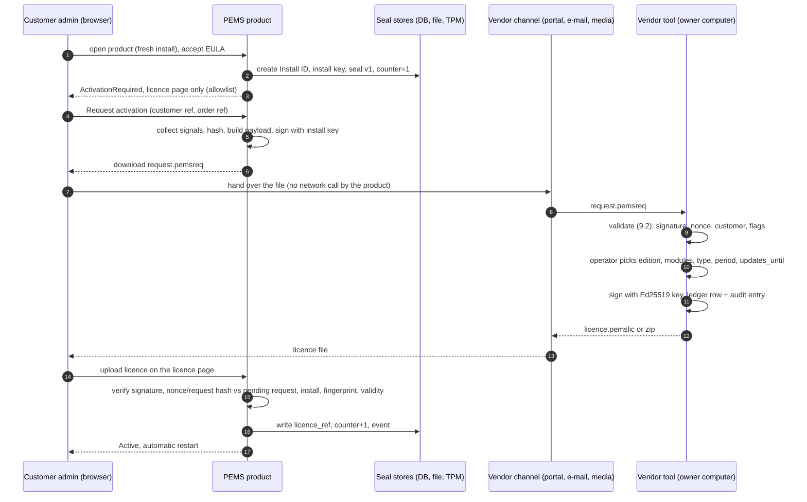

# PEMS licensing - technical design

Status: **DRAFT for approval by Member A** - Jira SCRUM-26, plan row #339 - 2026-10-25.
Scope: design only, no code. It makes rows #98-#106 estimable and reviewable and fixes the formats that #108, #115, #116, #161, #170 and #341-#349 also use.
Every example value in this file is obviously fake (`FAKE...`, `0000...`). No real key, signature, serial or licence appears here, and none may be added (rule 10).

Terms: **decided** = recorded in the plan (#96, #97, Licensing Design sheet, Instructions). **Recommended** = this document's proposal, needs Member A's approval. **Open** = listed in section 12 with a suggested owner. Nothing marked recommended is a decision yet.

## 1. Decided constraints and design principles

| # | Constraint | Source |
|---|---|---|
| C1 | On-prem; licence bound to machine **and** install time | Lessons, #96 |
| C2 | Perpetual licence plus annual maintenance (`updates_until`); lifetime or term (a time period, start and end date); trial and demo exist; **no count-based licences** | #102, #115 |
| C3 | **No user limit**; limits are on sites and modules only | #101 |
| C4 | Never phones home; no online licence, update or revocation check. Files travel by hand or through the website portal (#161), which is outside the product | rule 1 |
| C5 | VMs and Docker allowed, with extra protection: virtual TPM or hypervisor ID where available, restore-detection counter, no-cloning EULA clause | #97 |
| C6 | Goal is **casual-copy defence plus the EULA**, not an unbreakable scheme; no hardware token | #96 |
| C7 | Offline signature scheme; Ed25519 recommended; the private key lives only on the owner computers and never on a development machine, CI, shared server, the repository or the assistant's environment | #107, rule 10 |
| C8 | Licence active in every environment; a signed dev licence; no bypass flag in any package; always-free surfaces only from one allowlist | rule 11, #110 |
| C9 | Every customer and vendor licensing step is completable in a UI; a CLI is an optional extra | rule 20 |
| C10 | No per-customer forks; customer differences live in the licence | rule 17 |

Principles that follow:

1. **One licensing engine** (guideline ch. 01, R3): one verifier library used by startup, middleware, the Hangfire job, sensitive operations and the update page. No second implementation anywhere.
2. **Honest about limits.** Each defence lists its residual weakness and its contractual answer (section 11.1).
3. **Fail restricted, not dead.** Failure moves the product to a read-only restricted state; the licence page always stays reachable, so a customer can always recover through the UI.
4. **Hashes only on the wire.** No raw serial, MAC or UUID leaves the machine or is stored.
5. **Formats are versioned and shared.** Request, licence and (later) reset files are produced and read by one shared library used by the product and the vendor tool (#344 reuses it).

## 2. Components and where they live

| Component | Role | Notes |
|---|---|---|
| `Licensing contracts` | DTOs and interfaces for fingerprint, seal, request, licence, state | Recommended in `PEMS.Application` (guideline ch. 01 section 1) |
| `Licensing core` | canonical file reader/writer, signature verification, fingerprint comparison, state machine | One shared library, referenced by the product **and** the vendor tool. Contains no private key code path in the product build |
| `Platform signal providers` | read Windows / Linux / container signals; DPAPI / CNG / TPM access | Recommended in `PEMS.Infrastructure` behind an interface; one provider per platform |
| `Seal store` | DB table + protected file + optional TPM counter | Table by new migration only (guideline ch. 01 section 3); never edit an applied migration |
| `Verification points` | startup gate, middleware, Hangfire job, sensitive-operation guard | All call the one verifier (section 7) |
| `Customer licence page` | status, fingerprint, request download, licence / zip upload, expiry warnings (#108) | Razor, component library, no logic in controllers; localization keys, Persian first |
| `Vendor tool` | separate web app, never in a customer package (#106) | Section 9 |

The shared library must run fully offline and must not need an online source to build (rule 1). Ed25519 and key-protection libraries are chosen under guideline ch. 03 (library first, licence recorded in L_OSS). See open question Q3.

## 3. Machine fingerprint (#98)

### 3.1 Signals

Every signal yields a **signal hash** `h = base64url(first 16 bytes of HMAC-SHA256(key = "PEMS-FP-V1:" + signal_id, message = normalised raw value))`. The HMAC key is a public constant: it is for domain separation and to keep raw serials out of files, not a secret. Raw values live only in memory while computing. Values that are empty, all-zero, all-`F`, or on a known placeholder list (for example `To be filled by O.E.M.`, `Default string`, `NONE`) are discarded as **unavailable**, never hashed.

Stability classes: **S1** stable for the life of the hardware and across OS reinstall; **S2** stable until the OS is reinstalled or the image is re-generalised; **S3** changes when a component is replaced; **S4** volatile (excluded).

| Signal id | Windows source | Linux source | Docker / container | Class | Weight | Notes |
|---|---|---|---|---|---|---|
| `smbios_uuid` | SMBIOS system UUID (`Win32_ComputerSystemProduct`) | `/sys/class/dmi/id/product_uuid` (root-readable only) | host value only if DMI is readable; see 3.4 | S1 | 3 | Duplicated or placeholder on some cheap boards and some cloned VMs; discard placeholders |
| `board_serial` | `Win32_BaseBoard.SerialNumber` | `/sys/class/dmi/id/board_serial` | as above | S1 | 2 | Frequently unset on VMs |
| `cpu_id` | `Win32_Processor.ProcessorId` | `/proc/cpuinfo` model / family / stepping (no unique id on most x86) | same as host if visible | S1/S3 | 1 | Weak on Linux and VMs; kept low weight. May be identical for same-model machines, so it is never sufficient alone |
| `disk_serial` | serial of the disk that holds the system volume (`Win32_DiskDrive`, storage query) | serial of the root-filesystem block device (`/sys/block/*/device/serial`, `udev`) | host disk not visible in most containers | S3 | 2 | Changes on disk replacement; virtual disks may expose a generated serial |
| `nic_macs` | physical NICs only: exclude virtual, VPN, loopback, Hyper-V / VMware host adapters, `vEthernet`, bridges | `/sys/class/net/*/address`, excluding entries under `/sys/devices/virtual/net` | virtual (`veth`) - **excluded** | S3 | 1 per NIC, max 2 | Each physical NIC is its own signal (`nic_mac_1`, `nic_mac_2`, sorted by hash) so one replaced NIC is one changed signal |
| `os_machine_id` | `HKLM\SOFTWARE\Microsoft\Cryptography\MachineGuid` | `/etc/machine-id` (fallback `/var/lib/dbus/machine-id`) | **host** machine-id via read-only bind mount, see 3.4 | S2 | 2 | Changes on OS reinstall; survives cloning of a disk image (which is why it is not enough alone) |
| `tpm_ek` | hash of TPM endorsement public key, where present and readable | same through `/dev/tpmrm0` | vTPM only when the hypervisor exposes one | S1 | 3 | Optional signal; contributes only if present at enrolment |
| `hypervisor_id` | CPUID hypervisor vendor leaf plus platform id (Hyper-V VM id from the guest parameters key, VMware / KVM BIOS UUID) | same via DMI / `systemd-detect-virt` | host's | S2 | 2 | Only used when virtualisation is detected (C5). Identifier behaviour on clone depends on the hypervisor option chosen when the clone is created; to be measured, see 3.5 |

S4 (excluded because volatile): IP addresses, host name, RAM size, free disk space, uptime, OS build, container id, container name, pod name, user names.

`platform` in the fingerprint is `windows`, `linux` or `container`; `virtualization` is `none`, `hyperv`, `vmware`, `kvm`, `other`, `container`. Both are recorded in the request and the licence so the vendor can apply the policy of C5.

### 3.2 Tolerance rule

The licence stores the list of signal hashes recorded at enrolment (section 5.2). The verifier recomputes the current signals and compares **per signal** against that licensed list.

Let `A` = signals available at enrolment (non-empty hash), `M` = the subset of `A` whose current hash equals the licensed hash, `C = A \ M` the changed or missing signals, `W(x)` = sum of weights.

| Result | Condition (recommended) | Behaviour |
|---|---|---|
| **Match** | `C` is empty | Active |
| **Tolerated** | `|C| = 1` **and** `W(M) / W(A) >= 0.60` **and** at least one S1 signal in `M` | Active, internal event `fp_drift`, warning shown on the licence page for administrators |
| **Degraded** | `|C| = 2` **and** `W(M) / W(A) >= 0.60` **and** at least one S1 signal in `M` | Active with a visible warning and a prompt to request a refreshed licence (renewal request, type `refresh`). Restricted after the grace setting. **Open Q1** (the plan states one change is tolerated and three or more invalidate; two is not stated) |
| **Invalid** | `|C| >= 3`, or the other conditions fail | Restricted mode (section 7.3); licence page offers a transfer or restore request |

Rules that make the tolerance safe:

- **The baseline is the licence, not the last start.** There is no rolling baseline: otherwise replacing one signal at a time would walk the licence to another machine. Drift is reset only when the vendor issues a new licence (renewal or transfer), which gives the vendor a point to check it (section 9).
- Signals that were **unavailable at enrolment** are ignored. A signal that was available but is **now unreadable** (permission, driver) counts as changed.
- Two NIC signals are two signals; replacing both NICs is `|C| = 2`.
- Reboot, NIC replaced, one disk replaced: Tolerated (the #98 test). A different machine: Invalid (almost every signal differs). The threshold, weights and `max_changed` are constants in the shared library, not in the licence, so a licence cannot loosen them. **Open Q2**: weights and the 0.60 threshold need calibration on real hardware in the #98 spike.

### 3.3 Output and exposure

- The only fingerprint values shown in the UI or written to files are signal hashes and `fp_hash = base64url(SHA-256(join(sorted(signal_id ":" h))))`.
- The licence page shows a short form (first 8 characters of `fp_hash`) that the customer can read to support, plus the copy / download of the request (customer need from Lessons 8).
- No logging of raw values (guideline ch. 01 section 6).

### 3.4 Docker and Linux specifics (recommended deployment contract)

A container does not see the host's hardware identity by default. To make C5 workable the supported Docker deployment must:

1. Bind-mount the host `/etc/machine-id` read-only to a fixed path inside the container (for example `/host/etc/machine-id`); the provider reads that path in container mode. The container's own `/etc/machine-id` is ignored.
2. Mount a **persistent named volume** for the seal file; a container rebuilt without the volume is a new install (new Install ID), which is a re-activation.
3. Optionally expose DMI (`/sys/class/dmi/id`) read-only, so `smbios_uuid` and `board_serial` work.
4. Document that the host is the licensed machine; moving the compose project to another host is a transfer.

The deployment kit (`deploy/`) and the Docker env file must carry these settings (settings contract, guideline ch. 01 section 4). `tools/PemsLinuxProbe` is the existing probe project for Linux / VM checks; extending it to dump signal availability (hashes only) is the cheapest way to calibrate Q2 on real hosts.

### 3.5 Virtualisation notes (policy C5)

- Hypervisors differ on what changes after a clone: SMBIOS UUID, Hyper-V VM id, MAC and vTPM state can each stay the same or be regenerated depending on the option chosen at clone time. The design therefore treats hypervisor id and vTPM as **useful when they change**, never as proof that a copy is absent. A vTPM exported with the VM carries its keys with it. Behaviour per hypervisor (Hyper-V, VMware, KVM / libvirt, Proxmox) must be measured and recorded in the Supportability Matrix by #104; this document does not assume results.
- When virtualisation is detected the request sets `virtualization` and the vendor tool shows it, so the vendor can apply the sales policy (extra checks, shorter term, a clause reminder).

## 4. Install seal and restore-detection counter (#99, #104, #105)

### 4.1 What the seal is

At first start (before any user exists) the product creates:

- `install_id`: 128 random bits from a CSPRNG, written `PEMS-` + Crockford base32 groups, e.g. `PEMS-FAKE0-00000-00000-00000-00000`.
- `install_time_utc`: the UTC time of creation (the "install time" of C1).
- An **install key pair** (section 4.3). The private key is non-exportable where the platform allows.
- The first `seal record` (4.2), written to all stores.

### 4.2 Seal record (logical fields)

| Field | Meaning |
|---|---|
| `seal_version` | integer, starts at 1 |
| `install_id`, `install_time_utc` | as above |
| `install_pub` | install public key (SPKI, base64url) and `install_key_alg`, `key_protection` (`tpm`, `cng-machine`, `software`) |
| `counter` | monotonic non-negative integer, see 4.4 |
| `last_seen_utc` | latest trusted time, for the clock guard (4.5) |
| `audit_head` | hash-chain head of the licensing event log (4.4) |
| `licence_id`, `licence_hash` | active licence (null until activated) |
| `fp_enrol` | the signal hashes recorded at enrolment (for the request) |
| `state` | last computed licence state (section 7.2) |
| `restore_flags` | `restore_suspected`, `restore_reactivation_pending` |
| `eula` | accepted version, UTC time, administrator id (EULA acceptance record required by #120) |
| `sig` | install-key signature over the canonical bytes of all fields above (`PEMS-SEAL-V1\n` prefix) |

The record is **signed** with the install key (proves it was produced by this install and not edited) and written to independent stores:

| Store | Where | Content |
|---|---|---|
| S-DB | new table `LicenseSeal` (single row) and append-only `LicenseEvent` (audit chain) in the application database | seal record + events |
| S-FILE | `install.seal` in a protected directory outside the web root and outside the database backup set: `%ProgramData%\PEMS\seal\` on Windows, `/var/lib/pems/seal/` on Linux (a named volume in Docker). Permissions: service account only (ACL / mode 0600) | same record; optionally wrapped (4.3) |
| S-TPM | optional, where a physical TPM 2.0 is usable: an NV counter incremented with `counter` | the number only |

`LicenseEvent` follows the history rule (append-only, never updated or deleted). Whether the tables inherit `BaseEntity` is an implementation detail for #99; `TenantId` is irrelevant (one install, one seal). The DB schema arrives through a migration only.

### 4.3 Key protection - what each platform really gives

| Platform | Install key | Honest strength |
|---|---|---|
| Windows with physical TPM | CNG key in the Platform Crypto Provider (non-exportable, hardware-held) | Strong against disk copy: the key cannot leave this TPM |
| Windows without TPM | CNG software key, machine scope, non-exportable flag | Exportability is blocked for ordinary tools, but the key lives on the disk, so an **image on other hardware keeps it**. DPAPI machine scope also does **not** bind to hardware: the machine secret is on the same disk. Protection then rests on the fingerprint check, not on cryptography |
| Linux with physical TPM | TPM 2.0 key through the resource manager | As Windows with TPM |
| Linux, Docker, no TPM | key file in the seal directory, mode 0600 | Casual-copy only |

Consequences, stated plainly so #99's requirement ("copying a disk to other hardware cannot open the seal") is evaluated against the real platform:

- With a TPM the requirement holds cryptographically.
- Without a TPM it holds only because the verifier compares the fingerprint. **Recommended hardening for #99 to evaluate (optional):** wrap the seal's data key with a **t-of-n secret share** where each share is encrypted with a key derived (HKDF) from one S1/S2/S3 signal. Any `t` matching signals recover the key, so the tolerance rule of 3.2 is enforced by the encryption, and hardware that shares fewer than `t` signals cannot unwrap the file. It costs complexity and an implementation of Shamir sharing (library first); the spike decides (Q4).
- Algorithm choice: the install key is an **ECDSA P-256** key on Windows / TPM platforms, because non-exportable Ed25519 is not available in those providers. This is separate from the vendor signing key (Ed25519, section 5). **Open Q3**: confirm the algorithm pairing and the library set in the #98/#99 spike; at the time of writing the .NET base class library has no Ed25519 type, which this document has not re-verified.

### 4.4 Counter and audit hash chain (restore detection)

- `counter` increases by 1 at every application start and once per 24 hours of uptime (heartbeat; a setting). It is written **S-DB first, then S-FILE, then S-TPM**.
- Every licensing event (start, activation, state change, fingerprint drift, clock jump, restore suspicion, upload, refresh, transfer request) is appended to `LicenseEvent` with `seq`, `utc`, `type`, `data_hash`, `prev_hash`, `entry_hash = SHA-256(prev_hash ‖ seq ‖ utc ‖ type ‖ data_hash)`. `audit_head` in the seal is the latest `entry_hash`. Events must never contain raw serials or personal data.
- **Check at start and by the periodic job:** read all stores. Let `max` be the greatest counter seen.

| Observation | Meaning | Action |
|---|---|---|
| all equal, chain head equal | normal | continue |
| one store lags by exactly 1 | interrupted two-phase write | repair from the greater store, record `seal_repair` |
| any store lower than another by 2 or more, or `audit_head` not on the other store's chain | **restore suspected** (DB restored from backup, file restored, or one store copied) | event `restore_suspected`, state `RestoreSuspected` (7.2), re-activation required |
| a store missing or unreadable | tamper or new volume | same as above |
| S-TPM counter higher than S-DB and S-FILE | disk or VM image restored on the same hardware | `restore_suspected` |
| signature of the seal fails | tamper | state `SealInvalid`, re-activation required |

Limits to state honestly (they drive Q5 and section 11.1):

- A **complete** machine or VM image restored (database, file and registry together) rolls both software stores back together. Software alone cannot see it. Detection then relies on: the TPM counter (physical TPM only; a vTPM may be snapshotted with the VM), and the **vendor-side witness**: every renewal, transfer or restore request carries `counter` and `audit_head`, and the vendor ledger (section 9) stores the highest values seen per Install ID. A request whose counter is lower than the ledger value, or two requests for the same Install ID with diverging chains, is flagged. This needs a file exchange, never a network call.
- "Simultaneous running on two machines" (#104 title) cannot be observed offline except through that vendor witness and the EULA. A LAN-multicast peer check would be a new behaviour; it is **not** proposed (Q5).

### 4.5 Clock guard (#105)

- `last_seen_utc` is updated on every start and heartbeat and stored in the seal.
- `effective_now = max(system_utc_now, last_seen_utc, newest timestamp in LicenseEvent)`; term, trial and demo expiry and warnings use `effective_now`, never the raw system clock. Optionally the newest business timestamp (latest audit-log row of the main database) joins the maximum; it is cheap and raises the floor (Q6).
- If `system_utc_now < last_seen_utc - tolerance` (tolerance a setting, recommended 5 minutes; large forward jumps are not suspicious): event `clock_backward`, state flag `ClockSoftLock`, banner for administrators, and a **confirmation request** (an administrator confirms the clock was corrected; the confirmation is logged and does not move `effective_now` backwards).
- Setting the clock back 30 days therefore leaves `effective_now` unchanged and the term does not extend (#105 test).
- Lifetime licences are not blocked by clock events; the events are only logged.

## 5. File formats (#100, #101)

### 5.1 Common envelope

Both files are UTF-8 JSON. To avoid canonicalisation bugs the signed bytes are exactly the bytes transported (JWS-like): the payload object is serialised once, encoded as base64url, and the signature is computed over a domain-separation prefix plus those bytes.

```json
{
  "format": "pemsreq",
  "format_version": 1,
  "payload": "<base64url of the UTF-8 JSON payload bytes>",
  "signature": {
    "alg": "ES256",
    "key_id": "inst-FAKE0000",
    "value": "<base64url FAKE signature>"
  }
}
```

- Signed message = `"PEMS-REQ-V1\n"` ‖ payload bytes for requests; `"PEMS-LIC-V1\n"` ‖ payload bytes for licences. A different prefix (and a different key) is used for reset files (#344 / #349), so a signature from one file type can never validate as another.
- The verifier rejects, each with a **distinct reason code**: unknown `format`, unknown major `format_version`, bad base64url, payload larger than the size cap, unknown `alg`, unknown `key_id`, bad signature, expired or not-yet-valid dates, nonce mismatch, install mismatch, fingerprint mismatch, revoked key. "Changing one byte" (the #100 test) fails at signature.
- Unknown extra payload fields are ignored inside the same major version **unless** listed in `crit` (array of field names the reader must understand; unknown `crit` entry = reject).
- Size caps: request 32 KiB, licence 32 KiB, zip bundle 1 MiB, at most 16 entries; the zip reader rejects absolute paths, `..`, symlinks and entries whose name is not `*.pemslic` (plus an optional `manifest.json` that is never trusted).
- File extensions: `.pemsreq`, `.pemslic`, and a zip with extension `.pemslic.zip` for bundles (several licences, #101).

### 5.2 Activation request - `.pemsreq`

Signed by the **install key** (proves integrity and possession of the install key, not the customer's identity; identity is checked by the vendor procedure #123).

Payload (all times UTC ISO-8601, all hashes base64url):

```json
{
  "request_type": "activation",
  "nonce": "FAKE-NONCE-0000000000000000000",
  "created_utc": "2026-11-01T08:30:00Z",
  "product": { "name": "PEMS", "version": "2026.11.0", "build_date": "2026-10-31" },
  "install": {
    "install_id": "PEMS-FAKE0-00000-00000-00000-00000",
    "install_time_utc": "2026-11-01T07:55:12Z",
    "install_pub": "<FAKE base64url SPKI>",
    "install_key_alg": "ES256",
    "key_protection": "software"
  },
  "fingerprint": {
    "scheme": 1,
    "platform": "windows",
    "virtualization": "none",
    "fp_hash": "FAKEFPHASH0000000000000000000000",
    "signals": [
      { "id": "smbios_uuid",  "h": "FAKE000000000000000000" },
      { "id": "os_machine_id","h": "FAKE000000000000000001" },
      { "id": "nic_mac_1",    "h": "FAKE000000000000000002" }
    ]
  },
  "seal": { "counter": 7, "audit_head": "FAKEHEAD000000000000", "state": "ActivationRequired" },
  "customer": { "customer_ref": "CUST-0000", "order_ref": "ORD-0000" },
  "previous_licence_id": null,
  "reason": null,
  "eula": { "version": "FAKE-1", "accepted_utc": "2026-11-01T08:00:00Z" }
}
```

| Field | Rules |
|---|---|
| `request_type` | `activation`, `renewal`, `refresh` (fingerprint drift), `transfer` (new hardware), `restore` (after image / backup restore) |
| `nonce` | 128 random bits, new for every request; the vendor rejects a nonce it has already used; the licence is bound to it |
| `previous_licence_id` | required for every type except `activation` |
| `reason` | free text, optional, length capped, no personal data |
| `customer.customer_ref`, `order_ref` | entered by the administrator in the UI; **unverified claim**, the vendor checks it against its register |
| `seal.counter`, `audit_head` | the vendor-witness values (section 4.4) |
| `eula` | the accepted version and time (from the seal) |

The request contains the signal **hashes list**, not only `fp_hash`, because the licence must store the per-signal baseline for the tolerance rule (3.2).

### 5.3 Signed licence - `.pemslic`

Signed by the **vendor Ed25519 key**; verified in the product with an embedded public-key set.

```json
{
  "licence_id": "LIC-FAKE-0000",
  "issue_seq": 1,
  "issued_utc": "2026-11-02T10:00:00Z",
  "signing_key_id": "vend-FAKE0001",
  "request_nonce": "FAKE-NONCE-0000000000000000000",
  "request_hash": "<base64url SHA-256 of the request payload bytes>",
  "customer": { "customer_ref": "CUST-0000", "display_name": "Example Customer Co" },
  "binding": {
    "install_id": "PEMS-FAKE0-00000-00000-00000-00000",
    "install_pub_hash": "<base64url SHA-256 of install_pub>",
    "fingerprint": { "scheme": 1, "fp_hash": "FAKEFPHASH0000000000000000000000",
      "signals": [ { "id": "smbios_uuid", "h": "FAKE000000000000000000" } ] },
    "deployment": { "platform": "windows", "virtualization": "none", "allowed": ["physical", "vm", "container"] }
  },
  "grant": {
    "edition": "FAKE-EDITION",
    "modules": ["FAKE-MODULE-A", "FAKE-MODULE-B"],
    "limits": { "sites": 1 }
  },
  "type": "lifetime",
  "validity": { "not_before": "2026-11-02T10:00:00Z", "not_after": null },
  "maintenance": { "updates_until": "2027-11-02T00:00:00Z" },
  "transfer_count": 0,
  "supersedes": null,
  "crit": []
}
```

| Field | Rules |
|---|---|
| `type` | `lifetime`, `term`, `trial`, `demo` (#102); no count-based type exists. `term`, `trial`, `demo` have `not_after`; `lifetime` has `null` |
| `validity` | instants in UTC. The vendor UI takes a **Jalali date** and stores the exclusive end instant at the end of that day in `Asia/Tehran` (use the time-zone database, not a hard-coded offset); the UI displays Jalali. Boundary tests per #102 |
| `grant.limits` | sites and module limits only; **no `users` field exists** (C3). Limit values come from the Supportability Matrix (rule 21), never invented in code |
| `maintenance.updates_until` | the entitlement to receive builds released up to this date (perpetual licence plus annual maintenance, CV_UPDENT). Checked when an update package is applied (#170), not by stopping a running product |
| `binding` | the licence is valid only for this `install_id` + `install_pub_hash`, and for a fingerprint that passes the tolerance rule against the listed signals. `request_nonce` and `request_hash` tie it to exactly one request, so a licence for request A never validates on install B (#101 test) |
| `issue_seq` | gapless counter from the vendor ledger (#106 requirement) |
| `supersedes` | `licence_id` replaced by this one (renewal, refresh, transfer); the product keeps only the newest accepted licence per Install ID |
| `deployment.allowed` | the vendor's policy per C5; a physical-only licence on a detected VM is Invalid |
| `crit` | as in 5.1 |

Signature: **Ed25519 (PureEdDSA)** over `"PEMS-LIC-V1\n"` ‖ payload bytes. Product-side verification uses a set of embedded public keys `{ key_id, public_key, status }`. A new key is added to the set with a signed update package (#170); a retired `key_id` is removed or marked `retired_after` an instant. A licence signed by an unknown key is rejected. Key creation, custody, backup, rotation and the compromise plan are #107 (`docs/process/KEY_MANAGEMENT.md`); this document only fixes the interface.

Why Ed25519: short keys and signatures, deterministic signing (no per-signature randomness bug class), widely implemented, proven in offline licensing (backlog evidence for #101). ECDSA P-256 is the fallback if the library review in Q3 finds a blocker.

### 5.4 Versioning policy (recommended)

- `format_version` is an integer major. Compatible additions (new optional fields) keep the number. Any change a reader must understand uses `crit` or a new major.
- The product reads the current and the previous major for at least two releases after a change (Q7); the vendor tool writes only the current one.
- The fingerprint `scheme` is versioned separately, so a signal change (for example a new Linux source) keeps old licences verifiable through the recorded scheme.
- Test vectors (valid, tampered byte, wrong nonce, wrong install, wrong key, unknown version, oversized, zip traversal) live beside the shared library and run in CI; they contain only fake keys generated in the test.

## 6. Customer licence page and first run (#108, #109, #110)

Everything below is browser UI (C9); the CLI is optional.

- **Licence page** (always-free surface): state, expiry (Jalali and Gregorian per product defaults), `fp_hash` short form, request type buttons (Request activation, Renew, Refresh, Request transfer, Restore after backup), download `.pemsreq`, upload `.pemslic` or `.pemslic.zip`, result with the distinct reason code translated through localization keys, restart handling after a successful upload.
- **Upload pipeline:** size and type check; parse; verify signature; check nonce / request_hash against a **pending request** stored in the DB (so a licence for an old request cannot be replayed); check install match; fingerprint tolerance; `supersedes`; write seal; append event; apply state; schedule the automatic restart (customer need, Lessons 8).
- **First run** (#109, #169): a fresh install with no ready DB shows the licence page first (in-memory rate limiting, no DB dependency), then administrator creation, then database preparation. First-run pages are reachable only from the server itself or with a one-time token shown by the graphical installer, never by reading a console log. The seal must therefore be creatable **before** the database exists: S-FILE is written first and S-DB is written when the database is ready (the two-phase order of 4.4 is reversed only for this step, and the check treats "S-DB not yet created" as normal until setup completes).
- **EULA step:** the legally approved EULA (#120) is shown at install; acceptance is recorded in the seal (`eula` field) and sent in every request.

## 7. Verification points and failure behaviour (#103, #110)

### 7.1 Points

| Id | Point | When | What it checks | Cost |
|---|---|---|---|---|
| V1 | Startup gate | process start, before hosted services and Hangfire start | seal stores (4.4), signature of the active licence, install match, fingerprint (3.2), validity with `effective_now`, counter increment | full check, a few hundred ms is acceptable |
| V2 | Request middleware | every request | cached state (7.2) integrity, allowlist lookup, read-only enforcement in `Restricted` | O(1), in-memory |
| V3 | Periodic job | Hangfire recurring job (interval a setting, recommended 6 h) and at heartbeat | re-run V1 completely, clock guard, expiry warnings, counter heartbeat | full check |
| V4 | Sensitive operations | publish a module, enable a feature, change builder settings, apply an update package, create a new site, restore a backup | licence grants the module / feature; state is not `Restricted`; for updates, build date vs `updates_until` | full check of the one involved grant |
| V5 | Licence page upload | each upload | section 6 pipeline | full |

All five call the one verifier library. The independence is in **separate call sites that recompute from the sources** (seal stores, licence file, hardware), not from one shared boolean: a patched V2 does not change V1, V3 or V4. Different consequences:

| Failed check | Consequence |
|---|---|
| V1 | state set; product starts in `Restricted` or `ActivationRequired` (never crashes) |
| V2 | blocks writes (HTTP 403 with the licence page link for browsers; problem details for APIs) |
| V3 | state change + event + administrator notification; flips to `Restricted` |
| V4 | refuses the single operation |
| V5 | rejects the file, nothing changes |

This is a casual-copy measure (C6): a skilled attacker can patch every site. Risk R7 in section 11.1 names the answer (obfuscation and integrity checks are #118, currently Hold; the EULA clause against removal).

### 7.2 States

| State | Meaning | Surfaces available |
|---|---|---|
| `ActivationRequired` | no valid licence (fresh install, seal invalid, new volume) | allowlist only |
| `Active` | valid, no warnings | all licensed |
| `ActiveWarning` | valid with `fp_drift`/degraded fingerprint, term expiring (warning window a setting), `ClockSoftLock` pending confirmation | all licensed, banners |
| `Restricted` | term/trial/demo expired, fingerprint Invalid, `RestoreSuspected` after grace, seal invalid, licence revoked | allowlist + **read-only** for licensed surfaces |
| `RestoreSuspected` | counter/chain mismatch (4.4) | as `ActiveWarning`; becomes `Restricted` when the grace setting elapses (Q5) |

**Read-only** means: reads and navigation work; writes are refused; authentication, the licence page and a data export of the customer's own data stay available (Q8: the export right needs the owner's confirmation and a EULA statement). Hangfire jobs that write business data are paused.

### 7.3 Allowlist and environments (#110, rule 11)

- One class, one list, one place (`LicenceFreeSurfaces`): login, licence page, first-run setup, the public demo page, the administrator recovery page (#346), static assets they need. Proposed addition (Q9): the anonymous details-free `/health/database` endpoint used by deploy pipelines (Lessons 25), because a pipeline must be able to probe an unlicensed install.
- Everything else is checked. There is no bypass flag, no `Development` shortcut, no per-environment branch in the verifier. A package scan (#119) fails a release that contains a bypass symbol, the vendor tool, a private key or a dev-only public key.
- **"A build without a licence does not start"** (#110) is read as: the licensed application does not come up; the process starts in `ActivationRequired` and serves only the allowlist, which is the only way the customer can reach the licence page. Q10 asks the owner to confirm this reading.
- **Dev and CI licences:** developers, CI and the demo need licences too, but the signing private key must never be on a development machine or CI (rule 10). Recommended: a **separate dev key pair** whose public half is compiled into non-release configurations only; its private half is held in the team's development secret store (not the production key); release builds do not trust it, and the package scan proves it. Counter-option: dev licences signed by the production key on an owner computer, with `type: demo` and a short term, per developer, which is safer but slower. Decision needed (Q11).

## 8. Types and behaviour (#102)

| Type | Validity | Warning | Notes |
|---|---|---|---|
| `lifetime` | no expiry | none | `maintenance.updates_until` still applies to updates |
| `term` | `not_before`..`not_after` (exclusive end at end of the Jalali day) | recommended 30 / 14 / 7 days before, a setting | at expiry: `Restricted`; renewal before or after expiry is an upload on the licence page and takes effect immediately |
| `trial` | short term | daily | cannot be extended; a new licence needs a new request |
| `demo` | term | n/a | pre-sales instance. This is the installed-product demo licence, not the public demo page of the website (a separate deployable, rule 18) |

`effective_now` (4.5) is used for every date comparison. Boundary tests: end of the Jalali day, renewal one second before and after, clock set back 30 days, trial extension attempt.

## 9. Vendor tool (#106, #341, #115, #116, #123, #161)

### 9.1 Shape

- A **separate web application** with its own project, never referenced by `PEMS.Web` or the customer package. Two guards (Licensing Design sheet, Lessons 9): a **build-time** flag (project and symbol exist only in the vendor solution) and a **run-time** flag (the tool refuses to start unless its vendor-mode setting is on and it finds its key store). The package scan (#119) proves absence from every customer release (#106 requirement).
- Runs on an **owner computer** (Hamid's or Saber's), not on a server or CI. Signing keys exist in its offline mode only: the private key is stored encrypted with a passphrase (memory-hard KDF) on the owner computer, or on a hardware token if the owner later chooses one; it is loaded into memory on unlock and never exported by the tool. Key generation, rotation and public-key export are screens in the tool (rule 20); the procedure itself is #107.
- All pages are UI; no step needs a terminal.

### 9.2 Validate a request (screen "Import request")

The tool shows a summary and these checks, each pass / warn / fail:

1. Envelope and size; known `format_version`; signature verifies with the request's own `install_pub` (**integrity only**, anyone can produce a self-consistent request).
2. `nonce` never seen before (ledger table of nonces).
3. `created_utc` plausible (not far in the future).
4. `customer_ref` and `order_ref` exist in the customer register; the operator confirms the customer identity (SOP #123).
5. `request_type` consistent with `previous_licence_id` and the ledger state of that licence.
6. **Clone and witness flags:** same `install_id` already licensed to another customer; same `fp_hash` under a different `install_id`; `seal.counter` or `audit_head` behind the ledger value; transfer count at the cap (#116); virtualisation detected (apply the C5 policy).
7. Fingerprint summary (short hashes only), install time, product version and build date.

A fail blocks issue; a warn needs an operator note that is written to the audit log.

### 9.3 Issue a licence (screen "Issue")

The operator chooses edition, modules, limits, type, Jalali start / end, `updates_until`, deployment policy; the tool builds the payload (5.3), signs it, writes the ledger row and the audit entry, and offers the `.pemslic` or `.pemslic.zip` download. The ledger insert, the `issue_seq` allocation and the audit entry are one atomic unit; a signing failure leaves no ledger row. The licence is bound to the nonce and request hash of the imported request.

### 9.4 Ledger and audit (#341)

Ledger columns: customer, licence id, Install ID, `fp_hash`, signing key id, edition, modules, type, period, `updates_until`, status (`active`, `revoked`, `expired`, `superseded`), issue date, request nonce, highest seen `counter` and `audit_head`, transfer count, operator note. Actions: issue, revoke, supersede, import an already-issued licence (signature verified with the public key, owner confirms the customer), CSV / Excel export, reports (expiring soon, maintenance lapsing, clone flags).

Audit log: append-only and hash-chained like `LicenseEvent` (`seq`, `utc`, `operator`, `action`, `subject`, `data_hash`, `prev_hash`, `entry_hash`). It records every issue, revoke, import, edit, key operation, flag override and export. The chain head is recorded periodically outside the tool (for example in each owner's notes) so deleting the tail is detectable. Two-person control (Licensing Design threat 7) is realised as: key operations require the second owner's confirmation entry in the audit log (the second owner's approval is a procedure in #107, not a software gate; Q12).

### 9.5 Revocation, renewal, transfer

- **Revoke:** ledger status `revoked` + an entry for the revocation list, which is shipped inside update or renewal packages (#117 is on Hold; until it is built a revoked licence stays valid on an install that never receives a new file, which is why section 11.1 (R10) answers it with the EULA).
- **Renewal / refresh:** a new `.pemsreq` of type `renewal` or `refresh`; the tool issues a new licence with the same binding (or the refreshed signal list), `supersedes` set, new `issue_seq`.
- **Transfer / re-host (#116):** request type `transfer` generated on the new install; the old licence is marked `superseded`; transfer counter incremented; above the cap manual approval is required.
- **Portal and procedure:** the website portal (#161) and the SOP (#123) are the delivery channels; the tool is where approval and issuing happen.
- **Ledger across two owner computers (Q13):** two owners imply two ledgers. Recommended: one authoritative ledger file (embedded database, hash-chained) moved between the owners by a signed export / import, never a shared server. This needs the owners' decision.

## 10. Sequences (first activation, renewal, restore)

### 10.1 First activation



Failure paths: signature fails, nonce mismatch, wrong install, fingerprint Invalid, expired - the page shows the reason code and nothing is changed. Request lost: generate a new one (new nonce); the vendor sees two requests for the same Install ID, which is normal and not a flag when the earlier one was never issued.

### 10.2 Renewal (term end, maintenance extension, or fingerprint refresh)

```mermaid
sequenceDiagram
    autonumber
    participant A as Customer admin
    participant P as PEMS product
    participant V as Vendor tool
    P-->>A: warning banner (30 / 14 / 7 days) or Degraded fingerprint
    A->>P: Renew (or Refresh)
    P-->>A: renewal.pemsreq (type renewal/refresh, previous_licence_id, counter, audit_head)
    A->>V: file via portal or hand
    V->>V: validate; compare counter and audit_head with the ledger (witness)
    V->>V: issue new licence, same binding or refreshed signals, supersedes = old, new issue_seq
    V-->>A: new .pemslic
    A->>P: upload
    P->>P: verify as in 10.1; replace the active licence only if it supersedes the current one
    P-->>A: Active with new dates (works before and after expiry; in Restricted the licence page remains reachable)
```

A renewal never needs the old licence to still be valid. A maintenance-only renewal changes `updates_until` and leaves `type` and validity alone.

### 10.3 Restore from image or backup

Four cases, matching the #104 test scenarios. All end in the licence page, never in a dead product.

```mermaid
sequenceDiagram
    autonumber
    participant A as Customer admin
    participant P as PEMS product (after restore)
    participant F as Seal stores
    participant V as Vendor tool
    P->>F: start: read all stores, compute fingerprint
    alt (1) image booted on different hardware
        P->>P: fingerprint Invalid (>=3 signals changed); TPM key unusable
        P-->>A: Restricted / ActivationRequired, offer Transfer request
    else (2) cloned VM
        P->>P: hypervisor id / vTPM changed where the hypervisor regenerates them, else only the counter and vendor witness can show it
        P-->>A: warning or Restricted per detection, offer Restore/Transfer request
    else (3) old snapshot or backup on the same machine
        P->>P: counter / audit chain behind another store (or TPM counter)
        P->>F: event restore_suspected
        P-->>A: warning, grace, re-activation request offered
    else (4) legitimate disaster recovery (#171)
        P-->>A: same screens as (3)
    end
    A->>P: Request (type restore or transfer)
    P-->>A: restore.pemsreq (counter, audit_head, previous_licence_id, reason)
    A->>V: file via portal or hand
    V->>V: compare with ledger: counter regression is expected for a restore, apply the restore cap, check for a second live copy
    V-->>A: new .pemslic (supersedes), restore noted in ledger
    A->>P: upload
    P->>F: reset counter to max(known)+1, new chain segment linking the old head, clear restore_suspected
```

Open points of 10.3: how many restores are free before manual approval (Q5), the grace length, and whether a restored DB should force a new Install ID. Recommended: keep the Install ID, because it keeps the vendor witness continuous.

## 11. Mapping: design items to rows and threats

Threat numbers are the rows of the table in the *Licensing Design* sheet.

| Design item | Section | Rows | Threat # | Residual (from the sheet) | Contractual answer (#120) |
|---|---|---|---|---|---|
| Signals, weights, tolerance, hashing | 3 | #98 | 1, 2 | Low / Medium | E1, E2 |
| Docker / VM deployment contract | 3.4, 3.5 | #97, #98, #104 | 2 | Medium | E2, E8 |
| Install ID, install key, seal record and stores | 4.1-4.3 | #99 | 1 | Low (TPM) / see R1 | E1, E3 |
| Counter, audit hash chain, TPM counter, vendor witness | 4.4 | #104 | 2, 3 | Medium | E2, E4 |
| Clock guard, `effective_now` | 4.5, 8 | #105, #102 | 4 | Low | E5 |
| Request file `.pemsreq` | 5.2 | #100, #108 | 6 | Low | E6 |
| Licence file `.pemslic`, signature, versioning, zip | 5.3-5.4 | #101 | 6, 7 | Low | E6, E9 |
| Licence types and validity logic | 8 | #102, #115 | 4 | Low | E5, E10 |
| Verification points V1-V5, states, read-only | 7 | #103 | 5 | Medium | E7 |
| Allowlist, no bypass, dev licence | 7.3 | #110 (merged #111) | 9 | Low | E7 |
| Licence page, first run, upload pipeline | 6 | #108, #109, #169 | 6, 10 | Low / Operational | E3, E4 |
| Vendor tool: validate, issue, ledger, audit | 9 | #106, #341 | 7, 8 | Critical if the key leaks / Low | E9, E11 |
| Transfer / re-host and revocation | 9.5, 10.3 | #116, #117, #171 | 10, 2 | Operational | E4, E10 |
| Package scan, tool absent from customer builds | 7.3, 9.1 | #119 | 8, 9 | Low | E7, E11 |
| Key custody and rotation | 5.3, 9.1 | #107 | 7 | Critical | E9 |
| Code protection | 7.1 | #118 (Hold) | 5 | Medium | E7 |
| Acceptance checklist and tests | 5.4, 6 | #122 | all | - | - |

Rows #98-#106 each appear: #98 (3), #99 (4.1-4.3), #100 (5.2), #101 (5.3-5.4), #102 (8), #103 (7), #104 (4.4, 10.3), #105 (4.5), #106 (9).

### 11.1 Open risks and their contractual answers

The EULA (#120) is Persian and English text under legal review. This table gives the **technical requirement for each clause**, not legal wording.

| Id | Open risk | Why the design cannot close it | EULA clause required (E-id) |
|---|---|---|---|
| R1 | Without a TPM the install key and the seal travel with a full disk image (4.3); only the fingerprint check stops it | software cannot bind to hardware that it can be told to imitate | **E1** No copying, imaging or relocating the software or its data stores to other hardware except through the vendor's transfer procedure |
| R2 | A VM clone that regenerates nothing is indistinguishable (3.5, threat 2) | hypervisors may preserve every identifier | **E2** No cloning, snapshot-and-run of a second instance, or concurrent use of one licence; one licence = one running installation |
| R3 | Tampering with the seal or its stores | a root user can edit files | **E3** No circumvention, modification or deletion of licensing data; the customer accepts the audit trail as evidence |
| R4 | A full image restore leaves no local trace (4.4); simultaneous running is not observable offline | no phone-home (C4) | **E4** Restores and re-hosts must be reported to the vendor with a request file; the vendor may inspect the licensing report on reasonable notice; restore count limits |
| R5 | Clock manipulation and edge cases before the `last_seen` floor was established | the clock is under customer control | **E5** No manipulation of system time to extend a term licence |
| R6 | Copied licence file | licence is bound, but the request can be made by a copy | **E6** A licence belongs to the named customer and installation; no sharing, resale or sub-licensing |
| R7 | Binary patching, removal of checks, decompilation (threat 5; #118 on Hold) | no software defence is absolute | **E7** No reverse engineering, decompiling, patching, removing or bypassing protection; consequences include termination and loss of maintenance |
| R8 | Virtual clone by an insider of an authorised customer | contractual | **E8** The customer is responsible for hypervisor and container configuration that keeps identifiers stable; a documented list of supported hypervisors and options |
| R9 | Leak of the vendor signing key (threat 7) | operational | **E9** Licences may be replaced or revoked after a key rotation; the customer must install the replacement; the vendor is not liable for downtime caused by a rotation announced in advance (liability wording to legal) |
| R10 | Revoked licence on an install that never receives a file (#117 on Hold) | offline | **E10** Revocation takes effect on delivery of the next vendor file; the customer must apply updates or renewals within a set period; unpaid or terminated licences are not to be used |
| R11 | Tool or process misuse inside the vendor | procedure | **E11** Contractual and data-protection terms for the customer data the vendor receives in request files (hashes and references only) |
| R12 | False positives (legitimate hardware change blocked) | tolerance cannot cover everything | **E12** Vendor commitment to re-issue within a stated time through the transfer procedure at no charge up to the cap; limitation of liability for downtime between a hardware failure and the re-issue (legal wording) |

## 12. Open questions (final list, with suggested owner)

Nothing here is decided. "Suggested owner" is who should answer, not who has.

| Id | Question | Suggested owner |
|---|---|---|
| Q1 | Behaviour for exactly two changed signals: Degraded with warning (recommended) or Invalid; and the grace length before Restricted | Member A |
| Q2 | Calibrate signal weights and the 0.60 threshold on real hardware (physical, Hyper-V, VMware, KVM, Docker); extend `tools/PemsLinuxProbe` | Claude Code in #98, reviewed by Member A |
| Q3 | Confirm algorithm pairing (install key ES256, vendor key Ed25519) and the crypto and TPM libraries; record licences in L_OSS; confirm the BCL situation for Ed25519 | Claude Code in #98/#99/#101, Member A approves |
| Q4 | Adopt the t-of-n signal-wrapped seal as hardening of #99, or accept fingerprint-only protection without a TPM | Member A |
| Q5 | Restore policy: grace length after `restore_suspected`, number of free restores, whether concurrent-use detection stays vendor-witness-only (recommended; no LAN peer check) | Owner (Hamid / Saber), with legal for E4 |
| Q6 | Include the newest business-data timestamp in `effective_now` | Member A |
| Q7 | How many releases the product keeps reading the previous format major | Member A |
| Q8 | Customer data export in `Restricted` mode, and the corresponding EULA statement | Owner, legal |
| Q9 | Add `/health/database` to the always-free allowlist | Member A |
| Q10 | Confirm "a build without a licence does not start" means "starts in ActivationRequired, serves only the allowlist" | Owner |
| Q11 | Dev and CI licences: separate dev key (recommended) or owner-signed short demo licences per developer | Owner (rule 10 is theirs) |
| Q12 | How the second-owner confirmation for key operations is evidenced | Owner, in #107 |
| Q13 | One authoritative ledger moved between the owners (recommended) versus another arrangement | Owner |
| Q14 | Whether the install time must be re-validated on a restore (keeps `install_time_utc`, recommended) and whether a restore may keep the Install ID | Member A |
| Q15 | Trial and demo licences: bind to an install like the others (recommended) | Member A |
| Q16 | Where `LicenseSeal` and `LicenseEvent` tables sit relative to `BaseEntity` and multi-tenancy | Claude Code in #99 |

## 13. Consequences for the plan (informational)

- #98 and #99 need a short spike (Q2-Q4) before the estimate is fixed; the estimates L may hold, but the TPM paths add platform-specific testing.
- #104's third scenario ("warning and re-activation") needs the request type `restore` (5.2) and the restore sequence (10.3), which add a field to the request and a vendor-tool check. They are included in this design.
- #117 (revocation list, Hold) and #118 (code protection, Hold) lower the strength of R7 and R10 until built; both are called out so the owner can reprioritise.
- Supportability Matrix rows, the plan Report text and the CHANGELOG line are proposed in the pull request description (parallel sessions edit the workbook, so this branch does not).
