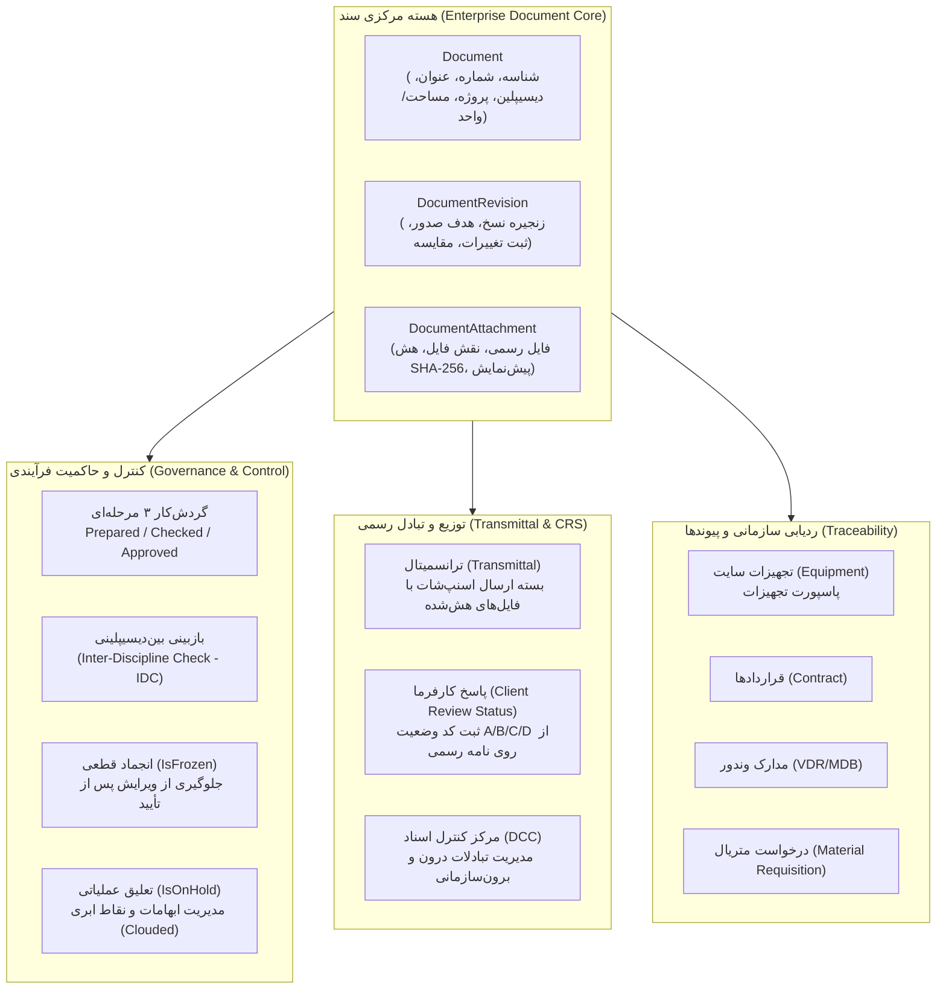

# 00 سیستم مدیریت اسناد و مدارک مهندسی (EDMS) — خلاصه مدیریتی و معماری کلان

**سامانه:** PEMS (Plant Engineering Management System)  
**ماژول:** مدیریت اسناد و مدارک مهندسی (Engineering Document Management System - EDMS)  
**مسیر مستندات:** `docs/engineering-documents/`  
**تاریخ بازبینی:** نوامبر ۲۰۲۶  

---

## ۱. معرفی و هدف ماژول

ماژول مدارک مهندسی (EDMS) در سامانه PEMS، هسته مرکزی مدیریت، گردش‌کار، اعتبارسنجی، کنترل نسخه، توزیع رسمی و بایگانی کلیه مدارک، نقشه‌ها، مشخصات فنی و دیتاشیت‌های پروژه‌های مهندسی، تدارکات، ساخت و بهره‌برداری (EPC/O&M) است.

این ماژول فراتر از یک مخزن ذخیره‌سازی فایل (File Storage)، به عنوان یک **محیط داده مشترک مهندسی (Common Data Environment - CDE)** مطابق با الزامات استانداردهای **ISO 19650** و **ISO 9001** عمل می‌کند و تضمین می‌نماید که کلیه تصمیمات، تغییرات و تأییدیه‌ها دارای زنجیره کامل ممیزی (Audit Trail) و مسئولیت‌پذیری حقوقی باشند.

---

## ۲. قابلیت‌های کلیدی پیاده‌سازی‌شده در هسته سامانه

### ۱. معماری وراثت پایگاه داده (Table-Per-Type):
* موجودیت پایه `Document` شامل تمام فیلدهای مشترک و قابل جستجو در سراسر سازمان.
* نوع تخصصی `EngineeringDocument` شامل اطلاعات تخصصی مهندسی، امضاکنندگان و ارتباطات فنی.
* امکان گزارش‌گیری واحد روی تمامی اسناد سازمان اعم از مهندسی، مدارک خرید (VDR)، مکاتبات و قراردادها.

### ۲. گردش‌کار مهندسی منطبق بر استاندارد ISO 9001:
* مدل سه‌امضایی رسمی: **تهیه‌کننده (Prepared By)** $\rightarrow$ **کنترل‌کننده (Checked By)** $\rightarrow$ **تأییدکننده (Approved By)**.
* جداسازی دقیق وظایف (Separation of Duties - SoD) و مسدودسازی ساختاری خود-تأییدی (Self-Approval Prevention).
* بازبینی موازی چندرشته‌ای (**IDC**) با ثبت مستقل و دائمی نظرات هر دیسیپلین قبل از تصمیم‌گیری نهایی.

### ۳. ترانسمیتال هوشمند و تغییرناپذیر (Immutable Transmittal Snapshots):
* ذخیره اسنپ‌شات غیرقابل تغییر از شماره رویژن، فایل و مقدار هش **SHA-256** در لحظه صدور ترانسمیتال.
* محاسبه دقیق مهلت پاسخ با استفاده از تقویم روزهای کاری (`WorkingDayCalculator`).
* ثبت تاییدیه دریافت و پاسخ به تفکیک گیرندگان.

### ۴. یکپارچگی چندبعدی با دارایی‌های فیزیکی:
* اتصال مستقیم هر نقشه یا سند به شناسنامه تجهیزات (`Equipment`)، قراردادها (`Contract`)، بسته‌های خرید (`MaterialRequisition`) و مدارک سازنده (`Vendor`).

---

## ۳. فهرست اسناد تکمیلی این مجموعه

| شماره سند | عنوان سند | موضوع و محتوا |
|---|---|---|
| **01** | [01-domain-model-and-architecture.md](file:///d:/PEMS/03-SOURCE/PEMS/docs/engineering-documents/01-domain-model-and-architecture.md) | ساختار کلاس‌ها، روابط EF Core، کلیدهای خارجی و نگاشت دیتابیس |
| **02** | [02-lifecycle-and-workflow-engine.md](file:///d:/PEMS/03-SOURCE/PEMS/docs/engineering-documents/02-lifecycle-and-workflow-engine.md) | چرخه حیات کامل سند، مراحل گردش‌کار، ماتریس IDC، انجماد و تعلیق |
| **03** | [03-transmittal-and-distribution-system.md](file:///d:/PEMS/03-SOURCE/PEMS/docs/engineering-documents/03-transmittal-and-distribution-system.md) | سیستم ترانسمیتال رسمی، فرآیند صدور، کنترل یکپارچگی فایل با هش SHA-256 |
| **04** | [04-standards-compliance-and-gap-matrix.md](file:///d:/PEMS/03-SOURCE/PEMS/docs/engineering-documents/04-standards-compliance-and-gap-matrix.md) | بررسی تطبیقی با ISO 19650, ISO 15489, DIN 6789, IEC 82045 و ماتریس شکاف |
| **05** | [05-mdr-vdr-and-handover-packages.md](file:///d:/PEMS/03-SOURCE/PEMS/docs/engineering-documents/05-mdr-vdr-and-handover-packages.md) | فهرست مدارک پروژه (MDR)، مدارک وندور (VDR)، کتابچه اطلاعات سازنده (MDB) و پکیج تحویل |
| **06** | [06-ai-intelligence-and-search.md](file:///d:/PEMS/03-SOURCE/PEMS/docs/engineering-documents/06-ai-intelligence-and-search.md) | پردازش هوشمند اسناد، مقایسه تفاوت نسخه‌ها، موتور جستجو و امنیت دسترسی |
