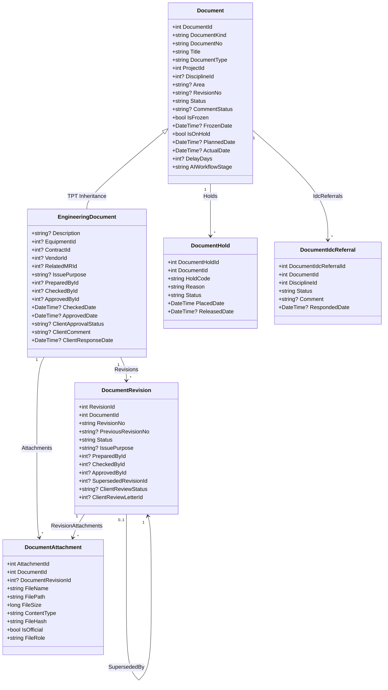

# 01 معماری مدل داده و دامنه (Domain Model & Architecture)

**سامانه:** PEMS — بخش مدارک مهندسی (EDMS)  
**معماری:** Clean Architecture + EF Core Table-Per-Type (TPT) Inheritance  

---

## ۱. الگوی وراثت پایگاه داده (Table-Per-Type)

در طراحی معماری PEMS، تمامی اسناد سازمان (مهندسی، وندور، مکاتبات، قراردادها، نگهداری) در هسته مرکزی از کلاس پایه `Document` ارث‌بری می‌کنند. در سطح دیتابیس، استراتژی **Table-Per-Type (TPT)** پیاده‌سازی شده است:
* جدول `Documents`: شامل ستون‌های هویتی، کد پروژه، دیسیپلین، شماره مدرک، عنوان، وضعیت، پرچم‌های انجماد و تعلیق.
* جدول `EngineeringDocuments`: صرفاً شامل کلید اصلی مشترک (`DocumentId`) و فیلدهای اختصاصی مهندسی (شرح تفصیلی، کلیدهای ارتباطی با تجهیزات، شماره قرارداد، هدف صدور و امضاکنندگان).

---

## ۲. توصیف تفصیلی موجودیت‌های اصلی

### ۲.۱ موجودیت `EngineeringDocument`
نماینده موجودیت سند مهندسی در سطح دیتابیس است.
* **کلیدهای خارجی ردیابی (Traceability FKs):**
  * `EquipmentId` (FK $\rightarrow$ `Equipment`): پیوند نقشه یا مدارک به تگ تجهیز در سایت (P&ID، دیتاشیت پمپ، نقشه‌های فونداسیون).
  * `ContractId` (FK $\rightarrow$ `Contract`): ارتباط با بسته پیمان یا قرارداد پیمانکار/مهندس مشاور.
  * `VendorId` (FK $\rightarrow$ `Vendor`): ارجاع به سازنده یا تامین‌کننده کالا/سند.
  * `RelatedMRId` (FK $\rightarrow$ `MaterialRequisition`): پیوند به درخواست متریال مهندسی.
* **امضاکنندگان قانونی (Digital Authority):**
  * `PreparedById`, `CheckedById`, `ApprovedById` (FK $\rightarrow$ `Employee`): نگه‌داری هویت پرسنلی که نقش‌های تهیه، بررسی و تایید را طبق الزامات سیستم مدیریت کیفیت ایفا کرده‌اند.

---

### ۲.۲ موجودیت `DocumentRevision` (مدیریت نسخه‌ها)
هر مدرک مهندسی در طول عمر خود بارها ویرایش و بازنگری می‌شود. این موجودیت تضمین‌کننده زنجیره تغییرناپذیر تاریخچه است:
* `RevisionNo`: کد رشته‌ای نسخه (مثل `00`, `01`, `A`, `B`, `0`, `1`).
* `SupersededRevisionId` (Self-Referencing FK): اشاره به شناسه رکوردی که این نسخه جایگزین آن شده است. این پیوند یک لیست پیوندی یک‌طرفه در دیتابیس ایجاد می‌کند تا تمام نسخه‌ها به صورت تاریخی قابل بازیابی باشند.
* `IssuePurpose`: هدف از صدور این نسخه خاص (مثلا IFA برای تایید، IFC برای ساخت، IFR برای بازبینی).
* `ClientReviewStatus`: وضعیت پاسخ کارفرما روی این نسخه مشخص (A/B/C/D) که متصل به شماره نامه وارده رسمی کارفرما (`ClientReviewLetterId`) است.

---

### ۲.۳ موجودیت `DocumentAttachment` و یکپارچگی فایل‌ها
هر فایل بارگذاری‌شده به عنوان پیوست یک سند یا یک رویژن خاص ثبت می‌گردد:
* `DocumentRevisionId`: اتصال مستقیم فایل به رویژن مشخص (جهت جلوگیری از ابهام در انتساب فایل به نسخه‌های مختلف).
* `IsOfficial`: مشخص‌کننده فایل رسمی و نهایی رویژن (Native DWG یا Signed PDF).
* `FileRole`: نقش فایل شامل `NativeDrawing`, `PDFDeliverable`, `CommentResolutionSheet`, `CalculationSheet`, `Attachment`.
* `FileHash`: رشته هش **SHA-256** که در زمان آپلود از جریان داده فایل محاسبه و ثبت می‌شود تا از هرگونه دستکاری فیزیکی فایل روی دیسک جلوگیری شود.

---

### ۲.۴ مدیریت وضعیت‌های معلق و بازبینی موازی
* **`DocumentHold`:** ثبت سوابق موانع فنی در سند (مثل ابهام در قطر لوله یا نامشخص بودن داده‌های سازنده). تا زمانی که یک ردیف Open در جدول Hold وجود داشته باشد، ستون محاسباتی `IsOnHold` روی سند فعال بوده و گردش‌کار صدور نهایی قفل می‌ماند.
* **`DocumentIdcReferral`:** ثبت ارجاع مدرک به دیسیپلین‌های همکار جهت بازبینی موازی. وضعیت هر دیسیپلین (`Approve`, `Comment`, `Reject`) مستقل از وضعیت کلی سند در این جدول ماندگار می‌شود.
