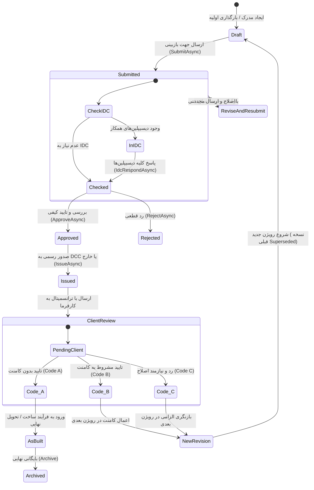
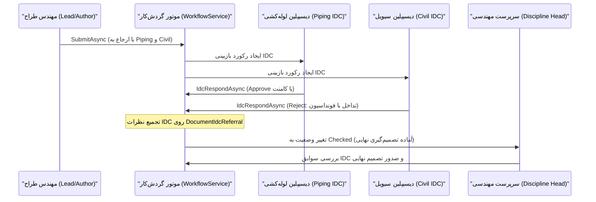

# 02 چرخه حیات و موتور گردش‌کار مدارک مهندسی (Lifecycle & Workflow Engine)

**سامانه:** PEMS — بخش مدارک مهندسی (EDMS)  
**استاندارد مرجع:** ISO 9001:2026 (کنترل اطلاعات مستند)، ISO 19650 (مراحل تحویل CDE)، و اصول تفکیک وظایف (SoD)

---

## ۱. دیاگرام ماشین وضعیت چرخه حیات مدرک مهندسی

---

## ۲. مراحل و اقدامات گردش‌کار در `IDocumentWorkflowService`

### ۲.۱ مرحله ۱: ثبت پیش‌نویس و ارسال (`SubmitAsync`)
* مدرک توسط مهندس طراح (Prepared By) ایجاد شده و فایل‌های محاسباتی/نقشه پیوست می‌گردد.
* هنگام فراخوانی `SubmitAsync`، طراح لیست دیسیپلین‌هایی که باید در بازبینی مدرک مشارکت داشته باشند را انتخاب می‌کند (`idcDisciplineIds`).
* در صورتی که دیسیپلین دیگری انتخاب نشود، وضعیت مستقیماً به `Checked` یا آماده تایید تغییر می‌یابد.

---

### ۲.۲ مرحله ۲: بازبینی موازی چندرشته‌ای (Inter-Discipline Check - IDC)
* **فلسفه مهندسی IDC:** در طراحی پروژه‌های صنعتی (نفت، گاز، پتروشیمی، نیروگاهی)، نقشه‌های یک دیسیپلین (مثلاً مکانیک یا لوله‌کشی) بر دیسیپلین‌های دیگر (سیویل، برق، ابزاردقیق، ایمنی و فرآیند) اثر مستقیم دارد.
* **مکانیزم عملکرد در PEMS:**
  1. به ازای هر دیسیپلین انتخاب‌شده، یک رکورد مستقل در جدول `DocumentIdcReferral` ایجاد می‌شود.
  2. مهندسین مجاز هر دیسیپلین از طریق کارتابل خود اقدام به ثبت نظر (`Approve`, `Comment`, `Reject`) می‌کنند.
  3. نظر منفی یک دیسیپلین به تنهایی منجر به ابطال سند نمی‌شود، بلکه سیستم سوابق تمامی نظرات را حفظ کرده و پس از اتمام پاسخ‌ها، وضعیت کلی را به مرحله تصمیم‌گیری سرپرست دیسیپلین هدایت می‌کند.

---

### ۲.۳ مرحله ۳: بررسی و تایید سه‌امضایی (Prepared / Checked / Approved)
مطابق با الزامات ایزو ۹۰۰۱، هر سند مهندسی معتبر باید دارای سه سطح مسئولیت شفاف باشد:
1. **تهیه‌کننده (Prepared By):** شخصی که طراحی یا محاسبه را انجام داده است (ثبت در زمان ساخت).
2. **بررسی‌کننده (Checked By):** کارشناس ارشد یا Lead دیسیپلین که صحت فنی را کنترل می‌کند (`CheckAsync`).
3. **تأییدکننده (Approved By):** رئیس بخش مهندسی یا Project Engineering Manager که مسئولیت نهایی را بر عهده می‌گیرد (`ApproveAsync`).

> [!IMPORTANT]
> **قانون تفکیک وظایف (Separation of Duties - SoD):**
> سیستم به صورت خودکار مانع از این می‌شود که شخصی که مدرک را ایجاد یا ویرایش کرده است (`PreparedById`) بتواند خودش آن را تأیید نماید (`ApprovedById`). همچنین نقش بررسی‌کننده و تأییدکننده باید از افراد مجزا باشند. در صورت تلاش برای خود-تأییدی، سرویس امنیتی خطای عدم مجوز صادر می‌کند.

---

### ۲.۴ مرحله ۴: صدور رسمی سند (`IssueAsync`)
پس از تأیید نهایی، سند توسط واحد کنترل مدارک مهندسی (DCC) صادر می‌شود:
* **واحدهای تحویل‌گیرنده (`deliveryUnitType`):**
  * `InternalDCC`: توزیع در آرشیو مرکزی مهندسی.
  * `InternalDepartment`: توزیع برای کارگاه ساخت یا تدارکات.
  * `External`: توزیع به نهادهای بیرونی (کارفرما یا پیمانکار اصلی). در این حالت، ثبت شماره و مشخصات نامه رسمی ارسالی (`letterNumber`) در ماژول مکاتبات اجباری است.
* **کدهای استاندارد هدف صدور (`issuePurpose`):**
  * `IFA`: جهت تایید (Issue For Approval)
  * `IFR`: جهت بازبینی (Issue For Review)
  * `IFC`: جهت ساخت و اجرا (Issue For Construction)
  * `IFI`: جهت اطلاع (Issue For Information)

---

### ۲.۵ مرحله ۵: ثبت بازخورد کارفرما (Client Review Status - CRS)
پاسخ کارفرما به مدارک ارسالی در قالب نامه‌های رسمی دریافت می‌شود (`RecordClientResponseAsync`):
* سیستم کاربر را ملزم می‌کند که بازخورد را به یک **نامه وارده واقعی (`IncomingLetter`)** در ماژول مکاتبات متصل کند.
* **کدهای استاندارد پاسخ کارفرما:**
  * **Code A (Approved):** تایید کامل بدون تغییر. مدرک معتبر برای اجراست.
  * **Code B (Approved with Comments):** تایید مشروط به اعمال کامنت‌ها در رویژن بعدی. عملیات ساخت مشروط به رعایت کامنت‌ها می‌تواند آغاز شود.
  * **Code C (Revise and Resubmit):** رد مدرک. نقشه باید اصلاح و رویژن جدید صادر گردد.
  * **Code D (Rejected):** رد کامل به دلیل عدم تطابق بنیادین با مشخصات فنی.

---

## ۳. مکانیزم‌های کنترلی خاص: Freeze و Hold

### ۳.۱ انجماد مدرک (`IsFrozen` و `DocumentFrozenException`)
* اسنادی که به تایید نهایی کارفرما یا وضعیت IFC می‌رسند، برای جلوگیری از هرگونه تغییر ناخواسته فریز می‌شوند.
* در سطح مخزن داده (`EngineeringDocumentRepository`)، متد `UpdateAsync` در صورت فریز بودن سند، بلافاصله استثنای `DocumentFrozenException` صادر کرده و جلوی تراکنش را می‌گیرد. رفع فریز صرفاً با دسترسی خاص و ثبت دلیل رسمی (`UnfreezeReason`) امکان‌پذیر است.

### ۳.۲ تعلیق عملیاتی مدرک (`DocumentHold`)
* در صورتی که بخشی از نقشه دارای ابهام باشد (مثلاً منتظر رسیدن مشخصات فلنج از سوی سازنده خارجی)، یک ردیف در جدول `DocumentHold` درج می‌شود.
* وجود هلد مانع از صدور رسمی سند (`IssueAsync`) و درج آن در ترانسمیتال‌های اجرایی می‌شود.
