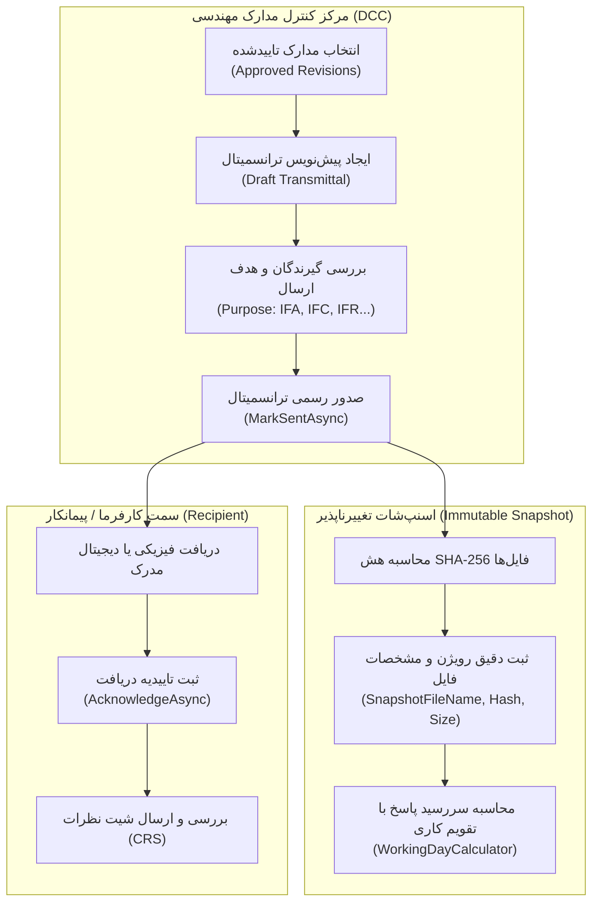

# 03 سیستم ترانسمیتال و مکانیزم توزیع اسناد (Transmittal & Distribution)

**سامانه:** PEMS — بخش مدارک مهندسی (EDMS)  
**ماژول:** ترانسمیتال و کنترل توزیع اسناد (Transmittal Subsystem)  
**استاندارد مرجع:** الزامات اثبات‌پذیری حقوقی تبادلات اسناد مهندسی (Non-Repudiation in Engineering Deliverables)

---

## ۱. جایگاه ترانسمیتال در پروژه‌های EPC

ترانسمیتال (Transmittal) بسته سند رسمی است که توسط مرکز کنترل مدارک (DCC) برای ارسال نقشه‌ها، محاسبات و مدارک مهندسی به یک گیرنده بیرونی (کارفرما، مشاور، پیمانکار اجرایی یا وندور) صادر می‌شود.

در قراردادهای بین‌المللی نفت، گاز و پتروشیمی (مثل FIDIC یا قراردادهای EPC/EPCC)، ترانسمیتال سند اثبات قانونی ارسال و سررسید مهلت بررسی است و در حل دعاوی حقوقی (Claims) مبنی بر تاخیرات پروژه مبنای عمل قرار می‌گیرد.

---

## ۲. معماری اسنپ‌شات تغییرناپذیر (Immutable Historical Snapshots)

یکی از مخاطرات عمده در سیستم‌های سنتی EDMS این است که اگر پس از ارسال ترانسمیتال، فایل یک رویژن در دیتابیس ویرایش یا بازنویسی شود، تاریخچه سند ارسالی در ترانسمیتال قبلی دچار اعوجاج می‌گردد. در PEMS طبق یافته ممیزی **G-21** این چالش با الگوی **اسنپ‌شات قطعی** حل شده است:

### ۲.۱ فیلدهای اسنپ‌شات در موجودیت `TransmittalItem`:
* `DocumentRevisionId` (FK): اتصال مستقیم به رکورد دائمی رویژن.
* `DocumentAttachmentId` (FK): شناسه فایل پیوست رسمی در لحظه ارسال.
* `SnapshotFileName`: کپی متنی از نام دقیق فایل ارسال‌شده.
* `SnapshotFileHash`: رشته کد هش **SHA-256** از بایت‌های فایل در لحظه ارسال.
* `SnapshotFileSize`: حجم دقیق فایل بر حسب بایت.

> [!NOTE]
> حتی اگر (از نظر تئوری) رکورد پیوست فایل بعداً در پایگاه داده تغییر کند یا حذف شود، داده‌های ثبتی جدول `TransmittalItem` دست‌نخورده باقی می‌مانند و نسخه ارسالی اولیه قابل اثبات و بازسازی کامل در محاکم فنی و داوری خواهد بود.

---

## ۳. چرخه حیات وضعیت ترانسمیتال و مدل Reissue

### ۳.۱ وضعیت‌های ترانسمیتال (`Status`):
1. **`Draft` (پیش‌نویس):** ویرایش اقلام، گیرندگان و توضیحات آزاد است.
2. **`Sent` (صادرشده):** پس از صدور رسمی، هیچ اکشن ویرایشی روی رکورد وجود ندارد. رکورد کاملاً قفل (Read-Only) می‌شود.
3. **`Acknowledged` (تایید دریافت):** حداقل یکی از گیرندگان دریافت بسته را تایید کرده است.
4. **`Cancelled` (باطل‌شده):** در صورت بروز اشتباه در مخاطب یا محتوا، ترانسمیتال با ذکر دلیل رسمی باطل می‌شود.

### ۳.۲ فرآیند بازصدور (Reissue):
چنانچه نیاز به اصلاح یک ترانسمیتال ارسال‌شده باشد، ویرایش درجا مجاز نیست؛ بلکه ترانسمیتال قبلی `Cancelled` شده و توسط متد `ReissueAsync` یک رکورد کاملاً جدید با شماره و تاریخ تازه تولید می‌شود و شماره ترانسمیتال قبلی در سوابق آن درج می‌گردد.

---

## ۴. مدیریت تاییدیه دریافت به تفکیک گیرندگان (Finding G-22)

در پروژه‌های بزرگ، یک ترانسمیتال ممکن است به چند گیرنده مجزا (مثلاً کارفرما، مشاور مهندسی و بازرس شخص ثالث TPI) ارسال گردد. در موجودیت `TransmittalRecipient`:
* `AcknowledgedAt`: تاریخ و زمان دقیق تایید دریافت توسط گیرنده.
* `AcknowledgedById`: کاربری که دریافت بسته را تایید کرده است.
* `AcknowledgementNote`: یادداشت یا شماره ثبت رسید در دبیرخانه طرف مقابل.
* `AcknowledgeAsync`: متد اختصاصی سرویس جهت ثبت تاییدیه دریافت هر گیرنده به صورت مستقل.

---

## ۵. محاسبه هوشمند مهلت پاسخ بر مبنای تقویم روزهای کاری

طبق بند ۵.۲ مشخصات فرآیندی ترانسمیتال:
* چنانچه فیلد `ResponseRequired` برابر `true` باشد (مثلاً در ترانسمیتال‌های IFA یا IFR)، تعیین مهلت پاسخ نباید به صورت تقویمی ساده (Naive Calendar Days) انجام شود؛ زیرا پنجره‌های تعطیلات رسمی و آخر هفته‌ها زمان بررسی واقعی را کوتاه می‌کنند.
* سیستم با بهره‌گیری از سرویس `WorkingDayCalculator`، تعداد روزهای کاری مجاز را با در نظر گرفتن تقویم کاری پروژه و تعطیلات رسمی محاسبه نموده و ستون `ResponseDueDate` را به‌طور دقیق مقداردهی می‌کند.
