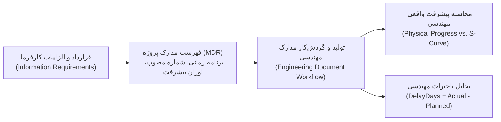
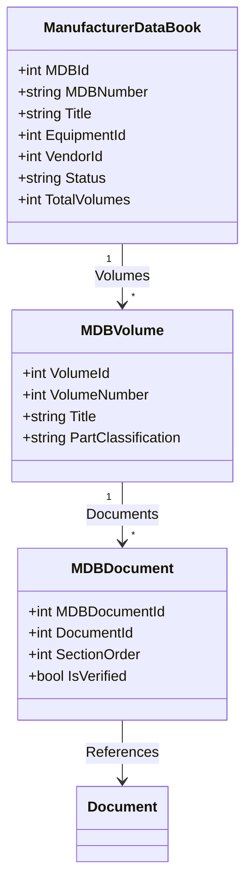

# 05 فهرست مدارک مهندسی (MDR)، مدارک سازندگان (VDR) و تحویل نهایی (Handover)

**سامانه:** PEMS — بخش مدارک مهندسی (EDMS)  
**حوزه‌ها:** فهرست اسناد اصلی (MDR)، کنترل اسناد وندورها (VDR)، کتابچه اطلاعات سازنده (MDB) و تحویل پروژه به بهره‌برداری  

---

## ۱. فهرست اسناد اصلی پروژه (Master Document Register - MDR)

در پروژه‌های صنعتی و EPC، سند MDR شناسنامه کامل کلیه خروجی‌های مهندسی مورد توافق میان پیمانکار و کارفرما است. این سند تعیین می‌کند چه مدارکی، توسط چه دیسیپلینی، در چه تاریخی و با چه اوزانی باید تولید و تحویل گردند.

### ۱.۱ قابلیت‌های MDR در PEMS:
* **ستون‌های برنامه‌ریزی زمانی (`PlannedDate` و `ActualDate`):** هر رکورد سند مهندسی دارای تاریخ تعهد برنامه زمانی است.
* **محاسبه هوشمند تاخیرات (`DelayDays`):** ویژگی محاسباتی که اختلاف تاریخ جاری با تاریخ مصوب تحویل را بر حسب روز محاسبه کرده و هشدارهای سررسید را روی داشبورد مهندسی فعال می‌نماید.
* **ایمپورت گروهی (`MDRImportService`):** ایمپورت اکسل لیست مدارک مهندسی کارفرما یا مشاور با نگاشت خودکار فیلدهای پروژه، دیسیپلین، مساحت و نوع مدرک.

---

## ۲. کنترل اسناد وندورها و سازندگان تجهیزات (Vendor Document Register - VDR)

اسناد سازندگان تجهیزات (نقشه‌های ساخت، دیتاشیت پمپ‌ها، دفترچه‌های نصب و راه‌اندازی، نتایج تست هیدرواستاتیک و تست‌های عملکردی FAT) چرخه‌ای متفاوت از مدارک داخلی مهندسی دارند.

### ۲.۱ تفاوت‌های کلیدی مدارک مهندسی و مدارک وندور:
| مشخصه | مدرک مهندسی (Engineering Document) | مدرک سازنده (VDR Item) |
|---|---|---|
| **مرجع تولید** | مهندسین مشاور یا تیم طراحی داخلی EPC | سازنده تجهیز یا پکیج (Vendor / Manufacturer) |
| **هسته دامنه** | کلاس `EngineeringDocument` | کلاس `VDRItem` (وارث از Document) |
| **چرخه بازبینی** | گردش‌کار ۳ امضایی و IDC داخلی | سابمیشن‌های دوره‌ای (`VDRSubmission`) با مهلت SLA |
| **کدهای بازخورد** | کدهای تایید داخلی یا کدهای کارفرما | کدهای مهندسی ۴ گانه سازندگان (Code 1, 2, 3, 4) |
| **پیوند تجهیزات** | ارجاع عمومی به سیستم یا خط فرآیندی | پیوند انحصاری به سفارش خرید (`PO`) و تگ تجهیز |

### ۲.۲ ردیابی چرخه بازبینی اسناد وندور (`VDRSubmission`):
* هر نوبت ارسال سازنده به عنوان یک سابمیشن جدید ثبت می‌گردد.
* سیستم دارای محاسبه‌گر مهلت بررسی بر اساس روزهای کاری قرارداد (مثلاً ۱۰ روز کاری) است.
* در صورت عبور از مهلت بدون ثبت پاسخ، وضعیت تسریع‌بخشی (Expediting) فعال می‌شود.

---

## ۳. کتابچه اطلاعات نهایی سازنده (Manufacturer Data Book - MDB)

برای هر تجهیز سنگین یا پکیج صنعتی (مانند کمپرسورها، بویلرها، راکتورها، ترانسفورماتورها)، کلیه سوابق ساخت و آزمون در قالب کتابچه‌های MDB صحافی و تدوین می‌گردند:

### ۳.۱ طبقه‌بندی استاندارد بخش‌های کتابچه (Parts A / B / C):
* **بخش A (Design & Engineering):** نقشه‌های کلی (GA Drawings)، دیتاشیت‌ها، نقشه‌های قطعات یدکی و نقشه‌های مدارات الکتریکی.
* **بخش B (Manufacturing & Materials):** سرتیفیکیت متریال (MTC طبق EN 10204 3.1/3.2)، تاییدیه‌های جوشکاری (WPS/PQR/WPQ)، و نتایج آزمون‌های غیرمخرب (NDT Reports).
* **بخش C (Testing, Preservation & Commissioning):** پروتکل‌های تست کارخانه‌ای (FAT)، دستورالعمل‌های نگهداری در انبار، و منوال‌های نصب و نگهداری (O&M Manuals).

---

## ۴. بسته تحویل نهایی به بهره‌برداری (Project Handover Package)

در نقطه اتمام فاز ساخت و راه‌اندازی (Commissioning)، کلیه اطلاعات باید از قالب پروژه به قالب بهره‌برداری کارخانه (Operations & Maintenance) تحویل گردند:
1. **نقشه‌های چون‌ساخت (As-Built Drawings):** انتقال آخرین رویژن نهایی‌شده نقشه‌ها به ماژول مدیریت دارایی‌ها (Asset Management).
2. **اتصال به شناسنامه تجهیز (Equipment Passport):** هر تگ تجهیز در نرم‌افزار CMMS مستقیماً به لینک اسناد As-Built، منوال‌های O&M و کتابچه‌های MDB خود متصل می‌گردد تا در زمان صدور دستورکار تعمیراتی (Work Order)، تکنسین با یک کلیک به نقشه‌های انفجاری و کاتالوگ قطعات یدکی دسترسی داشته باشد.
