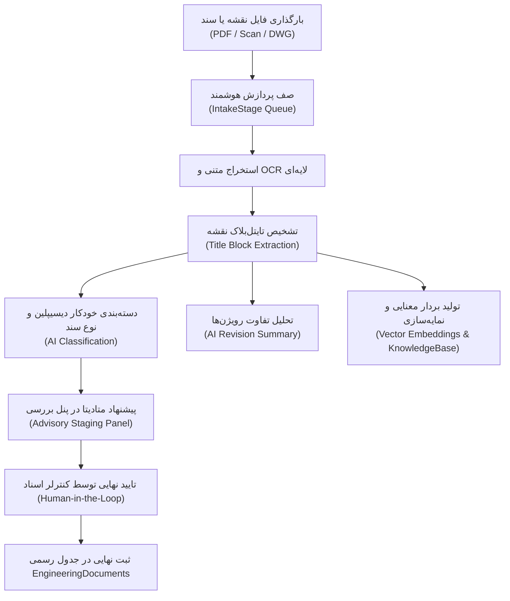

# 06 هوش مصنوعی اسناد، امنیت دانلود و حاکمیت دسترسی (AI Intelligence & Security)

**سامانه:** PEMS — بخش مدارک مهندسی (EDMS)  
**ماژول‌ها:** هوش مصنوعی اسناد (Document Intelligence)، سرویس دانش (Knowledge Base)، کنترل دسترسی و امنیت فایل‌ها  

---

## ۱. پردازش هوشمند اسناد مهندسی (AI Document Intelligence)

سامانه PEMS مجهز به پایپ‌لاین پیشرفته هوش مصنوعی جهت پردازش خودکار نقشه‌ها و فایل‌های اسناد است:

### ۱.۱ استخراج خودکار تایتل‌بلاک (Title Block Parsing):
* سیستم از طریق الگوریتم‌های بینایی ماشین و OCR، کادر مشخصات فنی نقشه (Title Block) را اسکن کرده و مقادیر زیر را به عنوان متادیتا پیشنهاد می‌دهد:
  * شماره مدرک کارفرما و پیمانکار (Client/Contractor Doc No)
  * عنوان نقشه و مشخصات شیت (Title & Sheet Number)
  * کد رویژن جاری و تاریخ ترسیم
  * نام طراح، چک‌کننده و مدیر پروژه
  * کدهای دیسیپلین و محدوده سایت (Area/Unit)

### ۱.۲ خلاصه هوشمند تغییرات نسخه (`AIRevisionSummary`):
* با آپلود یک رویژن جدید، موتور هوشمند متن و متادیتای رویژن جدید را با رویژن قبلی منسوخ‌شده (`SupersededRevision`) مقایسه کرده و تغییرات کلیدی در مشخصات، جداول یا نوت‌های مهندسی را به صورت یک پاراگراف شفاف در فیلد `AIRevisionSummary` خلاصه می‌کند.

---

## ۲. مرز قطعی حاکمیت داده میان هوش مصنوعی و اسناد رسمی (Finding G-26)

یکی از مخاطرات بنیادین سامانه‌های هوشمند، امکان مداخله غیرقابل ردگیری هوش مصنوعی در داده‌های رسمی و دارای بار حقوقی است. در PEMS طبق یافته ممیزی **G-26** مرز قطعی زیر پیاده‌سازی و تثبیت شده است:

> [!CAUTION]
> **اصل استقلال مطلق داده (Strict Authority Boundary):**
> نتایج خروجی هوش مصنوعی صرفاً «پیشنهادی و مشورتی» (Advisory) هستند. وضعیت پایپ‌لاین هوش مصنوعی (`AIWorkflowStage`) کاملاً مستقل از وضعیت حقوقی مدرک مهندسی (`Document.Status`) است. هیچ سرویس هوش مصنوعی حق نوشتن مستقیم روی وضعیت‌های رسمی (مانند `Approved` یا `IsFrozen`) را ندارد و ارتقای سند به مراحل رسمی صرفاً از طریق گردش‌کار انسانی و امضای دیجیتال پرسنل مجاز صورت می‌پذیرد.

---

## ۳. امنیت دانلود و یکپارچگی فایل‌ها (File Security & Non-Enumeration)

برای حفاظت از محرمانگی نقشه‌ها و اسناد محرمانه صنعتی:
1. **دانلود صرفاً با شناسه پیوست (`AttachmentId`):**
   * هیچ مسیر فیزیکی یا نام فایلی روی وب اکسپوز نمی‌شود. درخواست دانلود صرفاً شناسه عددی رندوم را به متد `FilesController.Download` ارسال می‌کند.
2. **بررسی مجوز پروژه و دیسیپلین (Project Scope Authorization):**
   * در زمان درخواست دانلود، سیستم عضویت کاربر در پروژه، دیسیپلین و سطح محرمانگی سند را اعتبارسنجی می‌کند.
3. **پاسخ 403 Forbidden به جای 404 Not Found:**
   * در صورت تلاش برای دانلود فایلی که کاربر به آن دسترسی ندارد، جهت جلوگیری از حملات شمارش شناسه‌ها (ID Enumeration Attacks)، خطای دسترسی غیرمجاز صادر می‌شود.
4. **جریان دانلود بافرشده و هش:**
   * فایل‌ها به صورت استریم بافرشده ارسال شده و هش ذخیره‌شده فایل در بدنه هدر اعتبارسنجی قرار می‌گیرد.

---

## ۴. کنترل دسترسی مبتنی بر نقش و ویژگی (RBAC & ABAC)

مدیریت اسناد مهندسی توسط سرویس `AccessControlService` و قوانین سیاست‌های تفکیک وظایف (`SoDPolicy`) محافظت می‌شود:

| نقش کاربری | ایجاد پیش‌نویس | بررسی فنی (Check) | بازبینی IDC | تایید نهایی (Approve) | صدور به ترانسمیتال |
|---|:---:|:---:|:---:|:---:|:---:|
| **مهندس طراح (Lead/Author)** | ✅ مجاز | ❌ ممنوع | ❌ ممنوع | ❌ ممنوع | ❌ ممنوع |
| **کارشناس ارشد بررسی‌کننده (Checker)** | ❌ ممنوع | ✅ مجاز | ❌ ممنوع | ❌ ممنوع | ❌ ممنوع |
| **دیسیپلین همکار (IDC Reviewer)** | ❌ ممنوع | ❌ ممنوع | ✅ مجاز | ❌ ممنوع | ❌ ممنوع |
| **رئیس بخش مهندسی (Discipline Head)** | ❌ ممنوع | ❌ ممنوع | ❌ ممنوع | ✅ مجاز (با رعایت SoD) | ❌ ممنوع |
| **مرکز کنترل مدارک (DCC Controller)** | ❌ ممنوع | ❌ ممنوع | ❌ ممنوع | ❌ ممنوع | ✅ مجاز |

> **قاعده ضد-تداخل SoD:** چنانچه رئیس بخش مهندسی، خود تهیه‌کننده یا ویرایش‌کننده یک نقشه باشد، سیستم اجازه تایید مدرک را به او نمی‌دهد و فرآیند تایید باید به مدیر بالادستی پروژه ارجاع داده شود.
