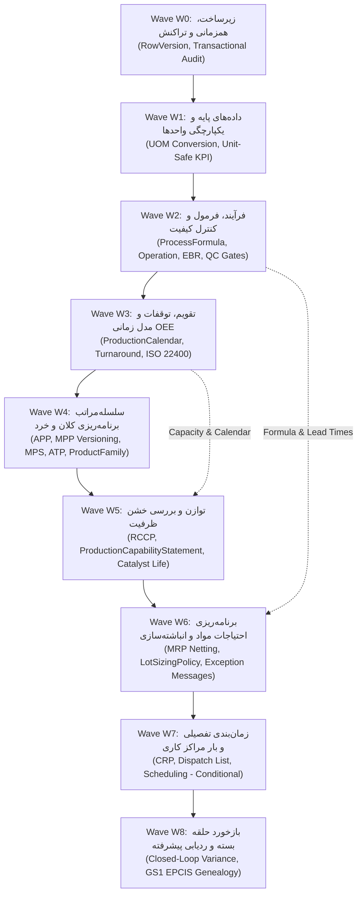

# 11 Revised Wave Map with Standards Integration (2026-11-18)

**Status:** PROPOSED & FULLY STRUCTURED  
**Basis:** Incorporates Decisions OD-01 through OD-29 and Requirements REQ-01 through REQ-46.  
**Standards Aligned:** ISA-88 (IEC 61512), ISO 22400-1/2, APICS ASCM CPIM (MRP II), ISA-95 (IEC 62264), GS1 EPCIS 2.0.

---

## 1. ماتریس تفصیلی امواج پیاده‌سازی (Waves W0 تا W8)

---

## 2. جدول مشخصات امواج کاری و خروجی‌های استاندارد

| موج (Wave) | محدوده و هدف عملیاتی | استانداردهای پوشش‌داده‌شده | نیازمندی‌ها | موجودیت‌های کلیدی افزوده | تست‌های پذیرش و اوراکل |
|---|---|---|---|---|---|
| **W0** | ایجاد قفل خوش‌بینانه و تراکنش واحد داده + ممیزی | اصول کنترل داخلی (COSO) | REQ-19, REQ-20 | `RowVersion` روی جداول پایه تولید و موجودی | `T-TX-01`, `T-CONC-01` |
| **W1** | ایمن‌سازی واحد سنجش و تبدیل فرمول‌ها | ISO 22400-2 (Unit Safety) | REQ-17, REQ-24, REQ-30 | `MaterialUOM.ConversionFactor`, `OperationsReportService` اصلاحی | `T-UOM-01`, `T-KPI-01`, `T-REC-01` |
| **W2** | فرمول ساخت، توالی عملیات و ثبت الکترونیکی دسته | ISA-88 / IEC 61512 (Recipe & EBR) | REQ-09 تا REQ-16, REQ-33, REQ-34, REQ-41 | `ProcessFormula`, `ProcessFormulaOperation`, `ProductionRunOperationLog`, `ProductionBatchGenealogy` | `T-FORM-01`, `T-FORM-02`, `T-ROUT-01`, `T-REL-01`, `T-QC-01`, `T-EBR-01` |
| **W3** | تقویم تولید، توقفات برنامه‌ریزی‌شده و OEE | ISO 22400-2 (Time Model & OEE) | REQ-12, REQ-22, REQ-31, REQ-32, REQ-45 | `ProductionCalendar`, `CalendarShift`, `CalendarEvent` (لینک به CMMS) | `T-CAL-01`, `T-TIME-01`, `T-RUN-01`, `T-OEE-01`, `T-TAR-01` |
| **W4** | برنامه‌ریزی کلان (APP) و خرد (MPS) با حصارهای زمانی | APICS ASCM + ISA-95 Level 4 | REQ-01 تا REQ-03, REQ-35, REQ-36, REQ-39 | `ProductFamily`, `ProductFamilyMember`, `PlanVersion` (حصارهای زمانی), `PlanItem` (ATP/PAB) | `T-PLAN-01`, `T-VER-01`, `T-MPS-01`, `T-ATP-01`, `T-DTF-01`, `T-FAM-01` |
| **W5** | توازن ظرفیت خشن (RCCP) و پایش عمر کاتالیست | ISA-95 Part 2 (Capability) | REQ-04, REQ-40, REQ-44 | `ProductionCapabilityStatement`, `ProcessRouteOperation.CycleCountLimit` | `T-RCCP-01`, `T-CAT-01` |
| **W6** | موتور MRP تولید، سیاست‌های انباشته‌سازی و هشدارها | APICS ASCM (MRP II Lot-Sizing) | REQ-05, REQ-37, REQ-38, REQ-46 | `LotSizingPolicy`, `MrpExceptionMessage`, سرشکن‌سازی محصولات فرعی (Co-products) | `T-MRP-01`, `T-MRP-02`, `T-LOT-01`, `T-EXC-01` |
| **W7** | ظرفیت تفصیلی (CRP) و زمان‌بندی عملیات | ISA-95 Part 4 (Job Order / Dispatch) | REQ-06, REQ-07, REQ-43 | مدل اعزام کارگاه و زمان‌بندی ماشین‌آلات (مشروط به تصمیم نهایی OD-07) | `T-CRP-01`, `T-PS-01` |
| **W8** | بازخورد حلقه بسته عملکرد و تبارشناسی چندسطحی | APICS Closed-Loop + GS1 EPCIS 2.0 | REQ-21, REQ-42 | سرویس مقایسه انحرافات برنامه با عملکرد واقعی، کلیدهای خارجی یکپارچه‌ساز | `T-TRC-02`, `T-IMP-01`, `T-CLO-01` |

---

## 3. پیش‌نیازها و گیت‌های ورود و خروج هر مرحله

1. **گیت ورود به Wave W0:** تأیید نهایی مستندات تکمیلی معمارانه و تخصیص ردیف‌های کاری در اسپرینت.
2. **گیت ورود به Wave W2:** دستیابی به نتایج سبز در تست‌های همزمانی پایگاه‌داده و اعتبارسنجی تبدیل واحدها (W0 و W1).
3. **قانون تغییرناپذیری تست‌های رگرسیون:** اجرای ۱۶۸ تست موجود قبل و بعد از ادغام هر Wave؛ هیچ شکستی در تست‌های موجود قابل چشم‌پوشی نیست.
4. **تست‌های اوراکل (Oracle Tests):** محاسبات OEE، ATP، ظرفیت RCCP و سرشکن MRP باید پیش از پیاده‌سازی توسط محاسبات دستی مقایسه شده و تست پذیرش تایید گردد.
