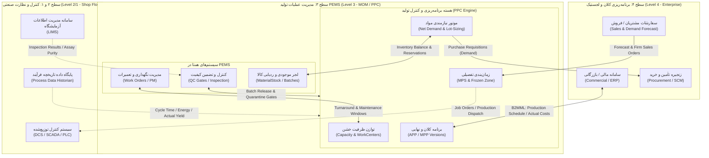

# 13 Integration and Data Exchange Architecture (B2MML & ISA-95)

**Status:** ARCHITECTURAL SPECIFICATION & STUDY  
**Target:** PEMS PPC Integration with Enterprise (Level 4) and Shop Floor (Level 2/1)  
**Standards:** ISA-95 (IEC 62264 Parts 1, 2, 4, 5), B2MML (Business to Manufacturing Markup Language), Open Manufacturing Platform (OMP)

---

## 1. نقشه یکپارچگی افقی و عمودی (Vertical & Horizontal Integration)



---

## 2. تبادل پیام طبق استاندارد B2MML (Business to Manufacturing Markup Language)

استاندارد B2MML نگاشت پیاده‌سازی‌شده XML/JSON از مدل‌های داده ISA-95 است. برای حفظ ماهیت Offline و مستقل سامانه PEMS، این نگاشت‌ها در قالب الگوهای Data Transfer Object (DTO) با فرمت ساختاریافته استاندارد تدوین می‌شوند.

### 2.1 الگوی پیام درخواست تولید (Production Schedule / Request)
این پیام از سیستم برنامه‌ریزی کلان به ماژول اجرای تولید صادر می‌گردد:

```json
{
  "$schema": "https://www.mesa.org/xml/B2MML-V0600",
  "Header": {
    "MessageID": "MSG-B2MML-REQ-20270115-001",
    "Timestamp": "2027-01-15T08:00:00Z",
    "Source": "PEMS.PPC.PlanVersion",
    "Target": "PEMS.ProductionOrder"
  },
  "ProductionSchedule": {
    "ScheduleID": "MPS-2027-W03-01",
    "PlanVersionNumber": 3,
    "TimeFenceStatus": "InsideDemandFence",
    "ProductionRequest": [
      {
        "RequestID": "PR-HDPE-BATCH-104",
        "ProductDefinitionID": "MAT-POLY-HDPE-52518",
        "ProductFamilyID": "FAM-HIGH-DENSITY-POLYMERS",
        "ProcessFormulaID": "FRM-HDPE-BLOW-V2",
        "ProcessRouteID": "RT-REACTOR-LINE-01",
        "TargetQuantity": {
          "Value": 25000.00,
          "UnitOfMeasure": "KG"
        },
        "EarliestStartTime": "2027-01-16T06:00:00Z",
        "LatestEndTime": "2027-01-16T22:00:00Z",
        "Priority": 1
      }
    ]
  }
}
```

### 2.2 الگوی پیام گزارش عملکرد تولید (Production Performance / Response)
این پیام پس از خاتمه دسته تولید و تایید کنترل کیفیت، برای به‌روزرسانی مانده موجودی و فیدبک حلقه بسته (Closed-Loop) صادر می‌شود:

```json
{
  "$schema": "https://www.mesa.org/xml/B2MML-V0600",
  "Header": {
    "MessageID": "MSG-B2MML-RES-20270116-042",
    "Timestamp": "2027-01-16T22:45:00Z",
    "Source": "PEMS.ProductionRunService",
    "Target": "PEMS.PPC.ClosedLoop"
  },
  "ProductionResponse": {
    "ResponseID": "RUN-2027-0116-09",
    "ProductionOrderID": 104,
    "ProductionBatchID": "BT-2027-HDPE-0891",
    "QualityStatus": "Released",
    "BatchReleasedDate": "2027-01-16T22:30:00Z",
    "MaterialProduced": [
      {
        "MaterialID": "MAT-POLY-HDPE-52518",
        "Kind": "Primary",
        "ActualQuantity": 24650.00,
        "UnitOfMeasure": "KG",
        "YieldPercent": 98.60
      },
      {
        "MaterialID": "MAT-BYPROD-WAX-01",
        "Kind": "ByProduct",
        "ActualQuantity": 210.00,
        "UnitOfMeasure": "KG"
      }
    ],
    "MaterialConsumed": [
      {
        "MaterialID": "MAT-RAW-ETHYLENE",
        "SourceBatchID": "BT-FEED-ETH-402",
        "Quantity": 24900.00,
        "UnitOfMeasure": "KG"
      },
      {
        "MaterialID": "MAT-CAT-ZIEGLER-NATTA",
        "SourceBatchID": "BT-CAT-ZN-11",
        "Quantity": 15.50,
        "UnitOfMeasure": "KG"
      }
    ],
    "ExecutionMetrics": {
      "PlannedBusyHours": 16.0,
      "ActualProductionHours": 14.8,
      "SetupTimeHours": 0.8,
      "CleaningTimeHours": 0.4,
      "UnplannedStoppageHours": 0.0,
      "Availability": 0.925,
      "Effectiveness": 0.990,
      "QualityRatio": 0.991,
      "CalculatedOEE": 0.907
    }
  }
}
```

---

## 3. مرزهای امنیتی و ایزولاسیون داده با محیط‌های صنعتی (ISA/IEC 62443 Alignment)

با توجه به این که سامانه‌های صنعتی در معرض تهدیدات سایبری شبکه کنترل هستند، معماری یکپارچگی PPC از خط‌مشی **Air-Gapped & Buffer-Centric** پیروی می‌کند:

1. **ارتباط یک‌طرفه با شبکه کنترل (Level 2 to Level 3):**
   * هیچ متد یا کلاسی در PEMS مجاز به صدور فرمان اجرایی روی PLC یا شیرهای صنعتی نیست.
   * خواندن داده‌های سنسورها یا تاریخدان فرآیند (Process Historian) صرفاً از طریق جداول میانی (Staging Database) یا خواندن فایل‌های لاگ دوره‌ای صورت می‌گیرد.
2. **عدم وابستگی به اینترنت و ابر (Strict Offline Principle):**
   * کلیه اعتبارسنجی‌ها، تعاریف توالی فرآیندی و زمان‌بندی‌ها بدون وابستگی به سرویس‌های ابری خارجی اجرا می‌شوند.
