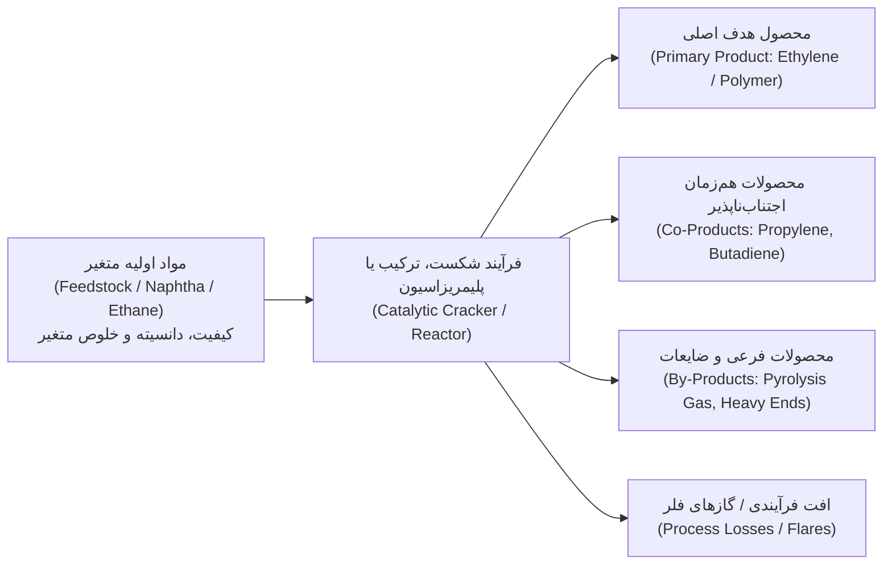
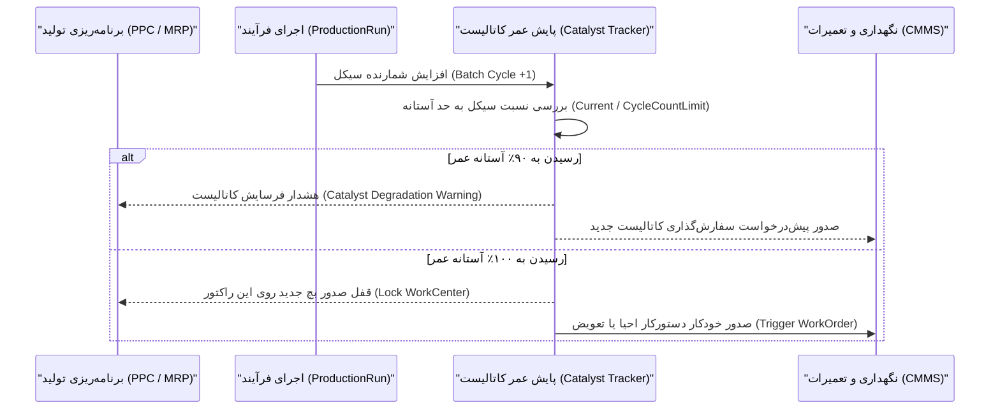

# 18 Petrochemical & Continuous Process Domain Study (PPC Deep Dive)

**Status:** DOMAIN ENGINEERING SPECIFICATION  
**Scope:** Chemical, Petrochemical, Refining and Continuous Process Manufacturing Dynamics  
**Focus Areas:** Mass Balance Accounting, Inseparable Co-Products, Catalyst Deactivation, Dynamic Yields, Turnaround Scoping

---

## 1. چالش‌های ساختاری فرآیندهای شیمیایی و پتروشیمی در مقایسه با تولید گسسته

در سیستم‌های سنتی گسسته (Discrete Manufacturing مانند خودروسازی)، ساختار قطعات بر پایه درخت سلسله‌مراتبی مشخص (BOM) است که در آن $1 \text{ Car} = 4 \text{ Wheels} + 1 \text{ Engine}$. در نقطه مقابل، در صنایع فرآیندی، شیمیایی و پتروشیمی اصول فیزیکی زیر حاکم است:

---

## 2. مدل بالانس جرم (Mass Balance Accounting) و تفکیک اتلافات

### 2.1 معادله بقای جرم در سطح بچ و خط پیوسته
در پتروشیمی، انحراف بالانس جرم جرم ورودی را با مجموع خروجی‌ها مقایسه می‌کند:

$$\sum M_{\text{Inputs}} = M_{\text{Primary}} + \sum M_{\text{CoProducts}} + \sum M_{\text{ByProducts}} + M_{\text{Losses}}$$

### 2.2 دسته‌بندی استانداردهای اتلاف (Loss Taxonomy):
1. **افت مجاز واکنش (Stoichiometric / Standard Process Loss):** افت ناشی از طبیعت شیمیایی واکنش (مانند تولید آب یا تبخیر طبیعی حلال). در فرمول فرآیندی با پارامتر `StandardLossPercent` تعریف می‌شود.
2. **ضایعات قابل بازیافت (Recyclable Solvents & Rework):** خروجی‌هایی که کیفیت محصول اصلی را ندارند ولی می‌توانند دوباره به چرخه تزریق شوند (توسط نوع `RecycledSolvent` در `ProcessFormulaCoProduct`).
3. **اتلاف غیرمجاز (Unaccounted Loss / Fugitive Emission):** تفاوت میان جرم ورودی و خروجی پس از کسر افت استاندارد؛ اگر از سقف تلرانس فراتر رود، نشان‌دهنده نشتی تجهیزات، فلرینگ بیش‌ازحد یا خطای ابزاردقیق است.

---

## 3. مدیریت محصولات هم‌زمان و تفکیک‌ناپذیر (Inseparable Co-Products)

در کراکرها و واحدهای تقطیر، با ورود خوراک به کوره یا راکتور، زنجیره‌ای از محصولات به صورت هم‌زمان پدید می‌آیند. برای نمونه، کراکینگ نفتا همزمان اتیلن، پروپیلن، بنزن و بوتادی‌ان تولید می‌کند.

### راهکار معماری در PEMS PPC:
* در موجودیت `ProcessFormulaCoProduct`، فیلد `AllocationPercent` سهم هر محصول را بر اساس مبنای وزنی یا ارزش نسبی اقتصادی ثبت می‌کند.
* **الگوریتم خالص‌سازی معکوس در MRP (Co-Product Netting):**
  اگر برنامه تقاضا برای اتیلن ۲۵،۰۰۰ تن باشد، فرآیند ناگزیر به تولید ۱۰،۰۰۰ تن پروپیلن نیز خواهد بود. سیستم MRP نباید برای پروپیلن یک سفارش تولید مستقل ایجاد کند که منجر به تولید مازاد اتیلن شود؛ بلکه مازاد پروپیلن به عنوان موجودی پیش‌بینی‌شده (Scheduled Receipt) در نظر گرفته شده و ثبت می‌گردد (طبق نیازمندی **REQ-46**).

---

## 4. دینامیک افت کاتالیست و پایش عمر فعال (Catalyst Deactivation Lifecycle)

در فرآیندهای پلیمریزاسیون و اصلاح فرآیندی (Reforming)، کاتالیست‌ها به مرور زمان دچار کک‌گرفتگی (Coking)، مسمومیت یا تغییر فاز بلوری می‌شوند. این پدیده دو اثر مستقیم بر برنامه‌ریزی تولید دارد:
1. **افزایش زمان چرخه تولید (Cycle Time Deterioration):** برای جبران افت کاتالیست، دمای راکتور باید بالا برود یا نرخ خوراک‌دهی کاهش یابد که ظرفیت موثر را کاهش می‌دهد.
2. **پنجره احیا یا تعویض (Regeneration / Turnaround Window):** پس از سپری شدن تعداد مشخصی از چرخه‌های تولید (`CycleCountLimit`)، راکتور باید از سرویس خارج و عملیات احیا یا تخلیه/شارژ کاتالیست صورت گیرد.

---

## 5. هماهنگی اورهال‌های دوره‌ای مجتمع با تقویم تولید (Turnaround - TAR)

در واحدهای پتروشیمی، اورهال‌های اساسی هر ۲ تا ۴ سال یک‌بار با خاموشی کامل مجتمع (معمولاً ۳۰ الی ۴۵ روز) همراه است:
* **تاریخ انجماد محدوده اورهال (Scope Freeze Date):** معمولاً ۲ ماه قبل از شروع توقف (T-60)، فهرست کارهای اورهال منجمد شده و هیچ آیتم جدیدی بدون مجوز مدیریت پذیرفته نمی‌شود.
* **انباشت استراتژیک محصول (Inventory Banking):** در ماه‌های منتهی به اورهال، سیستم برنامه‌ریزی MPS باید هدف تولید را بالاتر از تقاضای فصلی قرار دهد تا مخازن ذخیره برای تأمین تعهدات در دوران خاموشی پر شوند.
* **یکپارچگی با تقویم:** ثبت رویداد `Turnaround` در `ProductionCalendar` منجر به مسدودسازی مطلق ظرفیت مرکز کاری در دوره زمانی مدنظر در محاسبات RCCP خواهد شد.
