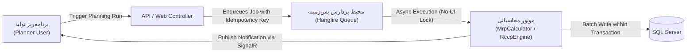

# 19 Non-Functional Requirements, Performance & Reliability Governance (PPC)

**Status:** TECHNICAL ARCHITECTURE SPECIFICATION  
**Scope:** Performance, Concurrency, Resiliency, Auditability, and Data Governance for PPC  
**Standards:** ISO/IEC 25010 (System and software quality models), ACID Transactional Standards

---

## 1. بودجه‌های کارایی و پردازش‌های پس‌زمینه (Performance Budgets)

محاسبات الگوریتمی برنامه‌ریزی (انفجار فرمول‌ها در MRP، خالص‌سازی تقاضای انبار، توازن ظرفیت خشن) ماهیتی پردازشی و سنگین دارند. برای جلوگیری از قفل شدن نخ‌های درخواست وب (Web Request Threads)، کلیه پردازش‌های محاسباتی به Hangfire منتقل می‌شوند.

### ۱.۱ جدول بودجه‌های زمانی و محدودیت‌های عملیاتی (SLAs)

| فرآیند محاسباتی | مقیاس داده ورودی | بودجه مجاز زمانی (SLA) | استراتژی اجرا |
|---|---|---|---|
| **اجرای محاسبات MRP کامل** | ۵،۰۰۰ ردیف تقاضا + ۲۰۰ فرمول فرآیندی | کمتر از **۴۵ ثانیه** | Hangfire Background Job با کلید یکتایی (Idempotency Key) |
| **محاسبه توازن ظرفیت RCCP** | ۱۲ ماه آینده، ۵۰ مرکز کاری و شیفت | کمتر از **۱۰ ثانیه** | محاسبه هم‌زمان در حافظه (In-Memory Aggregation) |
| **استعلام مانده قابل تعهد (ATP Check)** | ۱ قلم کالا در افق ۱۲ هفته | کمتر از **۱۵۰ میلی‌ثانیه** | پرس‌وجوی مستقیم کش‌شده با شاخص ایندکس دیتابیس |
| **ثبت ترخیص کیفی و ثبت ورودی/خروجی بچ** | ۱ رویداد صدور به همراه لاگ | کمتر از **۳۰۰ میلی‌ثانیه** | تراکنش سنکرون تحت قفل خوش‌بینانه `RowVersion` |

---

## 2. تمامیت داده، همزمانی و مدیریت تراکنش‌ها (Data Integrity & Concurrency)

### ۲.۱ قفل خوش‌بینانه (Optimistic Concurrency Control)
برای جلوگیری از پدیده بازنویسی ناخواسته (Lost Updates) در حین ویرایش هم‌زمان یک برنامه یا فرمول توسط دو برنامه‌ریز:
* موجودیت‌های کلیدی (`ProductionPlan`, `ProcessFormula`, `ProductionOrder`, `MaterialStock`) دارای فیلد رمزی `byte[] RowVersion` از نوع `rowversion` در پایگاه‌داده SQL Server هستند.
* در صورت تلاش برای ذخیره‌سازی داده‌های تاریخ‌گذشته، خطای `DbUpdateConcurrencyException` صادر شده و تراکنش متوقف می‌گردد.

### ۲.۲ اصل تراکنش واحد برای داده و ممیزی (Single-Transaction Audit)
طبق یافته ممیزی **A3**، ذخیره‌سازی رویداد عملیاتی و ثبت لاگ ممیزی (`AuditLog`) باید درون **یک تراکنش اتمیک (Single ACID Transaction)** انجام شود. در صورتی که ذخیره ممیزی با شکست مواجه گردد، کل عملیات تولید یا ترخیص بچ بازگردانی (Rollback) می‌شود.

---

## 3. اصول بایگانی، تغییرناپذیری نسخه‌ها و جبران تراکنش (Append-Only & Reversals)

1. **تغییرناپذیری نسخه‌های تاییدشده (Immutable MPP Versions):**
   * ردیف‌های جدول `PlanVersion` پس از اخذ وضعیت `Published` یا `Frozen`، از نظر سطح دسترسی دیتابیس غیرقابل ویرایش یا حذف مستقیم می‌شوند. هرگونه تغییر در برنامه کلان مستلزم ایجاد نسخه جدید (`VersionNumber + 1`) است.
2. **سیاست عدم حذف فیزیکی (No Hard Deletes):**
   * هیچ ردیفی از سفارشات، اجراها یا خروجی‌های بچ حذف فیزیکی نمی‌گردد؛ فرآیندهای لغو صرفاً وضعیت را به `Cancelled` تغییر می‌دهند.
3. **تراکنش‌های جبرانی (Compensating Transactions):**
   * چنانچه یک بچ تولیدی تاییدشده و ثبت‌شده در انبار به دلایل کیفی باطل گردد، سند انبار حذف نمی‌شود، بلکه یک تراکنش معکوس (Reversal Entry) با ماهیت بستانکار در لجر انبار ثبت می‌گردد.

---

## 4. ماتریس امنیت، دسترسی و تفکیک وظایف (Maker-Checker / SoD)

| نقش کاربری | ایجاد پیش‌نویس برنامه | تایید نسخه کلان (MPP) | انتشار فرمول فرآیند | ترخیص کیفی قرنطینه | ثبت گزارش عملکرد بچ |
|---|:---:|:---:|:---:|:---:|:---:|
| **برنامه‌ریز تولید (Planner)** | ✅ مجاز | ❌ ممنوع | ❌ ممنوع | ❌ ممنوع | ❌ ممنوع |
| **سرپرست/مدیر تولید (Production Manager)** | ✅ مجاز | ✅ مجاز (با تایید) | ❌ ممنوع | ❌ ممنوع | ❌ ممنوع |
| **مهندسی فرآیند (Process Engineer)** | ❌ ممنوع | ❌ ممنوع | ✅ تایید اولیه | ❌ ممنوع | ❌ ممنوع |
| **مدیر تضمین کیفیت (QA/QC Manager)** | ❌ ممنوع | ❌ ممنوع | ✅ تایید نهایی | ✅ انحصاری | ❌ ممنوع |
| **اپراتور شیفت تولید (Plant Operator)** | ❌ ممنوع | ❌ ممنوع | ❌ ممنوع | ❌ ممنوع | ✅ مجاز |

> [!IMPORTANT]
> **قانون قطعی Maker-Checker:** فردی که فرمول فرآیندی یا نسخه برنامه تولید را ایجاد کرده است، به هیچ عنوان اجازه تصویب یا ترخیص نهایی همان سند را از نظر دسترسی سامانه نخواهد داشت.
