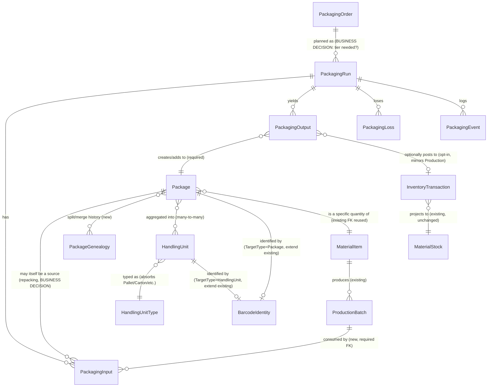

# PEMS Operations Phase 2D — Packaging Technical Specification

**This is a design/specification document. It contains zero implementation code changes and
defines no database entities. Every proposed entity, relationship, and lifecycle in this
document is conceptual and explicitly marked as not implemented.**

---

## 1. Document Control

| | |
|---|---|
| Document | `PEMS_OPERATIONS_PHASE_2D_PACKAGING_TECHNICAL_SPECIFICATION.md` |
| Phase | Operations Phase 2D — Packaging Business Decision & Technical Specification |
| Repository | `D:\PEMS\03-SOURCE\PEMS-cmms-edit-empoleeys-master\PEMS-cmms-edit-empoleeys-master` |
| Branch | `main` |
| Predecessor documents | `PEMS_OPERATIONS_PRODUCTION_ARCHITECTURE_SPEC_v1.md`, `PEMS_OPERATIONS_PRODUCTION_PHASE1_IMPLEMENTATION_REPORT.md`, `PEMS_OPERATIONS_ARCHITECTURE_AND_PERIOD_REPORTING_AUDIT.md`, `PEMS_OPERATIONS_CMS_BOUNDARY_CORRECTION_REPORT.md`, `PEMS_OPERATIONAL_DATA_AND_PERIOD_REPORTING_ARCHITECTURE_AUDIT.md`, `PEMS_OPERATIONS_PHASE_2A_FOUNDATIONAL_HARDENING_REPORT.md`, `PEMS_OPERATIONS_PHASE_2B_BUSINESS_SEMANTICS_PACKAGING_DESIGN_GATE.md`, `PEMS_OPERATIONS_PHASE_2C_PRODUCTION_SAFETY_AND_DECISION_BASELINE_REPORT.md` |
| Companion documents | `PEMS_OPERATIONS_PHASE_2D_BUSINESS_DECISION_REGISTER.md`, `PEMS_OPERATIONS_PHASE_2D_PACKAGING_DECISION_AND_SPECIFICATION_AUDIT_REPORT.md` |
| Status | Specification only — no code, no migration, no entity created |

## 2. Phase 2D Scope

Produce an implementation-ready conceptual specification for Packaging, resolving (where
technically decidable) or explicitly flagging (where a business decision is required) every
open question carried forward from Phase 2B/2C. This document is the input to Phase 3
implementation planning, not Phase 3 itself.

## 3. Non-Scope

No `Package`, `PackagingOrder`, `PackagingRun`, `PackagingInput`, `PackagingOutput`,
`PackagingLoss`, `PackagingEvent`, `HandlingUnit`, `Pallet`, or `QualityTestResult` entity;
no Gross/Tare/Net field; no barcode target-type extension; no migration; no controller, view,
API, permission, or workflow; no Daily Operations; no rework implementation. Confirmed by the
file list in the companion audit report's Section 23 (Validation).

---

## 4. Current Architecture (re-audited this phase, not assumed)

Re-confirmed directly against the live repository during this phase:

```
MaterialItem (Product/Material master — PEMS.Domain/Entities/MaterialItem.cs)
   └── ProductionOrder → ProductionRun → ProductionBatch → ProductionOutput
                                                                  └── InventoryTransaction (nullable ProductionBatchId, Phase 2A)
                                                                        └── MaterialStock (projection, unchanged grain)
BarcodeIdentity (generic TargetType/TargetId — Equipment/MaterialItem/Warehouse/StorageLocation/ProductionBatch)
```

## 5. Current Production Model

Unchanged since Phase 1/2A, re-verified: `ProductionOrder`, `ProductionRun`, `ProductionBatch`,
`ProductionInput`, `ProductionOutput`, `ProductionLoss`, `ProductionEvent`,
`ProductionWorkCenter`, `ShiftDefinition`. State machines are plain explicit
`Dictionary<string,string[]>` tables in `ProductionOrderService`/`ProductionRunService`, not
`IWorkflowRuntime`. `ProductionBatch.Quantity` is a maintained running total, updated only by
`ProductionRunService.RecordOutputAsync`. Permission module: `"Production"` (flat, independent,
SoD-paired via `Production.Create↔Approve`/`Production.Edit↔Approve`).

## 6. Current Inventory Model

`InventoryTransaction` = append-only ledger (source of truth); `MaterialStock` = derived
projection, keyed `(MaterialItemId, WarehouseId, StorageLocationId)`, grain **unchanged since
Phase 1**. `InventoryTransaction.ProductionBatchId` (nullable, Phase 2A) allows
batch-level traceability at the *transaction* level only — `GetBatchBalancesAsync` derives a
batch balance by `GROUP BY`, never stored. `IMaterialStockService.ReceiveAsync`/`AdjustAsync`/
`ReturnAsync`/`TransferAsync` all accept an optional trailing `productionBatchId` parameter
(Phase 2A, purely additive). No batch-aware issue/transfer UI exists.

## 7. Current Quality Model

`ProductionBatch.QualityStatus ∈ {Produced, AwaitingQC, Released, Blocked, Rejected}`, with
transitions `Produced→AwaitingQC→{Released|Blocked|Rejected}`, `Blocked→AwaitingQC`. As of
Phase 2C, `ProductionRunService.PostOutputToInventoryAsync` **enforces** `QualityStatus ==
"Released"` before allowing a post to inventory — re-verified present and unchanged in the
current working tree (the exact check added in Phase 2C). No `QualityTestResult` entity exists.
`InspectionRecord` (`PEMS.Domain/Entities/InspectionRecord.cs`) is Equipment-scoped
(`EquipmentId` is a required, non-nullable `int`) — confirmed again this phase, not reusable
for product/batch/package quality without a breaking change.

## 8. Current Barcode Model

`BarcodeIdentity`: `Code` (immutable, non-guessable), `Symbology`, `TargetType`/`TargetId`
(generic), `Status ∈ {Active, Disabled, Revoked, Replaced}`, `PrintCount`/`LastPrintedDate`,
`ReplacedByBarcodeIdentityId`/`ReplacesBarcodeIdentityId` (supersession chain — never
mutates in place). `BarcodeService.SupportedTargetTypes = {Equipment, MaterialItem, Warehouse,
StorageLocation, ProductionBatch}`, re-confirmed this phase via direct read. Adding a `Package`/
`HandlingUnit` target type requires registering the string in this hash set plus 3 switch
methods plus `BarcodeController`'s routing switch — zero schema change, unchanged conclusion
from every prior audit.

---

## 9. Packaging Boundary

**Option analysis** (evidence-based, not scored):

| Option | Traceability | Genealogy | Quality | Inventory | Reporting | Workflow | Permissions | Audit | Maintainability | Scalability |
|---|---|---|---|---|---|---|---|---|---|---|
| **A. Subtype/extension of Production** | Forces packaging facts through `ProductionOutput`'s shape (a single quantity, no package count/size) — degrades traceability of package-specific attributes | Conflates two genealogy chains (raw→batch, batch→package) into one table | Couples package release to `ProductionBatch.QualityStatus`'s transition dictionary, which has no package-shaped states | Reuses `PostOutputToInventoryAsync` accidentally, risking the Phase 2C gate silently applying to the wrong concept | Reports can't distinguish "produced" from "packaged" without a discriminator column added post hoc | Reuses `ProductionRunService`'s state machine, but its transitions (`Planned→InProgress→Paused→Completed`) don't map cleanly to packaging-specific pauses (e.g. "awaiting labels") | Reuses `"Production"` module by accident, not by decision | Reuses `AuditLog` interceptor (automatic either way) | **Poor** — every future packaging-only field pollutes a Production table | **Poor** — packaging volume/cadence likely differs from production volume, coupling them limits independent scaling |
| **B. Independent bounded process reusing the Production *pattern*** | Own `PackagingInput`/`PackagingOutput` shaped correctly for package count/size; genealogy pointer (`SourceProductionBatchId`-equivalent) stays explicit and separate from production's own genealogy pointer | Two clean, separately-queryable genealogy chains, joinable via a shared `ProductionBatchId` | Own quality lifecycle (Section 25) can differ from batch's without distorting `ProductionBatch`'s own state machine | Reuses `IMaterialStockService` explicitly and deliberately, with its own call site subject to its own review (Section 28) | Reports naturally separate by table | Own state machine, shaped for packaging's actual steps, following the same explicit-dictionary *pattern* (not the same table) Phase 1 already proved | Own module name possible (`"Packaging"`) or deliberate reuse of `"Production"` — a real decision, not an accident | Same automatic reuse | **Good** — mirrors a pattern already proven twice (Production itself, and this pattern's reuse recommendation from Phase 2B) | **Good** — independently scalable, independently testable |
| **C. Primarily an inventory/warehouse process** | Weak — inventory transactions alone don't capture packaging-specific facts (package count, size, loss reason) without extending `InventoryTransaction` itself, which Phase 2A deliberately avoided doing to `MaterialStock`'s grain | Weak — genealogy would have to live on `InventoryTransaction`, overloading a ledger row with production-domain concerns | Weak — `InventoryTransaction` has no quality concept at all today | Directly reuses the ledger, but conflates "a packaging event happened" with "a stock movement happened" — not every packaging step moves stock (e.g., recording a loss doesn't) | Reports would need to reverse-engineer packaging facts from ledger entries, exactly the anti-pattern Phase 1's `ProductionOutput`-vs-`InventoryTransaction` separation was designed to avoid | No natural state machine — `InventoryTransaction` is append-only, not stateful | Inventory's own permission model (`InventoryMasterData`, distinct from `"Production"`) — awkward fit for what is fundamentally a manufacturing/conversion step | Same automatic reuse | **Poor** — repeats the exact mistake Phase 1 avoided by separating `ProductionOutput` from `InventoryTransaction` | **Poor**, same reasoning |

**Verification against actual code**: the Phase 2B/2C direction ("Packaging as an independent
bounded process reusing the Production Order/Run/Input/Output/Loss/Event *pattern*") is
**confirmed supported, not contradicted**, by the current repository. Every mechanism Option B
depends on already exists and is proven: the explicit-transition-dictionary state-machine
pattern (`ProductionOrderService`/`ProductionRunService`), the append-only fact-table pattern
(`ProductionInput`/`Output`/`Loss`/`Event`), the optional genealogy pointer pattern
(`ProductionInput.SourceProductionBatchId`), the opt-in inventory-posting pattern
(`PostOutputToInventoryAsync`), and the independent-permission-module pattern (`"Production"`,
proven separable from `"CMMS"` in the boundary-correction phase). **Recommendation: Option B,
formalized.**

---

## 10. Domain Concepts

| Concept | Category |
|---|---|
| `MaterialItem` | Master data (existing, reused) |
| `PackagingOrder` | Transactional fact (new, conceptual) |
| `PackagingRun` | Transactional fact (new, conceptual) |
| `PackagingInput` | Transactional fact (new, conceptual) |
| `PackagingOutput` | Transactional fact (new, conceptual) |
| `PackagingLoss` | Transactional fact (new, conceptual) |
| `PackagingEvent` | Transactional fact, append-only (new, conceptual) |
| `Package` | Physical identity (new, conceptual) |
| `HandlingUnit` | Physical identity (new, conceptual) |
| `BarcodeIdentity` | Identification layer (existing, extended by registration only) |
| `InventoryTransaction`/`MaterialStock` | Transactional fact / projection (existing, reused) |

No concept in this list duplicates `MaterialItem`.

## 11. Package Definition

Direct answers to Section 5's 15 questions:

| # | Question | Answer |
|---|---|---|
| 1 | Physical container? | Yes, in part — see #3 |
| 2 | Product unit? | Yes, in part — see #3 |
| 3 | Both? | **Yes — a `Package` is the physical instantiation of a specific quantity of a specific `MaterialItem`, produced from a specific `ProductionBatch` (or batches, #6). It is simultaneously "this much product" and "this physical container."** This is the same dual nature `ProductionBatch` itself already has (a batch is both "this quantity of material" and "this specific production event's output") — `Package` extends that same duality one level further down the physical hierarchy. |
| 4 | One `MaterialItem` only? | **RECOMMENDED: yes, mandatory.** A package containing a blend of two *different* materials would need its own new `MaterialItem` identity (the blend itself is a distinct product) — this preserves `MaterialItem` as the single source of "what product is this," consistent with Section 13's mass-balance requirement, which is only well-defined per-material. |
| 5 | Multiple `MaterialItem`s? | No (per #4) — a physically mixed-SKU package (e.g., an assortment box) is `BUSINESS DECISION REQUIRED` if it's a real scenario; if so, it should be modeled as its own `MaterialItem` (a "kit" product), not as a `Package` with multiple material references |
| 6 | Multiple `ProductionBatch`es (blending)? | **RECOMMENDED: yes, supported via multiple `PackagingInput` rows per `PackagingRun`**, each with its own batch reference — mirrors `ProductionInput`'s already-proven one-row-per-source pattern |
| 7 | Identity immutable? | **RECOMMENDED: yes** — matches `BarcodeIdentity`'s own existing "never mutate, only Replace/supersede" philosophy |
| 8 | Contents change after creation? | **RECOMMENDED: no** — a content change should close the old package and create a new one, preserving traceability |
| 9 | Opened/repacked? | See Section 24 |
| 10 | Split? | See Section 22 |
| 11 | Merged? | See Section 23 |
| 12 | Identity after split/merge? | See Sections 22-23 |
| 13 | Traceable after shipment? | Architecturally yes if `Package` identity is immutable and referenced by any future Shipment concept (out of scope, not designed here) — no contradiction found |
| 14 | Own lifecycle? | **RECOMMENDED: yes**, distinct from `PackagingRun`'s process lifecycle — see Section 30 |
| 15 | Own quality status? | **RECOMMENDED: yes**, snapshot-at-creation, independently mutable — see Section 25 |

## 12. PackagingRun Definition

| Attribute | Specification |
|---|---|
| Purpose | Records an actual packaging execution — "what actually happened," mirroring `ProductionRun`'s exact role relative to `ProductionOrder` |
| Business ownership | Packaging operator/supervisor, same role family as `ProductionRun` |
| Lifecycle | See Section 30 |
| Key identity | Surrogate int PK + a business `RunNumber` (numbered via the existing `INumberingService`, a new `Defaults` entry, mirroring `"ProductionRun"`'s existing registration) |
| Parent/child | Optional `PackagingOrderId` (mirrors `ProductionRun.ProductionOrderId`'s "what should be packaged" vs. "what happened" split — `BUSINESS DECISION REQUIRED` whether a `PackagingOrder` tier is needed at all, or whether `PackagingRun` alone suffices, given Packaging's likely shorter planning horizon than Production) |
| Quantity semantics | None of its own — quantities live on `PackagingInput`/`PackagingOutput`/`PackagingLoss`, exactly like `ProductionRun` |
| Quality relationship | None directly — quality lives on the resulting `Package` (Section 25) |
| Inventory relationship | Indirect only, via `PackagingOutput`'s eventual posting (Section 27) |
| Barcode relationship | None directly |
| Audit | Automatic via the existing interceptor, once built |
| Transactional or master data | Transactional |
| Identity mutability | Mutable state (status), immutable business key once assigned |

## 13. PackagingInput

Mirrors `ProductionInput` exactly in shape: `PackagingRunId`, `MaterialItemId` (the bulk
material being packaged), `Quantity`, `UomId`, and — the packaging-specific addition —
`SourceProductionBatchId` (**required**, not optional, unlike `ProductionInput`'s optional
genealogy hook — packaging always consumes from a known batch; there is no "packaging from
nowhere" scenario analogous to raw-material consumption). Append-only, plain class (no
`BaseEntity`), same convention as `ProductionInput`.

## 14. PackagingOutput

Mirrors `ProductionOutput`: `PackagingRunId`, `MaterialItemId`, `PackageId` (required — every
output creates or adds to exactly one `Package`, mirroring `ProductionOutput.
ProductionBatchId`'s required-FK precedent), `Quantity`, `UomId`, optional
`InventoryTransactionId` (for the eventual opt-in posting, Section 27). `OutputClassification`
recommended reused with the same `"Primary"`/`"ByProduct"` vocabulary `ProductionOutput`
already has, no new vocabulary invented.

## 15. PackagingLoss

Mirrors `ProductionLoss`: `PackagingRunId`, `Quantity`, `UomId`, `LossCategory` — recommended
**not** a reuse of `ProductionRunService.LossCategories` verbatim (`ProcessLoss`/
`MaterialLoss`/`Reject`/`Waste`/`Rework`/`Other`), since packaging has categorically different
loss reasons (e.g., `"DamagedPackage"`, `"LabelDefect"`, `"UnderfillOverfill"`). Recommended a
**parallel, packaging-specific controlled whitelist**, not a shared enum — this is not
duplication of the *concept* of a controlled loss-category list (the pattern is reused), only
the specific vocabulary, which genuinely differs by domain, matching how `ProductionLoss` and
(if built) `ProductionDowntimeEvent.CauseCategory` already each have their own independent
whitelists in this codebase rather than sharing one.

## 16. PackagingEvent

**Recommendation: a new, separate event table, not a reuse of `ProductionEvent`.**
`ProductionEvent`'s FK shape (`ProductionOrderId`/`ProductionRunId`, both nullable) is
Production-specific; reusing it for Packaging would require adding nullable `PackagingOrderId`/
`PackagingRunId` columns to an existing, already-live table — an unnecessary schema change to
an existing entity when the alternative (a new, identically-shaped `PackagingEvent` table) is
purely additive and costs nothing architecturally. The *pattern* (lightweight, append-only
event log, not full event sourcing) is reused; the *table* is not.

## 17. HandlingUnit

See Section 18. Aggregates `Package` rows via a many-to-many join (a package can move between
handling units over its life, per Section 11 #9's repacking allowance at the handling-unit
level — distinct from repacking the package's own contents, which is disallowed per #8).

## 18. Pallet Treatment

**Recommendation: Option B — `HandlingUnit.Type`, not a separate entity.** Evidence: `Pallet`,
`Carton`, `Cage`, `Container`, `Skid`, `Tote` are all, structurally, "a thing that aggregates
packages for joint handling/movement" — they differ in physical attributes (dimensions, max
weight) and in name, not in their relationship to `Package`. A `HandlingUnitType` lookup table
(reusable pattern already proven by `MaterialCategory`/`MaterialUOM` as independent lookup
masters) can carry per-type attributes (default tare, max capacity) without a new entity per
physical form factor. This avoids the entity-proliferation risk Phase 2B already flagged.
Nesting (`HandlingUnit` containing another `HandlingUnit`, e.g. cartons on a pallet) is
**`BUSINESS DECISION REQUIRED`** — technically supportable via a self-referencing
`ParentHandlingUnitId`, mirroring `StorageLocation`'s and `FunctionalLocation`'s already-proven
self-referencing tree pattern, but not designed further without confirming the business need.

---

## 19. Gross/Tare/Net

**Evaluated models**:

| Model | Shape | Auditability | Mass balance | Recalculation risk | Industrial practice fit |
|---|---|---|---|---|---|
| **A. Store Gross + Tare, calculate Net** | Two stored facts, Net always derived at read time | High — Net can never silently drift from its inputs | Clean — Gross and Tare are independently auditable | None — nothing is ever recalculated and re-stored | Matches standard weighbridge/scale practice (gross-in, tare known, net computed) |
| **B. Store Gross + Tare + Net snapshot** | Three stored facts | Requires a consistency check (`Net == Gross - Tare`) that could theoretically drift if not enforced | Same as A, plus a redundant column to keep in sync | Low if enforced at write time, otherwise a real risk | Matches practice where Net must be a stable printed/certified value even if Gross or Tare's raw precision changes later (e.g., regulatory/customs documentation) |
| **C. Store Net only** | One stored fact | Lowest — no way to audit how Net was derived, or to prove a scale reading | Weakest — cannot reconcile against physical Gross/Tare records if ever disputed | N/A (nothing to recalculate) | Does not match standard practice for any regulated or customer-facing weight declaration |

**Recommendation: Model A** for the general case, with **Model B as the correct choice
specifically if the business requires a stable, certified Net value independent of any later
Gross/Tare data correction** (e.g., a printed label's Net weight must never silently change
even if a later audit finds the original Gross reading was mis-keyed). This is exactly a
**`BUSINESS DECISION REQUIRED`** — the technical trade-off is clear, the choice between them is
not.

**Additional specification, all `BUSINESS DECISION REQUIRED` unless noted**:
- Tare source: container-master default (a `HandlingUnitType`/future `PackagingProfile`
  attribute) vs. per-instance measured — **not resolvable from code**, and the two are not
  mutually exclusive (a default that can be overridden by an actual measurement is a coherent
  third option, effectively Model A with an optional per-instance Tare override).
- Re-weighing creates a **new fact, never overwrites** — this part is **DECIDED** by this
  specification, not left open, because it follows directly from the append-only philosophy
  already proven throughout this codebase (`ProductionOutput`/`InventoryTransaction`/
  `WorkflowHistory` are all insert-only) — a correction is a new row referencing the original,
  exactly the same pattern already recommended (but not yet built) for `ProductionAdjustment`
  in the very first architecture spec.
- Decimal precision: `decimal(18,3)`, matching every existing quantity column in this codebase
  without exception — **DECIDED**, not a business question.
- Measurement timestamp/device/operator: recommended additional columns
  (`MeasuredAt`/`MeasuredByEmployeeId`/optional `DeviceIdentifier`) on whichever fact table
  captures Gross/Tare — **RECOMMENDED, business sign-off on whether device identity matters**.
- UOM/conversion: unchanged limitation carried from every prior phase — `MaterialUOM.
  ConversionFactor` remains unused; Packaging inherits this gap, does not worsen it.

---

## 20. UOM and Quantity Semantics

No change to the existing `MaterialUOM` master. All Packaging quantity columns should use
`decimal(18,3)` (Section 19). Rounding policy: **`BUSINESS DECISION REQUIRED`** — no rounding
rule exists anywhere in the current codebase to inherit.

## 21. Batch Genealogy

Cardinality matrix (Section 7's required format):

| Relationship | Allowed? | Required? | Rationale |
|---|---|---|---|
| `ProductionBatch` → many `Package`s | Yes | N/A | Natural — mirrors `ProductionBatch` → many `ProductionOutput`s already proven |
| `Package` → one `ProductionBatch` (primary) | Yes | **Not mandatory as a single FK** — see next row | A package's primary lineage should be derivable, but... |
| `Package` → many `ProductionBatch`es (blending) | **Yes, if business confirms blending is real** | Conditional | Achieved via multiple `PackagingInput` rows per `PackagingRun` referencing the resulting `Package`'s outputs — not a direct FK on `Package` itself, avoiding a cardinality assumption baked into the schema |
| `PackagingRun` → many `PackagingInput`s | Yes | N/A | Mirrors `ProductionRun` → many `ProductionInput`s |
| `Package` → multiple `MaterialItem`s | **No** (Section 11 #4-5) | N/A | Would break the mass-balance and quality-status model, which are per-material |

**Do not assume blending is required merely because it is technically supportable** — this
audit found no evidence in the codebase of a business requirement for it; it is included in
the cardinality design *because* supporting it costs nothing extra (the `PackagingInput`
many-rows-per-run pattern handles both cases identically), not because it is confirmed needed.

## 22. Package Split

```
Package P001 = 1000 kg
        ↓
P002 = 600 kg
P003 = 400 kg
```

**Recommended design** (mirrors the batch-genealogy pointer pattern already proven, extended
one level): `P001.Status` transitions to a terminal "Superseded"/"Closed" state (not deleted —
matching every append-only precedent in this codebase); `P002`/`P003` are new `Package` rows,
each carrying a `SourcePackageId = P001` reference (the split-specific genealogy pointer,
structurally identical to `ProductionInput.SourceProductionBatchId`). Barcode identity:
**not retained** — `P002`/`P003` get their own new `BarcodeIdentity` (`ReplaceAsync` is the
wrong mechanism here, since `Replace` means "this is still logically the same thing, relabeled"
— a split produces two *new* logical things). Quality status: **re-evaluated, not inherited
automatically** — each child package should start in the same "not yet released" default a
fresh package would (Section 25), since splitting a released package into two smaller ones is
itself a physical handling event that could introduce contamination/damage risk the original
release didn't account for; **`BUSINESS DECISION REQUIRED`** on whether an expedited
re-release (skipping full re-inspection) should ever be permitted. Inventory: a split does
create inventory transactions if the packages were already posted (an internal transformation,
not a net quantity change) — **`BUSINESS DECISION REQUIRED`** on the exact `TransactionType`
vocabulary needed (existing types `Receipt/Issue/Return/Transfer/Adjustment` don't cleanly fit
a same-material, same-location transformation). Reversibility: **not reversible** by design —
this follows the append-only precedent, a "split reversal" should be modeled as a merge
(Section 23) of the same two children back together, itself a new event, not an undo.

## 23. Package Merge

```
P001 = 500 kg
P002 = 500 kg
        ↓
P003 = 1000 kg
```

**Recommended design**, symmetric to split: `P001`/`P002` transition to "Superseded"/"Closed"
(remain traceable, not deleted); `P003` is a new `Package` with **two** `SourcePackageId`
references (this breaks the single-FK assumption in Section 22 — recommended shape is a
join/history table, `PackageGenealogy(ChildPackageId, ParentPackageId)`, supporting both split
[1 parent → many children] and merge [many parents → 1 child] through the same mechanism,
rather than two different FK shapes for two directions of the same underlying concept — this
is a specification refinement this document contributes beyond Phase 2B's simpler single-FK
suggestion). New identity for the merged result: **yes**, consistent with Section 11 #7's
immutability principle. Quality re-evaluation: **`BUSINESS DECISION REQUIRED`**, same reasoning
as split — merging two `Released` packages into one does not obviously preserve "released"
status without a business rule saying so (what if the two source packages had different lot
attributes that shouldn't be commingled?). Inventory reconciliation: same open vocabulary
question as split.

## 24. Repacking

**Recommendation**: repacking is a **`PackagingRun`** whose `PackagingInput` references an
*existing* `Package` (via the same `SourcePackageId` mechanism used for splits) rather than a
`ProductionBatch`. This requires `PackagingInput`'s source reference to be polymorphic-ish —
either a `ProductionBatch` (bulk-to-package, the normal case) or a `Package` (package-to-package,
repacking) — **`BUSINESS DECISION REQUIRED`** on whether this is modeled as two nullable,
mutually-exclusive FKs (mirroring `DocumentAttachment`'s existing per-parent-type FK pattern
elsewhere in PEMS) or a generic `TargetType`/`TargetId` pair (mirroring `BarcodeIdentity`'s
pattern instead) — both patterns already exist in this codebase for different reasons; this
document does not pick one without business confirmation that repacking is a real, near-term
requirement (it may not need building in Phase 3 at all).

---

## 25. Package Quality

**Model evaluation**:

| Model | Shipment-after-batch-status-change safety | Package-specific inspection | Damaged package | Partial rejection | Audit |
|---|---|---|---|---|---|
| A. Live reference to batch | **Unsafe** — releasing/blocking the batch later retroactively changes every already-shipped package's apparent status | Not supportable — no place to record a package-specific finding | Not supportable | Not supportable (all packages share one status) | Misleading — an audit trail would show a status "change" that never involved the specific package |
| B. Snapshot at creation, then frozen | Safe for the shipment-timing risk | Not supportable — status can never move again | Not supportable | Not supportable | Accurate but inflexible |
| C. Fully independent lifecycle (no inheritance at all) | Safe | Supportable | Supportable | Supportable (per-package) | Accurate, but loses the batch's quality decision as a starting point — every package would need full independent inspection even when the batch's release already covered it |
| **D. Inherited initial status + independent later lifecycle** | **Safe** | **Supportable** | **Supportable** | **Supportable** | **Accurate — the initial inheritance is itself an audited event, and every later change is its own audited event** |

**Recommendation: Model D**, confirming and sharpening Phase 2B's "snapshot-and-own"
conclusion into the precise mechanism: a `Package` is created with `QualityStatus` initialized
from its source batch's *current* `QualityStatus` at that instant (a copy, taken once,
logged as a `PackagingEvent`), and is independently mutable via its own transition dictionary
from that point forward — never re-read from the batch again.

**Conceptual state machine** (Section 10's instruction to justify every state, not add for
completeness):

```
Created  →  PendingQC  →  Released
                        →  Blocked  → PendingQC (recoverable, mirrors ProductionBatch's own Blocked→AwaitingQC)
                        →  Rejected
```
`Quarantined` was considered and **not included** as a separate state from `Blocked` — no
distinct business behavior was identified in this audit that `Blocked` doesn't already cover;
adding it would violate Section 10's "do not add states merely for completeness" instruction.
If the business owner identifies a real distinction (e.g., `Quarantined` implies physical
segregation with different handling permissions than `Blocked`), it should be added deliberately
at that time, not speculatively now.

## 26. Quality Permissions

**Current state, re-audited**: the `"Production"` permission module's fixed 7-boolean
vocabulary (`View/Create/Edit/Delete/Approve/Hold/ReleaseHold`) already maps cleanly onto
batch quality actions (`Approve`=Release/Reject, `Hold`/`ReleaseHold`=Block/Unblock), and the
`Production.Create↔Approve` SoD pair already prevents a batch's creator from also releasing it.

**Future Package quality permission model — `BUSINESS DECISION REQUIRED`**: should Package
release require the *same* authority as `ProductionBatch` release (reuse `"Production"`
module, same roles), or does Package release warrant a distinct role (e.g., a
"Packaging QC Inspector" distinct from whoever released the bulk batch)? This audit's
recommendation, absent a stated business need for separation: **reuse the `"Production"`
module and its existing SoD pair**, since a separate module would need its own new
`SystemRoles` entries and its own SoD policy rows — real, avoidable new surface area unless a
genuine separation-of-duties requirement is confirmed. The same reasoning that kept Phase 1's
`"Production"` module independent-but-reused now applies one layer further, for Packaging.

---

## 27. Inventory Boundary

**Verified assumption**: packaged output's `MaterialItem` may be the **same** `MaterialItem` as
the bulk (if `Package` is purely a physical repackaging with no product-identity change) or a
**different** `MaterialItem` (if packaging is itself considered to create a distinct
sellable/trackable product, e.g., "Bulk Chemical X" vs. "Chemical X, 25kg bag") —
**`BUSINESS DECISION REQUIRED`**, and this decision changes whether `PackagingOutput.
MaterialItemId` can differ from `PackagingInput.MaterialItemId` within the same run (it must
be allowed to, structurally, to support either answer without a later redesign).

**Recommended flow** (extending, not replacing, Phase 1/2A's proven pattern):
```
ProductionBatch (Released)
     ↓ PackagingInput (consumes, quantity deducted from the batch's own running total —
                        NOT from MaterialStock, since a Released-but-not-yet-posted batch
                        may not even be in MaterialStock yet)
     ↓ PackagingRun
     ↓ PackagingOutput (creates/adds to a Package)
     ↓ [explicit, opt-in posting — mirrors PostOutputToInventoryAsync exactly]
     ↓ InventoryTransaction (new ReferenceType="PackagingOutput", Receipt)
     ↓ MaterialStock
```

**Double-counting invariant, explicitly addressed**: a batch's material must not become
simultaneously available as raw bulk stock *and* as packaged stock. This is naturally
prevented **only if** `PackagingInput`'s consumption of a `ProductionBatch` is tracked against
the batch's own `Quantity` (the same running total `ProductionOutput` maintains), not against
a *second* posted-inventory quantity — i.e., **if the bulk batch was never itself posted to
inventory** (Phase 1/2A's inventory posting is opt-in, so a batch destined entirely for
packaging may legitimately skip bulk posting altogether), there is no double-availability risk
by construction. **If the bulk batch *was* posted to inventory first** (e.g., held in a bulk
warehouse before a packaging run consumes it), then `PackagingInput`'s consumption **must**
also post a corresponding `Issue`/`Adjustment`-type `InventoryTransaction` deducting the bulk
quantity, mirroring exactly how `ProductionInput.SourceProductionBatchId` +
`PostInputToInventoryAsync` already handle this same "consuming previously-posted stock"
scenario for production's own raw-material consumption. **This is the correct reuse target —
not a new mechanism.**

## 28. Inventory Quality Gate

Phase 2C's rule (`ProductionBatch.QualityStatus == "Released"` required before
`PostOutputToInventoryAsync` succeeds) lives inside `ProductionRunService`, specific to
Production's own posting method. **Recommendation for Packaging: an equivalent, explicitly
separate check inside a future `PackagingRunService.PostOutputToInventoryAsync`**, checking
`Package.QualityStatus == "Released"` (Section 25's model) — **not a shared/centralized policy
object**, for the same "smallest safe change, no premature abstraction" reasoning Phase 2C
applied: today there would be exactly two call sites (Production's and Packaging's), each
checking a different entity's status field (`ProductionBatch` vs. `Package`) — a shared
abstraction over two call sites checking two different types is speculative generalization,
not a proven need. **If a third inventory-producing process ever emerges**, that would be the
right time to extract a shared policy, not before. This directly answers Phase 2C's own
D-ReceiveGuard open question: the answer is **duplicate the check at each new call site
deliberately**, not push it into the shared `IMaterialStockService.ReceiveAsync`, which should
remain agnostic to what kind of business object it's receiving stock on behalf of.

---

## 29. Barcode Integration

`Package`/`HandlingUnit` should each become a new `BarcodeService.SupportedTargetTypes` entry
when built (Section 8's zero-schema-change conclusion applies directly). Reprint/Replace:
directly reuse `IBarcodeService.RecordPrintAsync`/`ReplaceAsync` unchanged. Lost/damaged label:
same as any reprint — `RecordPrintAsync` again on the same `BarcodeIdentity` (no new mechanism
needed; a "lost" label isn't structurally different from "need another copy"). New label after
split/merge: **the split/merged child packages are new `Package` rows (Section 22-23), so they
naturally get new, independently-generated `BarcodeIdentity` rows via the normal
`GenerateAsync` path — not `ReplaceAsync`**, since `Replace` semantically means "same thing,
new label," and a split/merge produces a genuinely different logical thing. What a barcode
represents: **`TargetType="Package"` always means Package identity specifically** — never
`MaterialItem` identity (a scan resolves to "this specific physical unit," and the consuming
UI looks up its `MaterialItemId` from there, exactly as `BarcodeService.
ResolveTargetDisplayLabelAsync` already does for every other target type today).

---

## 30. Lifecycle Models

Four distinct lifecycles, **not collapsed into one status field** (per Section 15's explicit
instruction):

**Process lifecycle** (`PackagingRun`, mirrors `ProductionRun`'s proven shape):
```
Planned → InProgress ⇄ Paused → Completed
InProgress/Paused → OnHold → InProgress
Planned/Paused/OnHold → Cancelled
```

**Physical package lifecycle** (`Package`, new — not copied from Production, since a physical
unit's life genuinely differs from a process run's life):
```
Created → Available → Consumed (used as input to another packaging/repack event)
Created → Available → Shipped (out of PEMS's current tracked scope, but the state
                                  should exist so a future Dispatch module has somewhere
                                  to transition into)
Available → Superseded (via split/merge, Sections 22-23)
```

**Quality lifecycle** (`Package.QualityStatus`, Section 25):
```
Created → PendingQC → Released
                     → Blocked → PendingQC
                     → Rejected
```

**Inventory lifecycle** (unchanged — reuses `InventoryTransaction`'s existing, non-package-
specific states: a package's stock is simply on-hand or not, per `MaterialStock`, exactly like
any other posted quantity).

`PackagingOrder` lifecycle, if built at all (Section 12's open question): recommended identical
in shape to `ProductionOrder`'s own (`Draft→Planned→Released→InProgress→Completed→Closed`,
plus `OnHold`/`Cancelled`), reusing the pattern for consistency, not inventing a new shape for
no reason.

---

## 31. Audit Requirements

Automatic via the existing `PEMSDbContext.SaveChangesAsync` interceptor for every new
`BaseEntity`-derived entity — zero new code required, exactly as every prior phase's new
entities received this for free. `PackagingEvent` (Section 16) additionally provides a
human-readable business-event narrative, mirroring `ProductionEvent`'s exact role.

## 32. Mass Balance

**Invariant**:
```
Total PackagingInput Quantity
  =
Total PackagingOutput Net Quantity (Section 19)
  +
Total PackagingLoss Quantity
  ±
Permitted Process Difference (BUSINESS DECISION REQUIRED — no tolerance is assumed;
                                if the business defines one, e.g. a moisture-loss allowance,
                                it should be its own named, audited figure — not silently
                                absorbed into "loss")
```

**Effects on the invariant, addressed**:
- Rounding: **`BUSINESS DECISION REQUIRED`** (Section 20) — until defined, reconciliation
  reports must show the raw difference, never force it to zero (same principle Phase 1's
  `ProductionReconciliationDto` already established and this document reuses directly).
- Weighing/tare: depends on the Gross/Net model chosen (Section 19) — Model A/B both keep
  Net auditable against its Gross/Tare inputs, preserving the invariant's integrity; Model C
  would make the invariant unverifiable and is disqualified on this basis alone, independent
  of the earlier recommendation.
- Partial runs: a `PackagingRun` left `InProgress` or `Paused` simply has a partial invariant
  at that point in time — this is expected and not an error state, mirroring how
  `ProductionRun`'s own reconciliation (Phase 1) already tolerates and displays an
  in-progress imbalance rather than hiding it.
- Rejected packages: **included in Output** (they were physically produced) but excluded from
  any "available/sellable" total via the `QualityStatus` filter (Section 25) — not miscounted
  as Loss, since Loss represents material that never became a package at all.
- Rework: out of scope per Phase 2B/2C's own deferral; if built, mirrors
  `ProductionLoss.LossCategory="Rework"`'s already-recommended-but-undeferred
  `SourceProductionLossId` re-entry pattern (Phase 2B Section 7), applied at the packaging
  layer identically.

## 33. Reporting

Future reports (not built): Packaging run summary, input/output reconciliation, yield/loss,
package-level inventory, batch-to-package and package-to-batch traceability (both directions,
via the `PackageGenealogy` table from Section 23 plus `PackagingInput.SourceProductionBatchId`),
blocked/rejected quantity, handling-unit contents, and Production-vs-Packaging reconciliation
(comparing `ProductionOutput` totals consumed by `PackagingInput` against what was actually
packaged, surfacing any unaccounted bulk material). **No report may sum `ProductionOutput` and
`PackagingOutput` together as if they were the same physical event** — they represent two
different stages of the same physical material and must remain additive-safe by construction
(a report showing "total production" and a report showing "total packaged" are legitimately
different numbers, not a double-count, as long as no third report naively adds them).

## 34. Offline/Mobile Constraints

Not designed, not built. Noted for future data-model impact only: if barcode scanning becomes
part of packaging execution (recording a `PackagingOutput` by scanning a newly-printed
`Package` label), the existing PWA is confirmed (every prior audit) to be deliberately
network-only — offline capture would require a sync-queue concept that does not exist anywhere
in PEMS today. Duplicate-scan protection would follow the same `InventoryTransactionId ==
null` idempotency-guard pattern `PostOutputToInventoryAsync` already uses, applied to whatever
new action a scan triggers — not a new concept.

---

## 35. Security/RBAC/SoD

Recommended: reuse `"Production"` module (Section 26) unless business confirms separation is
needed. If a distinct `"Packaging"` module is chosen instead, it follows the exact same
additive registration pattern already proven three times (`"Barcode"` in Phase 1,
`"Production"` in Phase 1, and implicitly reused since) — a module-name string in
`PermissionService.Modules`, a `SeedMissingRolesAsync` block, and (if SoD is warranted) new
`SoDPolicy` rows mirroring `Production.Create↔Approve`.

## 36. Data Integrity Invariants

1. `Package` identity is immutable (Section 11 #7).
2. Package genealogy is traceable to source batch(es), single- or multi- (Section 21).
3. No inventory double-counting between bulk and packaged representations of the same physical
   material (Section 27's explicit resolution).
4. Gross/Tare/Net are deterministic once the business model (Section 19) is chosen — not
   deterministic today, by design, since undefined.
5. Quality status is auditable at every transition (Section 25, via the automatic interceptor
   plus `PackagingEvent`).
6. Package release authority is defined once Section 26 is resolved.
7. Barcode replacement never creates a new physical `Package` (Section 29 — `Replace` is for
   relabeling the *same* thing only).
8. Split/merge are deterministic (append-only, immutable-identity, Sections 22-23) once the
   quality-re-evaluation question in each is answered.
9. All `InventoryTransaction` rows remain traceable to their originating `PackagingOutput`/
   `PackagingInput` via `ReferenceType`/`ReferenceId`, exactly like Production's own pattern.
10. Existing Production, Inventory, and Barcode functionality is unaffected by this
    specification — nothing in this document proposes modifying any existing entity's shape.

---

## 37. Proposed Entity Relationship Model — Conceptual Only

> **CONCEPTUAL — NOT IMPLEMENTED IN PHASE 2D**



## 38. Proposed Service Boundaries — Conceptual Only

> **CONCEPTUAL — NOT IMPLEMENTED IN PHASE 2D**

```
IPackagingOrderService     — mirrors IProductionOrderService's shape (if the Order tier is confirmed needed)
IPackagingRunService       — mirrors IProductionRunService: CreateAsync/StartAsync/RecordInput/Output/LossAsync/PostOutputToInventoryAsync (own quality gate, Section 28)
IPackageService            — new: split/merge (Sections 22-23), quality transitions (Section 25), GetByIdAsync
IHandlingUnitService       — new: assign/remove Package, type management
```
No existing service (`IProductionOrderService`, `IProductionRunService`,
`IMaterialStockService`, `IBarcodeService`) requires a signature change to support this —
every integration point (inventory posting, barcode registration) is additive, per Sections
27-29.

## 39. Proposed Workflow Boundaries — Conceptual Only

> **CONCEPTUAL — NOT IMPLEMENTED IN PHASE 2D**

Recommended: **no `IWorkflowRuntime` adoption**, mirroring Production's own deliberate choice
(Phase 1's documented reasoning: `IWorkflowRuntime` is for genuinely multi-role parallel
approval chains, not single-actor-per-transition linear state machines). `PackagingRun`/
`Package` state machines should be plain explicit `Dictionary<string,string[]>` tables,
identical in *style* to every state machine this codebase already has. Revisit only if a
genuine multi-role Packaging approval need is confirmed by the business.

## 40. Migration Considerations — Planning Only

If/when built: additive-only migrations, one per logical entity group (mirroring Phase 1's
`AddProductionCore` and Phase 2A's `AddOperationsFoundationPhase2A` precedent — a single
migration per phase, not per table). `decimal(18,3)` for all quantity columns.
`ReferentialAction.Restrict` for all FKs (no cascade deletes), matching 100% of existing
Production/Inventory configuration. No existing table's shape changes — every new relationship
is a new nullable or required FK on a *new* table pointing at an *existing* one
(`ProductionBatch`, `MaterialItem`), never the reverse.

---

## 41. Blocking Decisions

See the companion Business Decision Register for the business-facing version. Technical
summary — **hard blockers** (would cause schema/domain redesign if changed after Phase 3
begins):

- Gross/Net/Tare model (Section 19) — the fact-table shape itself depends on this.
- Package↔MaterialItem cardinality (Section 11 #4-5) — changes `Package`'s core FK shape.
- Package quality model (Section 25) — changes whether `Package` needs its own status field at
  all.
- Split/merge genealogy shape (Sections 22-23) — the `PackageGenealogy` join-table design
  depends on confirming both directions are needed.
- Repacking's source-reference shape (Section 24) — changes `PackagingInput`'s FK design
  (single vs. polymorphic).

## 42. Deferred Decisions

Package quality permission scope (Section 26, technical direction recommended, not blocking);
`PackagingOrder` tier necessity (Section 12, recommended-but-deferrable); `HandlingUnit`
nesting (Section 18); rounding/tolerance policy (Section 20/32); offline/mobile (Section 34);
rework re-entry at the packaging layer (Section 32).

## 43. Phase 3 Implementation Scope (once decisions are made)

`PackagingRun`/`PackagingInput`/`PackagingOutput`/`PackagingLoss`/`PackagingEvent`, `Package`
with its quality lifecycle, opt-in inventory posting with its own quality gate, barcode
`TargetType` registration. Mirrors Phase 1's own scope discipline (Production Core first,
UI/reporting/advanced features later).

## 44. Phase 3 Non-Scope

`HandlingUnit`/`Pallet` (unless confirmed needed immediately), split/merge (unless confirmed
needed immediately), repacking, rework re-entry, offline/mobile, Sales/Dispatch, EPCIS/GS1 —
unchanged from every prior phase's deferral list.

## 45. Acceptance Criteria

Per Section 24 of the task, plus this document's own additions:
- Package identity is immutable.
- Package genealogy is traceable to source batch(es).
- No inventory double-counting (Section 27's invariant holds).
- Gross/Tare/Net semantics are deterministic (once Section 19 is decided).
- Quality status is auditable (Section 25/31).
- Package release authority is defined (Section 26).
- Barcode replacement does not create a new physical Package (Section 29).
- Split/merge behavior is deterministic (Sections 22-23).
- Inventory transactions are traceable (`ReferenceType`/`ReferenceId`, Section 27).
- Mass balance is auditable, never silently forced to balance (Section 32).
- Existing Production functionality remains unchanged (no existing entity modified by this
  specification).
- Existing Inventory functionality remains unchanged (`MaterialStock`'s grain untouched).
- Existing Barcode functionality remains unchanged (additive registration only).

## 46. Open Questions

Consolidated list, all `BUSINESS DECISION REQUIRED` items from Sections 11, 19-24, 26-27:
Gross/Net/Tare model and tare ownership; multi-SKU package (kit) support; `PackagingOrder`
tier necessity; blending confirmation; split/merge quality re-evaluation rules; split/merge
inventory transaction-type vocabulary; repacking's source-reference shape; packaged-vs-bulk
`MaterialItem` identity relationship; Package release permission scope; `HandlingUnit` nesting;
mass-balance tolerance policy; rounding policy; measurement device/operator capture necessity.

## 47. Final Recommendation

Adopt **Option B** (Section 9) as the formal Packaging boundary decision. Proceed to business
sign-off on the hard blockers (Section 41) before any Phase 3 coding. The technical shape
proposed throughout this document is internally consistent, reuses every existing proven
pattern in this codebase (state machines, append-only facts, optional genealogy pointers,
opt-in inventory posting, additive barcode registration, automatic audit), and introduces
exactly one genuinely new mechanism not previously used elsewhere — the bidirectional
`PackageGenealogy` join table (Section 23) — justified because split and merge are
structurally different cardinalities that a single FK cannot represent, unlike every other
genealogy relationship in this codebase so far.
